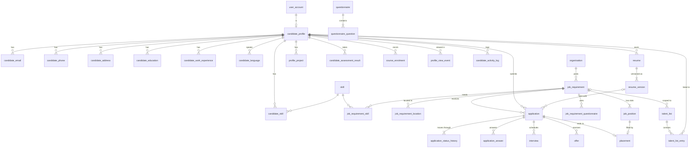

# Talentra — Phase 1 Design (Foundation)

**Scope:** Milestones 1–6, backlogs B1–B23. Common modules: **Master data**, **Profile**, **Jobs and Applications**.
**Status:** schema built and validated on PostgreSQL 16 (all milestone checks `sql/tests/m1_*.sql`–`m6_*.sql` pass).
**Artefacts:**

| File | Contents |
|---|---|
| `sql/00_foundation.sql` | Extensions, actor context, audit/append-only/partition helpers, `user_account` and `organisation` shells |
| `sql/01_master_data.sql` | Languages, UI label keys + translations, 40 lookup tables, currency, geography, skills, qualifications, industries, job roles, institutions |
| `sql/02_profile.sql` | Candidate profile and all child entities, resumes, projects, assessments, courses, completion scoring, view history, activity log |
| `sql/03_jobs_applications.sql` | Job requirements, positions, questionnaires, applications + enforced pipeline, interviews, offers, placements, saved jobs, search history, talent lists, referrals |
| `sql/04_seed_reference.sql` | Reference values (lookups with en/hi/ta labels, pipeline transitions, sample countries/cities) |
| `sql/tests/m1_provider.sql` … `m6_constraints.sql` | One verification script per milestone (static catalog checks + 45 behavioural tests) |
| `docs/phase1-verification-guide.md` | Step-by-step verification of each milestone |
| `docs/phase1-data-dictionary.md` | Every column: type, nullability, class, FK, null justification (generated from the catalog) |
| `run_phase1.sh` | Rebuilds the database in the `talentra-pg` container and verifies all or one milestone (`./run_phase1.sh m3`) |

---

## Milestone 1 — Provider, modules, assignment

### B1. DB provider: **PostgreSQL 16**

| Need from the docket | PostgreSQL 16 | MySQL 8 |
|---|---|---|
| Non-overlapping subscription periods / gig windows enforced by the DB (rule 10, B35, B47) | `EXCLUDE USING gist` with `btree_gist` | No exclusion constraints; needs triggers + locking |
| Recruiter/company isolation, blocked-party invisibility (§3) | Row-level security policies | No RLS; views/app only |
| Partitioned history tables that still carry FKs (B73) | Declarative partitioning; FKs from partitioned tables | Partitioned tables cannot have FKs |
| "One primary phone", "one active list entry" | Partial unique indexes, `UNIQUE NULLS NOT DISTINCT` | No partial indexes |
| Search over job text and names at 10 M profiles | GIN full-text (`tsvector`) + `pg_trgm` | FULLTEXT only, no trigram |
| Check constraints on business rules | Full support incl. `num_nonnulls` | Supported since 8.0.16, but no subqueries/functions |
| Timestamps in UTC | `timestamptz` | `TIMESTAMP` limited to 2038 |
| Safe migrations | Transactional DDL | DDL auto-commits |

Single target engine, so the reserved-word check runs against PostgreSQL's list (`pg_get_keywords()` reserved, type-func and col-name categories) plus a MySQL reserved subset for portability.

### B2. Agreed module list (11 modules + optional stretch)

| # | Module | Type / phase | Owner |
|---|---|---|---|
| 1 | Master data | Common, Phase 1 | Team |
| 2 | Profile | Common, Phase 1 | Team |
| 3 | Jobs and Applications | Common, Phase 1 | Team |
| 4 | Administration | Individual, Phase 2 | Member A |
| 5 | Organisation and account | Individual, Phase 2 | Member B |
| 6 | Gig marketplace | Individual, Phase 2 | Member C |
| 7 | Licences, seats, devices and sessions | Individual, Phase 3 | Member A |
| 8 | Sourcing and consultant requests | Individual, Phase 3 | Member B |
| 9 | Subscriptions, wallet, payments and download history | Individual, Phase 3 | Member C |
| 10 | Notifications, preferences and community | Phase 4 | Team |
| 11 | Analytics layer and reporting marts | Phase 4 | Team |
| — | Tier 3 stretch (salary benchmarks, company ratings, trending snapshots, dashboard aggregates, feature flags) | Optional, separate labelled module | Decide at Gate 1 |

### B3. Common module assignment
All three common modules are owned by the whole team. Working split used to build them: Master data authored first (everything references it), then Profile and Jobs and Applications in parallel, then cross-reviewed (each "validate" backlog is a review by someone who did not author that module plus the automated checks).

### Central vs secondary workflows (§2 decision)

| Central to the Phase 1 schema | Why | Secondary (modelled in later modules) |
|---|---|---|
| Candidate registration, profile building, resume creation, self-assessment | Every other workflow reads the profile | Login/sessions (Admin, Licences) |
| Job requirement posting, publish state, questionnaires | Supply side of every pipeline | Employer verification (Organisation) |
| Job search, application, application status tracking | The hiring pipeline is the problem statement's "single view" | Sourcing/outreach, consultant requests (Sourcing) |
| Shortlists/bookmarks, referrals | Feed sourcing and analytics | Wallet/credits, notifications, support, blocking (later modules) |

---

## Key design decisions

**D1 — Surrogate keys.** Every table: `id bigint` identity. Transactional tables use `GENERATED ALWAYS`; reference tables and the two shells use `GENERATED BY DEFAULT ... START WITH 1000` so ids 1–999 are a reserved *system range* seeded with fixed values. Natural keys (ISO codes, legacy record refs, requisition codes, referral codes) are unique constraints, never PKs.

**D2 — Enumerations.** Every fixed set is a lookup table with the identical shape `id, code, ui_label_key_id, sort_order, is_active` + audit columns, created by one procedure (`create_lookup_table`) so the shape cannot drift. Display names per UI language come from `ui_label_translation` through `ui_label_key_id`. Two enumerations drive CHECK constraints and use fixed system ids: `salary_disclosure_status` (1 disclosed, 2 not_disclosed, 3 not_applicable) and `job_category` (1 gig). A trigger forbids changing the code or id of any system row.

**D3 — Gigs are a separate subsystem (decided in Phase 1 because it shapes `job_requirement`).**
Gig requests, gig worker profiles, gig applications and assignments will live in the Gig marketplace module, not in `job_requirement`/`application`. `ck_job_requirement_not_gig` enforces this.

| Concern | Shared model | Separate subsystem (chosen) |
|---|---|---|
| Integrity | A single table needs ~10 gig-only nullable columns (window, price type, rate, handoff ref, earnings) and CHECKs keyed on category; non-overlap exclusion for a worker would need a partial exclusion on a 100 M-row table | Gig tables carry NOT NULL window/price columns and a clean `EXCLUDE` on the worker's windows (B35) |
| Applicant | Gig workers have a separate profile (availability, offerings, rates) | Gig application references the gig worker profile directly |
| Lifecycle | Gig flow ends at external fulfilment handoff; job flow ends at placement | Each has its own status set and transitions |
| Reporting | One table, simple counts | Unified through shared conformed dimensions (organisation, user, city, skill, job category, date) in the analytics layer (`an_fact_opportunity` / `an_fact_application` with a source column) |
| Future change | Gig changes risk regressions on the core pipeline | Gig evolves independently; both share master data, identity and organisation |

**D4 — Actor context and audit columns.** The access layer runs `SET LOCAL app.current_user_id` per transaction. `created_by`/`updated_by` default from it and are NOT NULL, so a write without an identified actor fails (tested). A generic trigger maintains `updated_at/updated_by` and freezes `created_at/created_by`. System id 1 is used by migration and scheduled jobs.

**D5 — Append-only history, partitioned.** `profile_view_event`, `candidate_activity_log`, `application_status_history`, `job_search_event` are range-partitioned by month (`<table>_pYYYYMM`, `<table>_pdefault`), have a PK of `(id, <timestamp>)` (PostgreSQL requires the partition key in the PK), and are guarded by triggers that reject UPDATE/DELETE/TRUNCATE. `resume_version` is also immutable. Phase 2 additionally revokes UPDATE/DELETE from the application role.

**D6 — Pipeline enforced in the database.** `application_status_transition` lists every legal move. A BEFORE trigger rejects illegal transitions and non-initial starting statuses; an AFTER trigger writes `application_status_history`, so the history cannot be skipped. Terminal statuses (joined, rejected, withdrawn, offer_declined) have no outgoing transitions.

**D7 — `application` is not partitioned.** It must be the FK target of history, answers, interviews, offers and placements and must keep a global unique `(job_requirement_id, candidate_profile_id)`. Partitioning would force the partition key into every child FK. At 100 M rows (~15–20 GB heap) a single table with the two composite indexes is serviceable; this is re-measured in Phase 5 (B73/B74).

**D8 — Integrity through composite keys.** `placement` references `(application_id, job_requirement_id)` and `(job_position_id, job_requirement_id)`, so a hire can only fill a slot of the job applied to. `talent_list` references `(job_requirement_id, organisation_id)`, so a job-specific shortlist can only belong to that job's organisation (recruiter isolation at the data level).

**D9 — Recruiters cannot register candidates.** `ck_candidate_profile_self_registered`: `created_by` must equal the profile's own `user_account_id`, or the system actor (legacy migration). Tested.

**D10 — Unknown vs not applicable.** Salary uses a disclosure status plus amount; a CHECK forces amount/currency/period to be present exactly when disclosed, so 0 cannot be used as "unknown". Gender and marital status have an explicit `prefer_not_to_say` value distinct from NULL (never asked). `total_experience_months` NULL = not stated; 0 = fresher.

**D11 — Phase 2 shells.** `user_account` and `organisation` are created minimal so Phase 1 FKs are real. Phase 2 extends them with `ALTER TABLE` (credentials, roles, status, hierarchy, tax ids, verification); it never recreates them.

---

## Milestone 2 — Entities (B4–B7)

### Master data (shared reference)
`language`, `ui_label_key`, `ui_label_translation`, `currency`, `country`, `state`, `city`, `industry` (hierarchical), `functional_area`, `job_role`, `skill`, `skill_alias`, `qualification`, `field_of_study`, `institution`, and 40 lookup tables (contact, person, money, career, jobs and pipeline enumerations — see data dictionary).

### Profile (B4)
| Entity | Purpose |
|---|---|
| `candidate_profile` | One per candidate user; identity, headline, experience, salary (current/expected), notice period, visibility, completion %, duplicate link, legacy ref |
| `candidate_email`, `candidate_phone`, `candidate_address`, `candidate_social_link` | Contact points (multiple, one primary) |
| `candidate_education`, `candidate_work_experience`, `candidate_skill`, `candidate_language`, `candidate_certification` | Career history |
| `candidate_preferred_location`, `candidate_preferred_job_role` | Career preferences (alert preferences are Notifications) |
| `resume_template`, `resume`, `resume_version` | Templates, logical resume, immutable versions |
| `profile_project`, `profile_project_skill` | Candidate projects (gig projects attach in Phase 2) |
| `assessment`, `candidate_assessment_result` | Assessments incl. self-assessment, attempts, scores |
| `course`, `course_enrolment` | Course enrolments |
| `candidate_profile_section_score` | Completion scoring per section (`profile_section.weight_pct`) |
| `profile_view_event` | Who viewed which profile, when, in what context (append-only) |
| `candidate_activity_log` | Login, profile update, resume download, ... (append-only) |

### Jobs and Applications (B6)
| Entity | Purpose |
|---|---|
| `job_requirement` | Posting: owner org, optional client org, category, type, mode, experience and salary ranges, status, publish state and window, consultant openness and fee, full-text document |
| `job_requirement_location`, `job_requirement_skill`, `job_requirement_qualification` | Requirement details |
| `job_position` | One row per headcount slot |
| `questionnaire`, `questionnaire_question`, `questionnaire_question_option`, `job_requirement_questionnaire` | Reusable screening questionnaires |
| `application`, `application_answer` | Application and answers |
| `application_status_transition`, `application_status_history` | Pipeline rules and append-only history |
| `interview`, `offer`, `placement` | Interviewed / offered / joined stages (rejection = status + reason) |
| `saved_job`, `job_search_event` | Candidate job search and bookmark history |
| `talent_list`, `talent_list_entry` | Employer/recruiter shortlists and bookmarks with add/remove history |
| `referral` | Referral tracking |

**Validation (B5, B7):** every Section 4 item assigned to these modules maps to at least one entity above (table below); no entity lacks an owning module.

| Section 4 item | Entity |
|---|---|
| Personal/contact details, education, experience, skills, languages | `candidate_profile`, `candidate_email/phone/address`, `candidate_education`, `candidate_work_experience`, `candidate_skill`, `candidate_language` |
| Resume versions and templates | `resume_template`, `resume`, `resume_version` |
| Profile projects (role, duration, outcome) | `profile_project` (`role_name`, `start_date`/`end_date`, `outcome`) |
| Assessments and scores; course enrolments; profile completion | `assessment`, `candidate_assessment_result`, `course_enrolment`, `candidate_profile_section_score` |
| Profile view history; candidate activity log | `profile_view_event`, `candidate_activity_log` |
| Shortlist and bookmark history | `talent_list`, `talent_list_entry` (`added_at`/`removed_at`) |
| Referral tracking | `referral` |
| Job posting, status, positions, requirements, publish state, consultant openness | `job_requirement` (+ details), `job_position` |
| Applications and pipeline (applied → joined/rejected) | `application`, `application_status_history`, `interview`, `offer`, `placement` |
| Candidate job search and application history | `job_search_event`, `saved_job`, `application_status_history` |
| Master data list + UI translation keys | Master data tables |

---

## Milestone 3 — Relationships (B8–B11)

**Cardinality and delete rules (rule group 2):**

| Relationship | Card. | ON DELETE | Reason |
|---|---|---|---|
| user_account → candidate_profile | 1 : 0..1 | RESTRICT | Unique `user_account_id`; erasure anonymises, never hard-deletes |
| candidate_profile → contact / education / experience / skills / languages / preferences / projects / courses / scores | 1 : N | CASCADE | Owned child data; removed with the profile on erasure |
| candidate_profile → profile_view_event / activity_log / application / talent_list_entry | 1 : N | RESTRICT | History must not vanish; profile is anonymised instead |
| resume → resume_version | 1 : 1..N | CASCADE | Versions belong to the resume (resume itself is soft-deleted) |
| resume_version → application | 1 : N | RESTRICT | An application keeps the exact version sent |
| organisation → job_requirement | 1 : N | RESTRICT | Org is soft-deleted; postings stay for history |
| job_requirement → location / skill / qualification / position / questionnaire link | 1 : N | CASCADE | Owned detail (requirement itself is soft-deleted) |
| job_requirement → application | 1 : N | RESTRICT | Applications are permanent records |
| application → status_history / interview / offer / placement | 1 : N / 0..1 | RESTRICT | Pipeline evidence |
| application → application_answer | 1 : N | CASCADE | Answers have no meaning without the application |
| any lookup / master → referencing table | 1 : N | RESTRICT | Lookups are deactivated (`is_active`), never deleted |
| every `created_by`/`updated_by` → user_account | N : 1 | RESTRICT | Actor must remain resolvable |

All `ON UPDATE` rules are RESTRICT (surrogate keys never change).

---

## Milestone 4 — Columns (B12–B15)

Full column list with type, nullability, class and null justification: **`docs/phase1-data-dictionary.md`** (generated from the catalog, so it cannot drift from the DDL).

**Standard domains applied (rule group 3):**

| Domain | Implementation |
|---|---|
| Identifier | `bigint` identity (D1) |
| Person name | `varchar(150)`, `full_name` mandatory as entered; `given_name`/`family_name` optional; no script/order assumption; `name_language_id` |
| Free text | `varchar(n)` with stated max; unbounded `text` only for `job_requirement.description` (CHECK ≤ 50 000) and `resume_version.body_text` (CHECK ≤ 200 000) |
| Email | `varchar(254)`, CHECK lowercase + format; unique where it identifies an account |
| Phone | `phone_e164 varchar(16)` CHECK `^\+[1-9][0-9]{6,14}$` + `country_id` |
| Money | `numeric(14,2)` + `*_currency_id` FK to `currency` (ISO 4217 code). Naming follows the FK rule (`_id`) |
| Percentage | `numeric(5,2)` CHECK 0–100 |
| Date / timestamp | `date`; `timestamptz` (UTC). `interview.display_time_zone` keeps the IANA zone for display |
| Date range | start/end + CHECK end ≥ start (education, experience, projects, certifications, enrolments, publish window, interviews, offers, talent list entries) |
| Enumeration | Lookup tables (D2) |
| Boolean | NOT NULL with default, every one |
| Coordinates | `numeric(9,6)` WGS84 (~0.11 m), CHECK ranges, `coordinate_source_id` required when present |
| UI label | `ui_label_key` + `ui_label_translation`; `fn_ui_label()` falls back to the default language |

**Sensitive data classes (rule group 6)** are tagged in column comments (`class=Public|Internal|Personal|Sensitive`). Phase 1 holds no Sensitive columns: national ids, tax ids, payment references and credentials belong to Phase 2/3 modules.

---

## Milestone 5 — Design (B16–B19)
The combined design is the four DDL files. Indexes are designed for the Phase 5 query set:

| Access path | Index |
|---|---|
| Candidate search by skill | `idx_candidate_skill_skill_id (skill_id, candidate_profile_id) INCLUDE (experience_months)` |
| Candidate search by city / role | partial indexes on `candidate_profile` `WHERE deleted_at IS NULL` |
| Name search incl. multilingual names, duplicate detection | trigram GIN on `full_name`; indexes on `candidate_email.email`, `candidate_phone.phone_e164` |
| Job search by keyword | GIN on generated `job_requirement.search_document` (`simple` config: language-neutral) |
| Job search by city / skill | `(city_id, job_requirement_id)`, `(skill_id, job_requirement_id)` |
| Recruiter pipeline for a job | `idx_application_job_requirement_id_status (job_requirement_id, application_status_id, status_changed_at DESC)` |
| Candidate "my applications" | `idx_application_candidate_profile_id (candidate_profile_id, applied_at DESC)` |
| Jobs open to consultants | partial index `WHERE is_open_to_consultants` |

---

## Milestone 6 — Keys and constraints (B20–B23)

Business rules enforced in the database (all tested unless noted):

| Rule | Mechanism |
|---|---|
| One profile per user; recruiters cannot register candidates | unique index; `ck_candidate_profile_self_registered` |
| Salary disclosed ⇔ amount + currency + period present; min ≤ max | `ck_candidate_profile_*_salary`, `ck_job_requirement_salary` |
| E.164 phones, lowercase emails, one primary email/phone | CHECKs; partial unique indexes |
| Date ranges valid; current job ⇔ no end date | `ck_*_date_range`, `ck_candidate_work_experience_current` |
| Gigs never in `job_requirement` | `ck_job_requirement_not_gig` |
| Consultant fee only on jobs open to consultants | `ck_job_requirement_consultant_fee` |
| Publish window valid; experience range valid; positions 1–10 000 | CHECKs |
| One application per candidate per job | `uq_application_job_requirement_id_candidate_profile_id` |
| Pipeline starts at `applied`, only legal transitions, history always written | triggers + `application_status_transition` |
| Placement fills a slot of the same job; one placement per slot/application/offer | composite FKs + unique |
| Job-specific talent list belongs to the job's organisation | composite FK |
| One active entry per candidate per list; entries never deleted | partial unique; delete trigger |
| Exactly one answer value per answer row | `ck_application_answer_one_value` |
| History/event tables append-only | `trg_*_append_only` (UPDATE/DELETE/TRUNCATE) |
| Every write has an actor | NOT NULL defaults from `app.current_user_id`; audit trigger |
| Exactly one default UI language; system lookup codes immutable | partial unique; trigger |

### Validation evidence (B5, B7, B9, B11, B13, B15, B17, B19, B21, B23)
`./run_phase1.sh` rebuilds from scratch and runs one script per milestone (`sql/tests/m1_*.sql` … `m6_*.sql`); step-by-step instructions are in [phase1-verification-guide.md](phase1-verification-guide.md).

| Milestone | Script | What it proves |
|---|---|---|
| M1 | `m1_provider.sql` | PostgreSQL 16, UTF-8 database and client, required extensions |
| M2 | `m2_entities.sql` | Every agreed entity exists; no table without an owning module; no gig tables in the core |
| M3 | `m3_relationships.sql` | 33 documented relationships exist with the stated cardinality and ON DELETE rule; all 420 FKs state explicit rules |
| M4 | `m4_columns.sql` | Reserved words, snake_case, `id` PKs, `_id` FKs, index naming, no floats, `timestamptz`, currency companions, audit columns, **every nullable column justified**, UI keys translated |
| M5 | `m5_design.sql` | On 20k candidates / 2k jobs / 40k applications (rolled back): 9 access paths use their intended index, soft-delete view filters, partitions in place |
| M6 | `m6_constraints.sql` | 45 behavioural tests: every rule in the table above has an accepted and/or rejected case, incl. the full applied → joined pipeline |

Result on the current build: **VERIFIED m1–m6** (79 PASS lines, runner exit code 0). Defects found and fixed during validation: (1) the audit trigger fell back to the previous `updated_by` when no actor was set, and now rejects the update; (2) the runner previously reported success even when a script failed (fixed with `pipefail`). Two GIN indexes (trigram name search, job full-text) are only shown to *match* their queries, because at sample size a sequential scan is cheaper. The planner must be seen choosing them unaided at 1M rows in Phase 5.

---

## Lifecycle, deletion and retention (rule group 4)

| Class | Tables | Rule |
|---|---|---|
| Soft delete (`deleted_at`, excluded by `v_` views/partial indexes) | `user_account`, `organisation`, `candidate_profile`, `resume`, `job_requirement`, `questionnaire`, `talent_list` | Default queries use `v_candidate_profile`, `v_job_requirement`; Phase 2 RLS adds the filter for all roles |
| Hard delete (owned child data) | contact, education, experience, skills, languages, certifications, preferences, projects, enrolments, section scores, requirement details, questionnaire questions/options, answers, saved jobs | Deleted by the owner or by cascade on erasure |
| Never deleted — status lifecycle | `application`, `interview`, `offer`, `placement`, `job_position`, `referral`, `talent_list_entry` | Closed through status/`removed_at` |
| Never deleted — append-only | `resume_version`, `application_status_history`, `profile_view_event`, `candidate_activity_log`, `job_search_event` | Retention by dropping whole partitions |
| Reference | master data, lookups | Deactivated with `is_active = false` |

**Retention:**
* *Erasure on request:* `candidate_profile.deletion_requested_at` set → within 30 days a scheduled job (system actor, audited) anonymises the profile in place (name → "Erased candidate", personal columns nulled, `deleted_at` set), hard-deletes owned child rows, deletes resume files from object storage and clears `resume_version.body_text`. Event rows keep only ids. Because the append-only triggers block this, the job runs as the table owner with `session_replication_role = replica` in its own audited transaction.
* *Inactivity:* no login for 36 months → reminder, then the same erasure 60 days later.
* *Event partitions:* `profile_view_event`, `candidate_activity_log`, `job_search_event` retained 24 months; `application_status_history` 7 years (employment-dispute window). Old partitions are detached and dropped.
* Implementation of the scheduled jobs is planned with Administration (consent records) in Phase 2.

---

## Deviation register (Phase 1)

| Rule | Deviation | Reason | Risk / mitigation |
|---|---|---|---|
| 1 — FK = `<table>_id` | Audit FKs are `created_by`/`updated_by`; role FKs are prefixed (`posted_by_user_account_id`, `viewer_user_account_id`, `current_salary_currency_id`, `duplicate_of_candidate_profile_id`) | Several FKs to the same table need distinct names; the rule's own audit columns use `_by` | All still end in `<table>_id` except the 2 mandated audit columns; checked automatically |
| 2 — PK named `id` | Partitioned tables have PK `(id, <timestamp>)` | PostgreSQL requires the partition key in the PK | `id` is still identity-unique; nothing references these tables by FK |
| 3 — Money: "companion currency **code** column" | `*_currency_id` FK to `currency` (which holds the ISO code) | FK-naming rule and referential integrity | Code resolved by join; analytics dimension denormalises it |
| 3 — Enumerations | Open master lists (skills, job roles, qualifications, industries, institutions, cities) are tables with a canonical `name` and *optional* `ui_label_key_id` | They are not fixed sets and grow continuously | Translation added when an item becomes a UI choice; canonical name is the fallback |
| 4 — `updated_at/by` on every table | Append-only tables carry `created_at/by` only | Rows are immutable; an `updated_*` column would always equal `created_*` | Enforced by trigger; checked automatically |
| 2 — CHECKs referencing lookup values | Two CHECKs use fixed system ids (salary disclosure 1, job category 1) | A CHECK cannot look up a code | Ids < 1000 reserved; trigger blocks changing system codes |
| 5 — Nullability | `job_search_event.user_account_id` nullable for guest searches | Guests are an actor in §3 | CHECK: exactly one of user or anonymous session ref |

## Rule compliance (Phase 1 scope)

| Rule group | Complies | Notes |
|---|---|---|
| 1 Naming | Yes, with documented deviation | Automated check |
| 2 Keys and constraints | Yes | Licence/device rules are Phase 3 |
| 3 Standard domains | Yes, with documented deviations | |
| 4 Audit and lifecycle | Yes for columns and classification; audit-trail table is Phase 2 | |
| 5 Nullability | Yes | Every nullable column justified (automated check) |
| 6 Classification | Yes (Public/Internal/Personal); no Sensitive columns in Phase 1 | |
| 7 Multilingual | Yes | UTF-8 database, label keys + translations + fallback, language recorded on user content |
| 8 Physical object naming | Yes | `v_` views, `mv_` materialised views, `<table>_pYYYYMM` partitions, `an_` analytical objects (Phase 4) |
| Reserved keyword check | Yes | Automated against PostgreSQL keyword list + MySQL subset |
| 9 Licensing, devices, sessions | N/A in Phase 1 | Phase 3 |
| 10 Money, subscriptions, history | Partially (view history append-only) | Ledgers, subscriptions, download history are Phase 3; `profile_view_event` gets the credit-deduction reference then |

## Hand-off to Phase 2

* **Administration (A):** extend `user_account` (credential, role, permission, consent); add `audit_event`; RLS policies using `app.current_user_id`; revoke UPDATE/DELETE on append-only tables from the app role; blocking lists, with the blocked-party filter applied to `candidate_profile` searches and views.
* **Organisation (B):** extend `organisation` (hierarchy, locations, tax/registration ids, verification); effective-dated recruiter mapping that RLS on `job_requirement` (by `organisation_id`) will use. Sub-roles inside an employer stay out of scope: they extend later as an `organisation_member_role` table without changing Phase 1 tables.
* **Gig (C):** gig tables per D3; add `gig_worker_profile_id` to `profile_project` with `CHECK (num_nonnulls(candidate_profile_id, gig_worker_profile_id) = 1)`.
* **Phase 3:** add `wallet_ledger_entry_id` to `profile_view_event` where a view consumes credit; Sourcing references `talent_list` and `job_requirement.is_open_to_consultants`.

## Sign-off (B23)

| | |
|---|---|
| Phase 1 design | Built and validated, PostgreSQL 16.x |
| Tables | 101 (incl. 40 lookups), plus 100 monthly partitions |
| Checks | All static and behavioural checks pass |
| Signed | ____________ (Team) Date: ________ |
