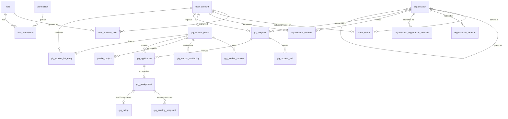

# Talentra — Phase 2 Design (Individual modules)

**Scope so far:** Milestones 7–8, backlogs B24–B29. Modules: **Administration** (Member A), **Organisation and account** (Member B), **Gig marketplace** (Member C).
**Status:** M7 and M8 built and verified on PostgreSQL 16 (`./run_phase1.sh` → `VERIFIED: m1 … m8`). M9 (columns review) and M10 (keys and constraints) are next.

| File | Contents |
|---|---|
| `sql/05_administration.sql` | `user_account` extension, roles, permissions, grants, audit trail |
| `sql/06_organisation.sql` | `organisation` extension (hierarchy, type, status, verification), locations, registration identifiers, member mapping |
| `sql/07_gig.sql` | Gig subsystem (D3) and the gig-project link on `profile_project` |
| `sql/tests/expected_entity.sql` | Shared entity → module register (used by m2 and m7) |
| `sql/tests/check_expected_fk.sql` | Shared relationship checker (used by m3 and m8) |
| `sql/tests/m7_entities.sql`, `m8_relationships.sql` | Milestone checks |

The runner now builds every `sql/NN_*.sql` in order and runs every `sql/tests/mN_*.sql`, so later phases need no runner change.

---

## Milestone 7 — Entities (B24–B26)

### Scope decision: what Administration builds now
The docket lists credentials, consent records, identity sessions and blocking lists in two places: the Administration module scope (§7) and the Phase 4 shared team items (B50). Phase 2's own backlog (B24) names only users, roles, permissions and the audit trail. **We follow the backlog:** those four items are built now; credentials, consent, identity sessions and blocking lists are built in Phase 4 (B50, B53, B56, B59). The design leaves room for them (credentials and sessions hang off `user_account`; the blocked-party filter attaches to `candidate_profile` reads).

### B24 Administration (Member A)
| Entity | Purpose |
|---|---|
| `user_account` (extended) | Adds `user_account_status_id` (active, suspended, locked, deactivated) to the Phase 1 shell |
| `role` | One row per §3 actor; ids 1–9 fixed so access rules can name them; `is_organisation_scoped` marks Account Admin, Employer, Recruiter |
| `permission` | `<resource>.<action>` codes |
| `role_permission` | Role → permission matrix |
| `user_account_role` | Grants with `granted_at` / `revoked_at`; never deleted, so "who held which role when" is answerable |
| `audit_event` | Append-only trail of sensitive actions; `created_by` is the actor; partitioned monthly |

### B25 Organisation and account (Member B)
| Entity | Purpose |
|---|---|
| `organisation` (extended) | Type (direct employer, staffing agency, client), parent (hierarchy), trade name, industry, website, account status, verification status |
| `organisation_location` | Addresses, HQ flag, optional coordinates |
| `organisation_registration_identifier` | Tax / registration ids (GSTIN, PAN, CIN, EIN, VAT …): vault token + keyed hash + masked form, per-identifier verification status and external reference |
| `organisation_member` | Effective-dated mapping of users to an organisation as account administrator, employer or recruiter (`valid_from` / `valid_to`) |

**Decision D12 — an account is the root organisation.** "Account profile, account status, account administrators" (§4) map to the root of an organisation hierarchy, its `organisation_account_status_id`, and its `account_administrator` members. Licences, subscriptions and the wallet (Phase 3) will reference that organisation. A separate `account` table would duplicate the organisation row 1 : 1 without adding a rule.

**Decision D13 — one mapping table for recruiters and administrators.** Recruiter mapping and account administrators share the same shape and lifecycle (effective-dated, never deleted, the basis of RLS). One `organisation_member` table with a type keeps one place for the access layer to look. Employer sub-roles (posting, interviewing, pipeline) stay out of scope (§3); they extend later as more `organisation_member_type` values, or a child table of `organisation_member`, without changing existing tables.

### B26 Gig marketplace (Member C)
| Entity | Purpose |
|---|---|
| `gig_worker_profile` | Separate from `candidate_profile` (§2); one per user |
| `gig_worker_service` | Service offerings with price type and charge rate |
| `gig_worker_availability` | Availability windows |
| `gig_request` | Requester (user, optionally for an organisation), window, price type and amount, status |
| `gig_request_skill` | Skills a gig needs |
| `gig_application` | Worker applies; requester accepts or rejects (one direction only, §2) |
| `gig_assignment` | Created on acceptance: external `handoff_ref`, status reconciled from the fulfilment system, copied window |
| `gig_earning_snapshot` | Estimated / total / projected earnings as reported by the fulfilment system; append-only, idempotent by `external_event_ref` |
| `gig_rating` | Requester rates a completed gig (one per assignment) |
| `gig_worker_list_entry` | Requester favourites and blacklist, with add/remove history |
| `profile_project` (extended) | Gains `gig_worker_profile_id`: a project belongs to exactly one candidate or gig worker (Phase 1 hand-off) |

### Validation (§4 coverage for these modules)
| Section 4 item | Entity |
|---|---|
| Identity: users, roles | `user_account`, `role`, `user_account_role`, `permission`, `role_permission` |
| Audit trail of sensitive actions | `audit_event` |
| Company details, locations, tax and registration ids, verification status | `organisation`, `organisation_location`, `organisation_registration_identifier` |
| Mapped recruiters, account administrators | `organisation_member` |
| Account profiles, account status, organisation hierarchy | `organisation` (root, `organisation_account_status_id`, `parent_organisation_id`) |
| Gig requests with windows and pricing | `gig_request`, `gig_request_skill` |
| Gig worker profiles, availability, service offerings, charge rates | `gig_worker_profile`, `gig_worker_availability`, `gig_worker_service` |
| Gig applications, assignments and handoff references | `gig_application`, `gig_assignment` |
| Lists and blacklists, ratings | `gig_worker_list_entry`, `gig_rating` |
| Earnings references from external systems | `gig_earning_snapshot` |
| Gig projects (role, duration, outcome) | `profile_project` + `gig_worker_profile_id` |
| *Deferred to Phase 4 (B50):* credentials, consent records, identity sessions, blocking lists | — |

13 new lookup tables (owned by Master data, seeded with English labels): `user_account_status`, `audit_action`, `organisation_type`, `organisation_account_status`, `verification_status`, `registration_identifier_type`, `organisation_member_type`, `gig_price_type`, `gig_request_status`, `gig_application_status`, `gig_assignment_status`, `gig_worker_list_type`, `gig_earning_type`.

---

## Milestone 8 — Relationships (B27–B29)



**Cardinality and delete rules:**

| Relationship | Card. | ON DELETE | Reason |
|---|---|---|---|
| user_account → user_account_role | 1 : N | RESTRICT | Grants are history; users are soft-deleted |
| role → user_account_role | 1 : N | RESTRICT | Roles are deactivated, never deleted |
| role / permission → role_permission | 1 : N | CASCADE | Matrix rows have no meaning without both ends |
| user_account → audit_event (`created_by`) | 1 : N | RESTRICT | Actor must stay resolvable; audit is append-only |
| organisation → audit_event | 0..1 : N | RESTRICT | Organisation context of the action |
| organisation → organisation (parent) | 0..1 : N | RESTRICT | Hierarchy; a parent with children cannot vanish |
| organisation → organisation_location | 1 : N | CASCADE | Owned detail (organisation itself is soft-deleted) |
| organisation → organisation_registration_identifier | 1 : N | RESTRICT | Verification evidence outlives the organisation row |
| organisation / user_account → organisation_member | 1 : N | RESTRICT | Effective-dated mapping is history; ended by `valid_to` |
| user_account → gig_worker_profile | 1 : 0..1 | RESTRICT | Unique `user_account_id`; erasure anonymises |
| gig_worker_profile → service / availability / profile_project | 1 : N | CASCADE | Owned detail |
| user_account → gig_request (requester) | 1 : N | RESTRICT | Requests are permanent records (soft-deleted) |
| organisation → gig_request | 0..1 : N | RESTRICT | Optional organisation the requester acts for |
| gig_request → gig_request_skill | 1 : N | CASCADE | Owned detail |
| gig_request / gig_worker_profile → gig_application | 1 : N | RESTRICT | Applications are permanent; one per worker per request |
| gig_application → gig_assignment | 1 : 0..1 | RESTRICT | Composite FK `(gig_application_id, gig_worker_profile_id)`: the assigned worker is always the applicant |
| gig_assignment → gig_earning_snapshot | 1 : N | RESTRICT | Append-only integration record |
| gig_assignment → gig_rating | 1 : 0..1 | RESTRICT | One rating per completed gig |
| gig_worker_profile / user_account → gig_worker_list_entry | 1 : N | RESTRICT | List history; entries are closed by `removed_at` |
| every lookup → referencing table | 1 : N | RESTRICT | Lookups are deactivated, never deleted |

**Decision D14 — the assignment repeats the worker and window.** `gig_assignment` carries `gig_worker_profile_id` (pinned to the application by the composite FK, the same technique as `placement` in D8) and the window. That puts both on one table, so B35's "no overlapping windows for a worker" can be a single `EXCLUDE USING gist` in M10 instead of a trigger joining three tables.

**Gig stays separate (D3, now checked both ways):** m2 asserts `job_requirement` and `application` reference no gig table; m7 asserts no gig table references a Jobs and Applications table. The two share master data, `user_account` and `organisation` only.

---

## Verification

```sh
MSYS_NO_PATHCONV=1 ./run_phase1.sh m7     # rebuild + entities
MSYS_NO_PATHCONV=1 ./run_phase1.sh m8     # rebuild + relationships
```

| Milestone | Pass signal |
|---|---|
| M7 | `administration : 5`, `gig : 10`, `organisation : 3` entities (+ the 2 Phase 1 shells counted in m2), all 9 actors exist as roles, gig shares no FK with the core pipeline |
| M8 | 33 documented relationships with the stated cardinality and ON DELETE rule; all 551 FKs state explicit rules |

Both checks were mutation-tested: switching `organisation_location`'s delete rule to RESTRICT fails m8, and dropping `gig_rating` fails m7.

**Review checklist (the "validate" step, by someone who did not author the module)**
- [ ] Every row of the §4 coverage table above maps to an entity, and the Phase 4 deferral of credentials/consent/sessions/blocking is agreed.
- [ ] D12 (account = root organisation) and D13 (one member table) are acceptable to the Phase 3 Licences and Subscriptions owners, who will reference them.
- [ ] Each CASCADE in the delete-rule table is owned detail, never history.

## Left for M9 and M10
* **M9 (columns):** review every Phase 2 column for domain, nullability and class; regenerate the data dictionary. The tables already pass the automated M4 column rules (null justification, naming, money, timestamps).
* **M10 (keys and constraints):**
  * RLS for recruiter isolation via `organisation_member`, and revoking UPDATE/DELETE on `audit_event` from the application role.
  * No overlapping `organisation_member` periods per organisation, user and type.
  * Hierarchy cycle prevention.
  * Gig window exclusion on `gig_assignment`, and assignment window inside the request window.
  * Only the requester may accept an application or give a rating.
  * One live favourite/blacklist entry per owner and worker.
  * Behavioural tests for all of the above.
