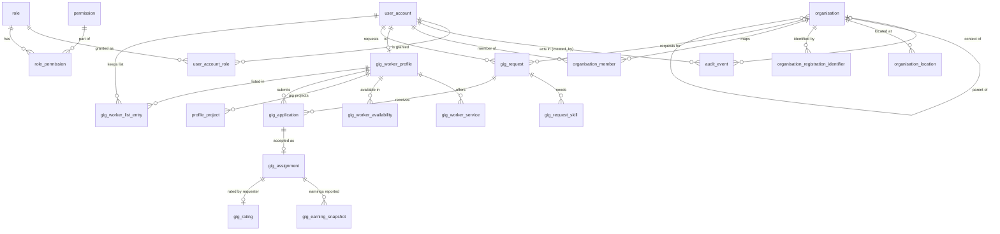

# Talentra — Phase 2 Design (Individual modules)

**Scope:** Milestones 7–10, backlogs B24–B35. Modules: **Administration** (Member A), **Organisation and account** (Member B), **Gig marketplace** (Member C).
**Status:** Phase 2 complete. M7–M10 built and verified on PostgreSQL 16 (`./run_phase1.sh` → all milestones VERIFIED).

| File | Contents |
|---|---|
| `sql/05_administration.sql` | `user_account` extension, roles, permissions, grants, audit trail |
| `sql/06_organisation.sql` | `organisation` extension (hierarchy, type, status, verification), locations, registration identifiers, member mapping |
| `sql/07_gig.sql` | Gig subsystem (D3), its workflow rules, and the gig-project link on `profile_project` |
| `sql/08_access_control.sql` | Permission matrix, `talentra_app` role, row-level security, append-only privileges, automatic audit (B33) |
| `docs/phase2-data-dictionary.md` | Every Phase 2 column: type, nullability, class, FK, null justification (generated) |
| `sql/tests/expected_entity.sql` | Shared entity → module register (used by m2 and m7) |
| `sql/tests/check_expected_fk.sql` | Shared relationship checker (used by m3 and m8) |
| `sql/tests/m7_entities.sql` … `m10_constraints.sql` | Milestone checks |

The runner now builds every `sql/NN_*.sql` in order and runs every `sql/tests/mN_*.sql`, so later phases need no runner change.

---

## Milestone 7 — Entities (B24–B26)

### Scope decision: what Administration builds now
The docket lists credentials, consent records, identity sessions and blocking lists in two places: the Administration module scope (§7) and the Phase 4 shared team items (B50). Phase 2's own backlog (B24) names only users, roles, permissions and the audit trail. **We follow the backlog:** those four items are built now; credentials, consent, identity sessions and blocking lists are built in Phase 4 (B50, B53, B56, B59). The design leaves room for them (credentials and sessions hang off `user_account`; the blocked-party filter attaches to `candidate_profile` reads).

### B24 Administration (Member A)
| Entity | Purpose |
|---|---|
| `user_account` (extended) | Adds `user_account_status_id` (active, suspended, locked, deactivated) to the Phase 1 shell |
| `role` | One row per §3 actor; ids 1–9 fixed so access rules can name them; `is_organisation_scoped` marks Account Admin, Employer, Recruiter |
| `permission` | `<resource>.<action>` codes |
| `role_permission` | Role → permission matrix |
| `user_account_role` | Grants with `granted_at` / `revoked_at`; never deleted, so "who held which role when" is answerable |
| `audit_event` | Append-only trail of sensitive actions; `created_by` is the actor; partitioned monthly |

### B25 Organisation and account (Member B)
| Entity | Purpose |
|---|---|
| `organisation` (extended) | Type (direct employer, staffing agency, client), parent (hierarchy), trade name, industry, website, account status, verification status |
| `organisation_location` | Addresses, HQ flag, optional coordinates |
| `organisation_registration_identifier` | Tax / registration ids (GSTIN, PAN, CIN, EIN, VAT …): vault token + keyed hash + masked form, per-identifier verification status and external reference |
| `organisation_member` | Effective-dated mapping of a user to an organisation in an organisation-scoped role: account admin, employer or recruiter (`valid_from` / `valid_to`) |

**Decision D12 — an account is the root organisation.** "Account profile, account status, account administrators" (§4) map to the root of an organisation hierarchy, its `organisation_account_status_id`, and its `account_administrator` members. Licences, subscriptions and the wallet (Phase 3) will reference that organisation. A separate `account` table would duplicate the organisation row 1 : 1 without adding a rule.

**Decision D13 — one mapping table for recruiters and administrators.** Recruiter mapping and account administrators share the same shape and lifecycle (effective-dated, never deleted, the basis of RLS). One `organisation_member` table keeps one place for the access layer to look. It references `role` directly (only the organisation-scoped roles 3, 6, 7 are allowed), so permissions come from the same `role_permission` matrix whether a role is held platform-wide or for one company. *(Revised in M10: the first draft used a separate `organisation_member_type` lookup, which would have needed its own permission mapping.)* Employer sub-roles (posting, interviewing, pipeline) stay out of scope (§3). They extend later as new organisation-scoped roles with their own permissions, without changing any table.

### B26 Gig marketplace (Member C)
| Entity | Purpose |
|---|---|
| `gig_worker_profile` | Separate from `candidate_profile` (§2); one per user |
| `gig_worker_service` | Service offerings with price type and charge rate |
| `gig_worker_availability` | Availability windows |
| `gig_request` | Requester (user, optionally for an organisation), window, price type and amount, status |
| `gig_request_skill` | Skills a gig needs |
| `gig_application` | Worker applies; requester accepts or rejects (one direction only, §2) |
| `gig_assignment` | Created on acceptance: external `handoff_ref`, status reconciled from the fulfilment system, copied window |
| `gig_earning_snapshot` | Estimated / total / projected earnings as reported by the fulfilment system; append-only, idempotent by `external_event_ref` |
| `gig_rating` | Requester rates a completed gig (one per assignment) |
| `gig_worker_list_entry` | Requester favourites and blacklist, with add/remove history |
| `profile_project` (extended) | Gains `gig_worker_profile_id`: a project belongs to exactly one candidate or gig worker (Phase 1 hand-off) |

### Validation (§4 coverage for these modules)
| Section 4 item | Entity |
|---|---|
| Identity: users, roles | `user_account`, `role`, `user_account_role`, `permission`, `role_permission` |
| Audit trail of sensitive actions | `audit_event` |
| Company details, locations, tax and registration ids, verification status | `organisation`, `organisation_location`, `organisation_registration_identifier` |
| Mapped recruiters, account administrators | `organisation_member` |
| Account profiles, account status, organisation hierarchy | `organisation` (root, `organisation_account_status_id`, `parent_organisation_id`) |
| Gig requests with windows and pricing | `gig_request`, `gig_request_skill` |
| Gig worker profiles, availability, service offerings, charge rates | `gig_worker_profile`, `gig_worker_availability`, `gig_worker_service` |
| Gig applications, assignments and handoff references | `gig_application`, `gig_assignment` |
| Lists and blacklists, ratings | `gig_worker_list_entry`, `gig_rating` |
| Earnings references from external systems | `gig_earning_snapshot` |
| Gig projects (role, duration, outcome) | `profile_project` + `gig_worker_profile_id` |
| *Deferred to Phase 4 (B50):* credentials, consent records, identity sessions, blocking lists | — |

13 new lookup tables (owned by Master data, seeded with English labels): `user_account_status`, `audit_action`, `organisation_type`, `organisation_account_status`, `verification_status`, `registration_identifier_type`, `company_size_band`, `gig_price_type`, `gig_request_status`, `gig_application_status`, `gig_assignment_status`, `gig_worker_list_type`, `gig_earning_type`.

---

## Milestone 8 — Relationships (B27–B29)



**Cardinality and delete rules:**

| Relationship | Card. | ON DELETE | Reason |
|---|---|---|---|
| user_account → user_account_role | 1 : N | RESTRICT | Grants are history; users are soft-deleted |
| role → user_account_role | 1 : N | RESTRICT | Roles are deactivated, never deleted |
| role / permission → role_permission | 1 : N | CASCADE | Matrix rows have no meaning without both ends |
| user_account → audit_event (`created_by`) | 1 : N | RESTRICT | Actor must stay resolvable; audit is append-only |
| organisation → audit_event | 0..1 : N | RESTRICT | Organisation context of the action |
| organisation → organisation (parent) | 0..1 : N | RESTRICT | Hierarchy; a parent with children cannot vanish |
| organisation → organisation_location | 1 : N | CASCADE | Owned detail (organisation itself is soft-deleted) |
| organisation → organisation_registration_identifier | 1 : N | RESTRICT | Verification evidence outlives the organisation row |
| organisation / user_account / role → organisation_member | 1 : N | RESTRICT | Effective-dated mapping is history; ended by `valid_to` |
| user_account → gig_worker_profile | 1 : 0..1 | RESTRICT | Unique `user_account_id`; erasure anonymises |
| gig_worker_profile → service / availability / profile_project | 1 : N | CASCADE | Owned detail |
| user_account → gig_request (requester) | 1 : N | RESTRICT | Requests are permanent records (soft-deleted) |
| organisation → gig_request | 0..1 : N | RESTRICT | Optional organisation the requester acts for |
| gig_request → gig_request_skill | 1 : N | CASCADE | Owned detail |
| gig_request / gig_worker_profile → gig_application | 1 : N | RESTRICT | Applications are permanent; one per worker per request |
| gig_application → gig_assignment | 1 : 0..1 | RESTRICT | Composite FK `(gig_application_id, gig_worker_profile_id)`: the assigned worker is always the applicant |
| gig_assignment → gig_earning_snapshot | 1 : N | RESTRICT | Append-only integration record |
| gig_assignment → gig_rating | 1 : 0..1 | RESTRICT | One rating per completed gig |
| gig_worker_profile / user_account → gig_worker_list_entry | 1 : N | RESTRICT | List history; entries are closed by `removed_at` |
| every lookup → referencing table | 1 : N | RESTRICT | Lookups are deactivated, never deleted |

**Decision D14 — the assignment repeats the worker and window.** `gig_assignment` carries `gig_worker_profile_id` (pinned to the application by the composite FK, the same technique as `placement` in D8) and the window. That puts both on one table, so B35's "no overlapping windows for a worker" can be a single `EXCLUDE USING gist` in M10 instead of a trigger joining three tables.

**Gig stays separate (D3, now checked both ways):** m2 asserts `job_requirement` and `application` reference no gig table; m7 asserts no gig table references a Jobs and Applications table. The two share master data, `user_account` and `organisation` only.

---

## Verification

```sh
MSYS_NO_PATHCONV=1 ./run_phase1.sh m7     # rebuild + entities
MSYS_NO_PATHCONV=1 ./run_phase1.sh m8     # rebuild + relationships
```

| Milestone | Pass signal |
|---|---|
| M7 | `administration : 5`, `gig : 10`, `organisation : 3` entities (+ the 2 Phase 1 shells counted in m2), all 9 actors exist as roles, gig shares no FK with the core pipeline |
| M8 | 33 documented relationships with the stated cardinality and ON DELETE rule; every FK states explicit rules |

Both checks were mutation-tested: switching `organisation_location`'s delete rule to RESTRICT fails m8, and dropping `gig_rating` fails m7.

**Review checklist (the "validate" step, by someone who did not author the module)**
- [ ] Every row of the §4 coverage table above maps to an entity, and the Phase 4 deferral of credentials/consent/sessions/blocking is agreed.
- [ ] D12 (account = root organisation) and D13 (one member table) are acceptable to the Phase 3 Licences and Subscriptions owners, who will reference them.
- [ ] Each CASCADE in the delete-rule table is owned detail, never history.

---

## Milestone 9 — Columns (B30–B32)

Full column list with type, nullability, class, FK and null justification: **[`docs/phase2-data-dictionary.md`](phase2-data-dictionary.md)** (21 tables, generated from the catalog: `data_dictionary.sql -v tables=…`).

**Columns added in this milestone.** `organisation` gains `description` (+ language), `company_size_band_id`, `founded_year`, `logo_uri`, `contact_email` and `contact_phone_e164` (+ country). These are the company-profile fields job platforms show on an employer page (input to the §4 competitor comparison).

**Domains applied (rule group 3), checked automatically in `m9_columns.sql`:**

| Domain | Phase 2 implementation |
|---|---|
| Email | `contact_email varchar(254)`, lowercase + format CHECK (also re-checked for every Phase 1 email column) |
| Phone | `contact_phone_e164` E.164 CHECK + `contact_phone_country_id`, both null together |
| Money | `rate_amount`, `price_amount`, `earning_amount`: `numeric(14,2)` + currency FK |
| Free text | all bounded (`varchar(n)`); only the two Phase 1 justified columns are unbounded |
| Date range | `granted_at/revoked_at`, `valid_from/valid_to`, gig windows, availability, list `added_at/removed_at`, `applied_at/decided_at`: each has a CHECK |
| Rating | `smallint` CHECK 1–5 |
| Year | `founded_year smallint` CHECK 1800–2100 |

**Sensitive data (rule group 6).** Phase 2 introduces the first Sensitive columns: `organisation_registration_identifier.identifier_token` (vault token) and `identifier_hmac` (HMAC-SHA256, length-checked). The clear tax id never enters the database. `m9` asserts schema-wide that every Sensitive column is a token or keyed hash, and that every data column of a Phase 2 table states its class explicitly. The first run of that check found 16 unclassified columns (titles, windows, timestamps), which were then classified.

**Personal data in Phase 2:** worker display name, base city, availability windows (they reveal a person's schedule), cover notes, earnings, audit IP / user agent.

---

## Milestone 10 — Keys and constraints (B33–B35)

### B33 Administration: role-based access in the database, append-only audit

| Rule | Mechanism |
|---|---|
| App never bypasses access rules | Application connects as `talentra_app` (owns nothing, so RLS applies). Migration and scheduled jobs use the owner role. **Correction (M18):** the `v_` views ran with their owner's rights and so bypassed RLS (a recruiter could read another company's drafts through `v_job_requirement`). Since M18 every view is `security_invoker`, and m18 asserts it for every view. |
| Permissions come from roles | `role_permission` matrix (6 permissions). `app_has_permission()` reads live platform grants; `app_organisation_ids_with()` reads live, effective-dated organisation mappings |
| Recruiter sees only own company's requirements (§3) | RLS on `job_requirement`: org read/insert/update policies per permission, plus a public-board policy (published + open + not deleted) that **excludes current recruiters** |
| Recruiter acts only on own company's applications | RLS on `application`: organisation policies via the job's organisation; candidates see only their own applications |
| Platform admin | `platform.admin` permission policy on both tables |
| Audit trail is append-only | Trigger blocks UPDATE/DELETE/TRUNCATE for every role; UPDATE/DELETE/TRUNCATE privileges revoked from `talentra_app` on every append-only table (Phase 1's too). `make_append_only()` now does both for later modules |
| Every sensitive action is audited (§3) | `trg_write_audit_event` on `user_account`, `user_account_role`, `role_permission`, `organisation`, `organisation_member`, `organisation_registration_identifier`: action, target, organisation, actor (`created_by`, so no actor = rejected), and the **names** of changed columns, never values |
| One live grant per user and role | partial unique index |

**Matrix:** super_admin, admin → `platform.admin`. account_admin → `organisation.manage`, `job_requirement.view`, `application.view`. employer → view + manage for requirements and applications. recruiter → `job_requirement.view`, `application.view`, `application.manage` (works the pipeline, does not post).

**Policy cost.** The organisation policies use `organisation_id IN (SELECT app_organisation_ids_with(...))`, an uncorrelated subquery that runs once per statement rather than once per row. To be measured on 1M rows in Phase 5.

### B34 Organisation: effective-dated recruiter mapping

| Rule | Mechanism |
|---|---|
| One mapping per organisation, user and role at any instant | `EXCLUDE USING gist (organisation_id =, user_account_id =, role_id =, tstzrange(valid_from, valid_to) &&)`. Adjacent periods are allowed |
| Only organisation-scoped roles can be mapped | `CHECK (role_id IN (3, 6, 7))` (system ids, like the Phase 1 lookup CHECKs) |
| Mapping history is kept | delete trigger; mappings end with `valid_to` |
| No cycles in the hierarchy | `ck_organisation_not_own_parent` + recursive-ancestor trigger |
| One headquarters | partial unique index |
| Tax id registered once | unique (type, country, HMAC) |
| Verified identifiers carry evidence | CHECK: status `verified` ⇒ `verified_at` and `verification_ref` present |
| Contact email / phone domains | CHECKs (M9) |

### B35 Gig marketplace

| Rule | Mechanism |
|---|---|
| **A worker's gig windows never overlap** | `EXCLUDE USING gist (gig_worker_profile_id =, tstzrange(window_start_at, window_end_at) &&) WHERE status <> cancelled` on `gig_assignment` (D14) |
| Assignment window = request window | trigger copies it on insert/update; the exclusion reads the copy |
| Assignment only for an accepted application, only for the applicant | trigger + composite FK |
| Bids flow one way: workers apply, requesters decide | trigger: only the worker inserts or withdraws; only the requester accepts or rejects; a decision is final; `decided_at` set ⇔ decided (CHECK) |
| Apply only to open requests; not to your own; not if blacklisted | trigger |
| Worker and requester register / post for themselves | `ck_gig_worker_profile_self_registered`, `ck_gig_request_self_requested` |
| Requester posts for an organisation only while mapped to it | trigger reads live `organisation_member` |
| Favourite xor blacklist, history kept | partial unique (owner, worker) on live entries; delete trigger |
| Only the requester rates, only a completed gig, 1–5 | trigger + CHECK; `completed_at` ⇔ completed (CHECK) |
| Earnings: append-only, idempotent | append-only trigger + privilege revoke; unique `external_event_ref` |
| Gig project has exactly one owner | `ck_profile_project_one_owner` |

### Validation evidence (B33–B35)
`m10_constraints.sql` runs **60 behavioural tests** in one rolled-back transaction. The RLS part runs as `talentra_app`. Each `PASS rejected:` line names the constraint, trigger or policy that blocked the action. Mutation-tested: disabling RLS on `job_requirement`, dropping the gig exclusion, or removing a class comment each makes the relevant check fail.

### Deviation register (Phase 2)

| Rule | Deviation | Reason | Risk / mitigation |
|---|---|---|---|
| 2 — CHECK with lookup values | `organisation_member` CHECKs role ids 3/6/7; gig CHECKs and triggers use system status ids | A CHECK cannot look up a code | Ids < 1000 reserved; lookup system codes immutable (Phase 1 trigger); `role` ids 1–9 seeded fixed |
| 1 — PK named `id` | `audit_event` PK `(id, occurred_at)` | Partition key must be in the PK | Same as Phase 1 history tables |
| 4 — `updated_*` on every table | `audit_event`, `gig_earning_snapshot` carry `created_*` only | Append-only | Enforced by trigger and privileges |
| §3 hierarchy | Parent-organisation members do not see child organisations' requirements | Not required by the docket; keeps RLS simple | Add a recursive descendant set to `app_organisation_ids_with()` if needed |
| Concurrency | Hierarchy cycle check can race under two simultaneous re-parentings | Rare admin action | Marked `ponytail:` in code; add a lock if self-service |

### Rule compliance (Phase 2 scope)

| Rule group | Complies | Notes |
|---|---|---|
| 1 Naming | Yes | Automated (m4) |
| 2 Keys and constraints | Yes, with deviations above | Exclusion constraints for mapping periods and gig windows |
| 3 Standard domains | Yes | Automated (m9) |
| 4 Audit and lifecycle | Yes | `audit_event` append-only + automatic audit triggers; soft delete views `v_user_account`, `v_organisation`, `v_gig_worker_profile`, `v_gig_request` |
| 5 Nullability | Yes | Automated (m4) |
| 6 Classification | Yes | Explicit class on every Phase 2 data column; Sensitive = tokens/hashes only (m9) |
| 7 Multilingual | Yes | Role, permission and lookup labels are keys; user text records its language |
| 8 Physical naming | Yes | `v_` views, `<table>_pYYYYMM` partitions |
| 9 Licensing | N/A | Phase 3 |
| 10 Money / history | Partially | Earnings append-only; ledgers in Phase 3 |
