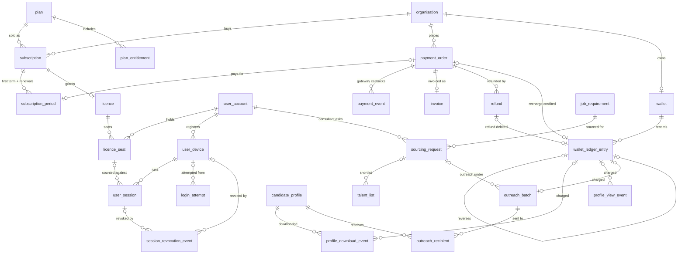

# Talentra — Phase 3 Design (Individual modules)

**Scope so far:** Milestones 11–13, backlogs B36–B44. Modules: **Licences, seats, devices and sessions** (Member A), **Sourcing and consultant requests** (Member B), **Subscriptions, wallet, payments and download history** (Member C).
**Status:** M11–M13 built and verified on PostgreSQL 16 (`./run_phase1.sh m11`, `m12`, `m13`). M14 (keys and constraints: device limit under concurrent logins, consultant-only-on-open requirements, non-overlapping subscription periods, ledger rules) is next.

| File | Contents |
|---|---|
| `sql/09_subscriptions.sql` | Plans, entitlements, subscriptions and periods, payment orders and events, invoices, refunds, wallet and ledger, profile download history |
| `sql/10_licences.sql` | Licences, seats, devices, sessions, login attempts, revocation events |
| `sql/11_sourcing.sql` | Sourcing requests, outreach batches and recipients; consultant shortlist link on `talent_list` |
| `sql/tests/m11_entities.sql`, `m12_relationships.sql`, `m13_columns.sql` | Milestone checks (m13 shares `check_columns.sql` with m9) |
| `docs/phase3-data-dictionary.md` | Generated column list |

Build order follows dependencies, not the docket's module order: Subscriptions (09) before Licences (10), because a licence is granted by a subscription. Sourcing (11) goes last because outreach references the wallet ledger.

Like Phase 2, the tables are created with their columns and foreign keys so the schema-wide M4/M9 column rules keep passing. The M14 deliverable (behavioural constraints) is still to do.

---

## Milestone 11 — Entities (B36–B38)

### B36 Licences, seats, devices and sessions (Member A)
| Entity | Purpose |
|---|---|
| `licence` | Granted by one subscription; `max_users` and `max_devices_per_user` stored as explicit positive columns (rule group 9), copied from the plan at purchase |
| `licence_seat` | Seat allocation: user ↔ licence, `assigned_at` / `released_at` (one live seat per user per licence) |
| `user_device` | Registered devices per user; fingerprint stored only as an HMAC; `revoked_at` |
| `user_session` | One row per login, bound to a device and (for licensed users) a seat; start, last activity, expiry, end + reason. Ended sessions do not count against the limit; the session token is stored as a hash |
| `login_attempt` | Login history incl. refused attempts (`device_limit_reached`, `seat_unavailable` …); append-only, monthly partitions |
| `session_revocation_event` | Revoking a session or a device is an auditable event (rule group 9); append-only |

**Decision D15 — one session table.** The docket lists "sessions (identity only)" under Administration and the Phase 4 shared items (B50), and "active sessions" here. One login produces one session, so there is one `user_session` table. Users who need no licence (candidates, gig workers) have `licence_seat_id` NULL, and the device limit still applies through their devices. B50 reuses this table.

### B37 Sourcing and consultant requests (Member B)
| Entity | Purpose |
|---|---|
| `sourcing_request` | A consultant asks to source for a requirement; status, the employer's accept/decline decision (who, when, note), proposed fee |
| `outreach_batch` | Bulk outreach by an employer, recruiter or consultant: channel, provider template reference, schedule, optional requirement / sourcing request, credit charge |
| `outreach_recipient` | One row per candidate in a batch: delivery status and times reported by the messaging provider (idempotent by provider message id) |
| *Consultant openness* | Already modelled in Phase 1: `job_requirement.is_open_to_consultants` + `consultant_fee_pct` |
| *Candidate sourcing shortlist* | `talent_list.sourcing_request_id`: the consultant's shortlist is a Jobs and Applications talent list scoped to the request (as the docket requires) |

**Decision D16 — the decision lives on the request.** The docket names "acceptance or decline decisions" as an entity. Each request gets exactly one decision, and status changes are audited, so the decision is `decided_at`, `decided_by_user_account_id` and `decision_note` on `sourcing_request`. A separate table would be 1 : 0..1 with nothing else in it.

### B38 Subscriptions, wallet, payments and download history (Member C)
| Entity | Purpose |
|---|---|
| `plan` | Sellable plan: billing period, price, licence limits |
| `plan_entitlement` | Quantity per period of each entitlement (job postings, profile downloads, outreach messages, featured jobs); NULL = unlimited |
| `subscription` | An account's purchase of a plan: status, auto-renew, cancellation (time, reason) |
| `subscription_period` | First term and every renewal (`renewal_number`), with the paying order; non-overlap per subscription/licence comes in M14 |
| `payment_order` | What the platform asked the gateway to collect: purpose (subscription / wallet recharge), amount, status, gateway order reference (idempotency) |
| `payment_event` | Gateway callbacks as received: status history, idempotent by gateway event id; append-only |
| `invoice` | One per paid order; immutable (append-only), total = subtotal + tax |
| `refund` | Refund against an order: amount, status, gateway refund reference |
| `wallet` | One credit wallet per account; balance cached from the ledger |
| `wallet_ledger_entry` | Append-only credit ledger: recharges, consumption, refunds, reversals; a correction references the entry it reverses (rule group 10) |
| `profile_download_event` | Who downloaded which profile, when, and the ledger entry charged; append-only, monthly partitions |
| *Profile view credit* | `profile_view_event.wallet_ledger_entry_id` (Phase 1 hand-off) |

**Decision D17 — ledger in credits, payments in money.** Money changes hands only on `payment_order`, `invoice` and `refund` (`numeric(14,2)` + currency). The wallet holds **credits** (integers), which recharges buy and downloads, views and outreach consume. Rounding never touches money that has already been paid, and a credit price change never rewrites history.

### Validation (§4 coverage for these modules)
| Section 4 item | Entity |
|---|---|
| Subscription licences, users allowed per licence, devices allowed per user, seat allocation | `licence`, `licence_seat` |
| Registered devices, active sessions, login history, device-limit rule | `user_device`, `user_session`, `login_attempt` (rule enforced in M14) |
| Revocation | `session_revocation_event`, `user_device.revoked_at`, `user_session.ended_at` |
| Sourcing requests, acceptance or decline, candidate shortlists | `sourcing_request`, `talent_list.sourcing_request_id` |
| Bulk outreach (§2 workflow) | `outreach_batch`, `outreach_recipient` |
| Plans, periods, renewals, cancellations, entitlements | `plan`, `plan_entitlement`, `subscription`, `subscription_period` |
| Payment orders, payment status, invoices, refunds | `payment_order`, `payment_event`, `invoice`, `refund` |
| Wallet balances, recharges, credit consumption, wallet ledger entries | `wallet`, `wallet_ledger_entry` |
| Profile download history (who, which profile, when, under which credit deduction) | `profile_download_event` |

16 new lookup tables (Master data): `billing_period`, `entitlement_type`, `subscription_status`, `payment_purpose`, `payment_order_status`, `refund_status`, `wallet_entry_type`, `licence_status`, `device_platform`, `session_end_reason`, `login_outcome`, `revocation_reason`, `sourcing_request_status`, `outreach_channel`, `outreach_batch_status`, `outreach_recipient_status`.

### Integration boundaries touched (docket §6)
| Boundary | Stored | Idempotency |
|---|---|---|
| Payment gateway | order and transaction references, status, amounts. **No card or bank data** (asserted by m11) | `gateway_order_ref`, `gateway_event_ref`, `gateway_refund_ref` unique |
| Messaging providers | template reference and delivery status per recipient; message bodies stay with the provider | `provider_message_ref` unique |

---

## Milestone 12 — Relationships (B39–B41)



**Cardinality and delete rules.** Every FK is `ON UPDATE RESTRICT`. As in Phases 1–2, lookup → referencing table is 1 : N RESTRICT.

| Relationship | Card. | ON DELETE | Reason |
|---|---|---|---|
| plan → plan_entitlement | 1 : N | CASCADE | Owned detail of the plan |
| organisation / plan → subscription | 1 : N | RESTRICT | Subscriptions are billing history |
| subscription → subscription_period | 1 : N | RESTRICT | Unique `(subscription_id, renewal_number)` |
| payment_order → subscription_period | 1 : 0..1 | RESTRICT | An order pays for at most one period (partial unique) |
| subscription → licence | 1 : 0..1 | RESTRICT | **Composite FK `(subscription_id, organisation_id)`**: the licence belongs to the subscriber |
| licence → licence_seat → user_account | 1 : N | RESTRICT | Seats are released, never deleted |
| user_account → user_device | 1 : N | RESTRICT | Devices are revoked, never deleted |
| user_device → user_session | 1 : N | RESTRICT | **Composite FK `(user_device_id, user_account_id)`**: a session runs on a device of its own user |
| licence_seat → user_session | 0..1 : N | RESTRICT | **Composite FK `(licence_seat_id, user_account_id)`**: a session uses its own user's seat |
| user_device → login_attempt | 0..1 : N | RESTRICT | Composite FK as for sessions; a device implies an account (CHECK) |
| user_session / user_device → session_revocation_event | 0..1 : N | RESTRICT | At least one target (CHECK). With both set, composite FK `(user_session_id, user_device_id)`: the session was on that device |
| organisation → payment_order | 1 : N | RESTRICT | Payment history |
| payment_order → payment_event / refund | 1 : N | RESTRICT | Append-only gateway history; refunds against the order |
| payment_order → invoice | 1 : 0..1 | RESTRICT | One invoice per paid order |
| organisation → wallet | 1 : 0..1 | RESTRICT | One wallet per account |
| wallet → wallet_ledger_entry | 1 : N | RESTRICT | Append-only ledger |
| payment_order / refund → wallet_ledger_entry | 1 : 0..1 | RESTRICT | A recharge is credited once, a refund debited once (partial unique) |
| wallet_ledger_entry → wallet_ledger_entry (reverses) | 1 : 0..1 | RESTRICT | An entry is corrected at most once |
| wallet_ledger_entry → outreach_batch | 1 : 0..1 | RESTRICT | A batch is charged once |
| wallet_ledger_entry → profile_download_event / profile_view_event | 1 : N (intended 1 : 0..1) | RESTRICT | See the deviation below |
| candidate_profile / user_account → profile_download_event | 1 : N | RESTRICT | Append-only history (actor, subject) |
| job_requirement / consultant → sourcing_request | 1 : N | RESTRICT | Requests are history |
| sourcing_request → talent_list | 0..1 : N | RESTRICT | The consultant's shortlist |
| sourcing_request → outreach_batch | 0..1 : N | RESTRICT | **Composite FK `(sourcing_request_id, job_requirement_id)`**: outreach under a request targets the request's requirement. CHECK: a request implies a requirement |
| outreach_batch → outreach_recipient → candidate_profile | 1 : N | RESTRICT | Unique `(batch, candidate)` |

**Decision D18 — composite FKs pin ownership.** Some rows name both a parent and an owner: session → device + user, licence → subscription + organisation, outreach → request + requirement. In each case the pair is one composite FK to a `UNIQUE (id, owner)` key on the parent. It is the same technique as `placement` (D8) and `gig_assignment` (D14). "A user cannot log in on someone else's device" becomes a constraint instead of an application rule.

PostgreSQL checks a composite FK only when every column is set (MATCH SIMPLE). Where one column can be NULL on its own, a CHECK closes the gap (`ck_login_attempt_device_needs_user`, `ck_outreach_batch_sourcing_request`), or a single-column FK keeps the lone column checked (`session_revocation_event.user_session_id`).

**Deviation — credit link on partitioned history.** `profile_download_event` and `profile_view_event` are partitioned. PostgreSQL requires a unique index on a partitioned table to include the partition key, so "one ledger entry pays for one download" cannot be a unique constraint. M14 decides between enforcing it with a trigger and accepting it, since the debit is written in the same transaction as the event.

## Milestone 13 — Columns (B42–B44)

Full column list with type, nullability, class, FK and null justification: **[`docs/phase3-data-dictionary.md`](phase3-data-dictionary.md)** (22 tables, generated from the catalog).

**Column added in this milestone.** `payment_order.credit_quantity`: a wallet recharge states how many credits it buys, fixed at order time. M14 can then check the ledger credit against what was paid for. CHECK: set and positive exactly for `wallet_recharge` orders.

**Domains applied (rule group 3), checked automatically in `m13_columns.sql`:**

| Domain | Phase 3 implementation |
|---|---|
| Money | `price_amount`, `order_amount`, `refund_amount`, `subtotal/tax/total_amount`: `numeric(14,2)` + currency FK; invoice total = subtotal + tax (CHECK) |
| Credits (D17) | `credit_balance`, `credit_delta`, `balance_after`, `credit_quantity`: `integer`; balance ≥ 0, delta ≠ 0 |
| Limits | `max_users`, `max_devices_per_user`: `integer NOT NULL CHECK > 0` (rule group 9) |
| Percentage | `proposed_fee_pct numeric(5,2)` CHECK 0–100, same as Phase 1 `consultant_fee_pct` |
| Integration reference | `gateway_*_ref`, `provider_message_ref`: `varchar(100)`, unique where it keys a callback |
| Free text | all bounded (`varchar(n)`) |
| Date range | seat, device, session, subscription, period, refund, sourcing decision, outreach delivery: each has a CHECK |
| IP address | `login_attempt.source_ip inet` (Personal) |

**Sensitive data (rule group 6).** Phase 3 adds three Sensitive columns, all keyed hashes: `user_device.device_fingerprint_hmac`, `user_session.session_token_hash` and `login_attempt.attempted_identifier_hmac`. A stolen copy of the database therefore holds no usable session token, no device fingerprint and no list of the login names people typed. Payment data stops at gateway references; m11 asserts there are no card or bank columns.

**Personal data in Phase 3:** device label, login IP and user agent, session and login timing (they reveal when a person works), outreach delivery and response, and download history (who looked at whom).

**Column contents required by rule groups 9 and 10** (asserted by m13): sessions store device, start, last activity and end. Download and view history store actor, subject, timestamp and the credit deduction.

---

## Verification

```sh
MSYS_NO_PATHCONV=1 ./run_phase1.sh m11
```
Expected: `licences : 6`, `sourcing : 3`, `subscriptions : 11` entities present, Phase 1 hand-offs wired, no card/bank columns, licence limits stored as explicit columns. The m2 orphan check also covers the new tables.

```sh
MSYS_NO_PATHCONV=1 ./run_phase1.sh m12
MSYS_NO_PATHCONV=1 ./run_phase1.sh m13
```
m12 expected output:
- `PASS 40 documented relationships …`;
- three `PASS rejected:` lines for the composite FKs: a session on another user's device, a licence for another organisation's subscription, and outreach for a different requirement.

m13 expected output: class and date-range checks for the Phase 3 tables, the column contents rule groups 9 and 10 require, credits stored as integers, and bounded integration references.

Mutation-tested: replacing the session/device composite FK with a plain FK makes m12 fail. Removing a class comment, or changing a credit column to `bigint`, makes m13 fail.

**Review checklist**
- [ ] D15 (one session table, reused by B50) is agreed with whoever owns Phase 4 shared items.
- [ ] D16 (decision on the request) and D17 (credits vs money) are acceptable to the panel narrative.
- [ ] Every row of the coverage table maps to an entity.
- [ ] D18 (composite FKs) and the partitioned-history credit-link deviation are agreed.
