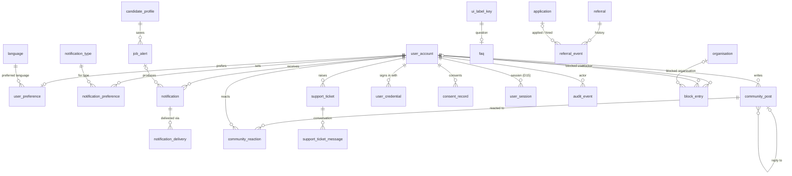
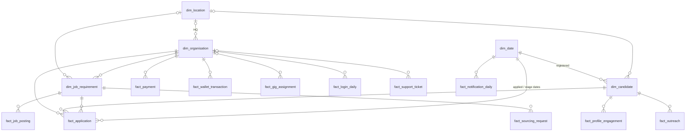

# Talentra — Phase 4 Design (Notifications, Analytics and shared team items)

**Scope so far:** Milestones 15–16, backlogs B48–B53. Modules: **Notifications, preferences and community**, **Analytics layer and reporting marts**, **Shared team items** (all team-owned).
**Status:** M15–M16 built and verified on PostgreSQL 16 (`./run_phase1.sh m15`, `m16`). M17 (columns) and M18 (keys and constraints: high-volume delivery write path, slowly changing dimension keys and aggregate refresh, append-only audit trail, unique credentials, blocked party cannot see the blocker's candidate) are next.

| File | Contents |
|---|---|
| `sql/12_notifications.sql` | Preferences (language, privacy, notification, job alerts), notifications and deliveries, community posts and reactions, support tickets, FAQs, referral events |
| `sql/13_shared.sql` | Credentials, consent records, blocking lists, system error log |
| `sql/14_analytics.sql` | Star schema: 5 dimensions, 11 facts, 4 aggregates |
| `sql/tests/m15_entities.sql`, `m16_relationships.sql` | Milestone checks |

As in Phases 2–3, tables are created with their columns, foreign keys and structural CHECKs, so the schema-wide column rules (m4, m9/m13) keep passing. The behavioural rules come in M18.

---

## Milestone 15 — Entities (B48–B50)

### B48 Notifications, preferences and community

| Entity | Purpose |
|---|---|
| `user_preference` | One row per user (1 : 0..1): **language preference** (`preferred_language_id`), time zone, and **privacy settings**: searchable by employers, show contact details, allow recruiter outreach, allow profile download |
| `notification_preference` | Per user × notification type × channel: on or off. No row means the type's default |
| `job_alert` | A candidate's saved search (keywords, city, role, industry, employment type, work mode, salary floor) with a frequency; at least one criterion |
| `notification` | One per event per recipient: type, template reference, short summary for the in-app list, what it is about (`target_table` / `target_record_id`), read time |
| `notification_delivery` | One per channel tried: provider message reference, status, sent / delivered / failed times. The high-volume write path, partitioned monthly |
| `community_post` | Post or reply (`parent_community_post_id`), text stored once in its language, moderation status, soft delete |
| `community_reaction` | One reaction per user per post |
| `support_ticket` / `support_ticket_message` | Ticket with category, priority, status, assignee and resolution times; append-only conversation, with internal notes flagged |
| `faq` | Question and answer as UI label keys (rule group 7: platform text is translated by key), by category |
| `referral_event` | History of a Phase 1 `referral` (invited → registered → applied → hired → rewarded), append-only |

**Decision D20 — one preference row per user; channels reuse `outreach_channel`.** Language and privacy are per-user settings with defaults, so they share one 1 : 0..1 row instead of four key/value tables. Notification channels are the same four channels outreach uses (email, SMS, WhatsApp, in-app), so `outreach_channel` serves both and no second channel list exists.

**Decision D22 — notification and delivery are split; only deliveries are partitioned.** A notification can go out on several channels, and each channel has its own provider status, so `delivery → notification` is N : 1. Deliveries carry the callback traffic, so they are partitioned monthly by `queued_at`. `notification` stays unpartitioned so it can be a plain FK target: a partitioned parent would force a composite FK containing a timestamp column, which the FK naming rule (m4: FK columns end in `_id`) does not allow.

### B50 Shared team items

| Item | Entity |
|---|---|
| Credentials | `user_credential`: password as an argon2id hash or a social sign-in as an HMAC of the provider subject. Revoked credentials are kept |
| Consent records | `consent_record`: every grant or withdrawal is a new row with policy version and evidence (IP, user agent). Append-only; the current state is the latest row |
| Identity sessions | `user_session` (Phase 3, **D15**), reused |
| Audit trail | `audit_event` (Phase 2), reused |
| Blocking lists for candidates, employers, recruiters and consultants | `block_entry`: a user blocks exactly one user or one organisation; unblocking closes the entry |
| System errors (Tier 1 "audit and error logging") | `system_error_event`: append-only, monthly partitions. This closes a Tier 1 gap left open since Phase 1 |

**Decision D21 — shared items are reused where they already exist.** Sessions and the audit trail were built in Phases 2–3 and are used across modules, so Phase 4 adds no second copy. m15 asserts that each B50 item maps to an entity.

The gig marketplace keeps its own `gig_worker_list_entry` (favourite / blacklist of workers by requesters, Phase 2). That list decides which gigs a worker can apply for. `block_entry` controls profile visibility. They have different purposes and different rules.

### B49 Analytics layer and reporting marts

**KPIs.** B49 and the module table refer to "the KPIs in Section 8", but the docket as issued has no Section 8: it ends at Section 7, the delivery plan. **This gap should be raised with the organisers.** The KPI set below is derived from the core workflows in §2 and the Tier 1 domains in §4, and m15 asserts that every KPI has a fact.

| # | KPI | Fact (grain) | Aggregate |
|---|---|---|---|
| 1 | Applications and stage conversion (applied → shortlisted → interviewed → offered → joined) | `fact_application` (application, accumulating snapshot) | `agg_hiring_funnel_monthly` |
| 2 | Time to shortlist, time to hire | `fact_application` | `agg_hiring_funnel_monthly` |
| 3 | Requirements posted, fill rate, time to fill | `fact_job_posting` (requirement, accumulating) | `agg_job_posting_monthly` |
| 4 | Profile views, downloads, credits used | `fact_profile_engagement` (event) | `agg_sourcing_monthly` |
| 5 | Outreach delivery and response rate | `fact_outreach` (recipient) | `agg_sourcing_monthly` |
| 6 | Consultant request acceptance rate and decision time | `fact_sourcing_request` (request) | — |
| 7 | Revenue, refunds, credits sold | `fact_payment` (order) | `agg_revenue_monthly` |
| 8 | Credits consumed by purpose | `fact_wallet_transaction` (ledger entry) | — |
| 9 | Gig fill, earnings, average rating | `fact_gig_assignment` (assignment) | — |
| 10 | Logins and device-limit refusals | `fact_login_daily` (day × organisation × outcome) | — |
| 11 | Notification delivery rate | `fact_notification_daily` (day × type × channel × status) | — |
| 12 | Support volume and resolution time | `fact_support_ticket` (ticket) | — |
| 13 | Candidate supply and profile completeness | `dim_candidate` (versions by registration date) | — |

**Dimensions.**

| Dimension | Type | Notes |
|---|---|---|
| `dim_date` | static | `id` = yyyymmdd smart key (CHECK); 2015–2035 generated in the DDL |
| `dim_location` | SCD 1 | City, state, country code |
| `dim_organisation` | **SCD 2** | A new version on a change of industry, size band, verification status or headquarters: `valid_from`, `valid_to`, `is_current` |
| `dim_candidate` | **SCD 2** | Banded only (experience band, highest qualification, fresher, completion %, location). No name, contact or exact salary |
| `dim_job_requirement` | SCD 1 | Role, industry, employment type, work mode, salary band, consultant openness |

**Decision D19 — the marts live in the same database, prefixed, decoupled from the transactional rows.**
- **Prefixed objects.** Analytical objects are `dim_`, `fact_` and `agg_` (rule group 8). m15 asserts that only analytical objects use those prefixes.
- **Enforced keys.** Facts reference dimensions by enforced FKs (rule group 2).
- **Degenerate source keys.** The source row id (`application_id`, `payment_order_id`, …) is kept as a degenerate key without an FK. The marts can then be loaded from a read replica, and erasing or anonymising a source row never blocks or rewrites reporting history.
- **Copied codes.** Dimensions hold lookup codes copied at load time (not free text), so a report needs no join back to the transactional side.
- **Aggregates.** Aggregates are materialised views over the facts; their refresh rule is part of M18.
- **No personal data in the marts.** Dimensions carry no direct identifiers, so the analytical layer can be opened to analysts without exposing Personal data.

---

## Milestone 16 — Relationships (B51–B53)

### Notifications, preferences, community and shared items



| Relationship | Card. | ON DELETE | Reason |
|---|---|---|---|
| user_account → user_preference | 1 : 0..1 | CASCADE | Owned settings (users are soft-deleted; erasure removes settings) |
| user_account → notification_preference | 1 : N | CASCADE | Owned settings, unique per type and channel |
| candidate_profile → job_alert | 1 : N | CASCADE | Owned saved searches |
| user_account → notification | 1 : N | RESTRICT | Notifications are history (in-app list, audit) |
| job_alert → notification | 0..1 : N | SET NULL | A deleted alert keeps the notifications it sent |
| notification → notification_delivery | 1 : N | RESTRICT | One delivery per channel attempt; delivery history kept |
| community_post → community_post (reply) | 0..1 : N | RESTRICT | Thread structure; posts are soft-deleted |
| community_post / user → community_reaction | 1 : N | CASCADE | A reaction has no meaning without its post or reactor; unique per user and post |
| support_ticket → support_ticket_message | 1 : N | RESTRICT | Conversation is append-only history |
| ui_label_key → faq | 1 : 0..1 (question), 1 : N (answer) | RESTRICT | Platform text by key |
| referral → referral_event | 1 : N | RESTRICT | Append-only history |
| user_account → user_credential / consent_record | 1 : N | RESTRICT | Revoked credentials and withdrawn consents are evidence |
| user_account → user_session / audit_event | 1 : N | RESTRICT | Reused shared items |
| user_account → block_entry (blocker) | 1 : N | RESTRICT | Block history |
| user_account / organisation → block_entry (blocked) | 0..1 : N | RESTRICT | Exactly one target per entry (CHECK) |

### Star schema (fact → dimension, aggregate → fact)



Aggregates and the facts they read (materialised-view dependencies, asserted by m16):

| Aggregate | Reads |
|---|---|
| `agg_hiring_funnel_monthly` | `fact_application`, `dim_organisation`, `dim_date` |
| `agg_job_posting_monthly` | `fact_job_posting`, `dim_organisation`, `dim_date` |
| `agg_sourcing_monthly` | `fact_profile_engagement`, `fact_outreach`, `dim_organisation`, `dim_date` |
| `agg_revenue_monthly` | `fact_payment`, `dim_organisation`, `dim_date` |

**Star-schema rules, checked automatically in m16** (not just for the listed sample of FKs):
- Every `*_date_id` column of a `dim_` / `fact_` table is an enforced FK to `dim_date`, and every `dim_<x>_id` column an FK to `dim_<x>`. There are 38 fact → dimension FKs.
- Analytical tables reference only analytical tables, `currency` and the audit actor (D19).
- Each aggregate is derived from its facts.
- Facts point at a specific dimension **version** (SCD 2 surrogate), so a report shows the organisation as it was when the event happened.

---

## Verification

```sh
MSYS_NO_PATHCONV=1 ./run_phase1.sh m15
MSYS_NO_PATHCONV=1 ./run_phase1.sh m16
```

m15 expected output:
- `analytics : 16`, `notifications : 11`, `shared : 4` entities present;
- all 16 docket entries mapped to an entity;
- prefix rule, 4 aggregates reading only facts and dimensions, 13 KPIs covered, no message bodies.

m16 expected output: `PASS 40 documented relationships …`, `894 foreign keys` explicit, the dimension-key rule (38 fact → dimension FKs), the D19 isolation rule, and aggregate → fact lineage.

Mutation-tested:
- An aggregate reading `job_requirement` makes m15 fail.
- Dropping a listed fact → `dim_date` FK makes m16 fail (listed-relationship check).
- Dropping an unlisted one (`fact_outreach.sent_date_id`) also makes m16 fail (general dimension-key rule).
- Adding an FK from `fact_payment` to `payment_order` makes m16 fail (D19).

**Review checklist**
- [ ] Missing Section 8 raised with the organisers; derived KPI set accepted.
- [ ] D19 (marts in the same database, degenerate keys), D20 (one preference row; shared channel list), D21 (reuse of sessions and audit trail), D22 (only deliveries partitioned) agreed.
- [ ] `block_entry` vs the gig worker blacklist split accepted.
