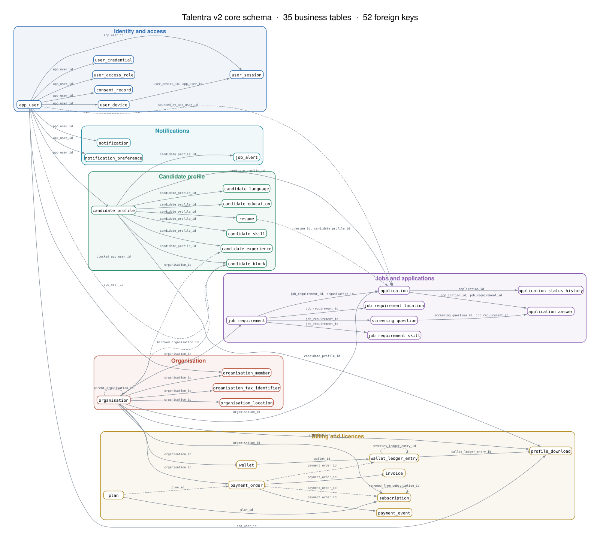
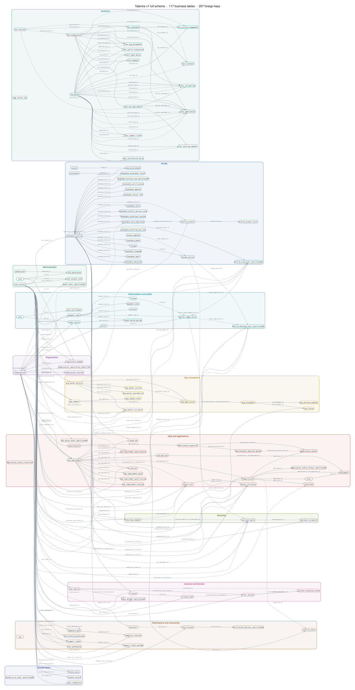

# Talentra schema diagrams

Generated from the live PostgreSQL catalogs by `python docs/schema/make_schema_diagram.py`; rerun it after a schema change. Boxes are tables, grouped and coloured by module; arrows go from the parent table to the child table and are labelled with the foreign-key column (for example `app_user → app_user_id → user_credential`).

**Legend:** arrow = one parent, many children · flat bar = one to one · dashed line = optional (nullable) key. Business tables only: reference data, lookup tables and the `created_by` / `updated_by` keys on every table are left out.

Interactive version (click a table to see its links): https://claude.ai/artifact/RNxTuejDgwdhzBAczCgEhz

## V2 core schema (`talentra_v2`)

35 business tables, 52 foreign keys, 6 modules: Identity and access, Organisation, Candidate profile, Jobs and applications, Billing and licences, Notifications.

Open the [SVG](schema/v2-schema.svg) to zoom without losing sharpness, or the [PNG](schema/v2-schema.png).

## V1 full schema (`talentra`)

117 business tables, 207 foreign keys, 11 modules: Profile, Jobs and applications, Administration, Organisation, Gig marketplace, Subscriptions and wallet, Licences and devices, Sourcing, Notifications and community, Shared items, Analytics.

Open the [SVG](schema/v1-schema.svg) to zoom without losing sharpness, or the [PNG](schema/v1-schema.png).
