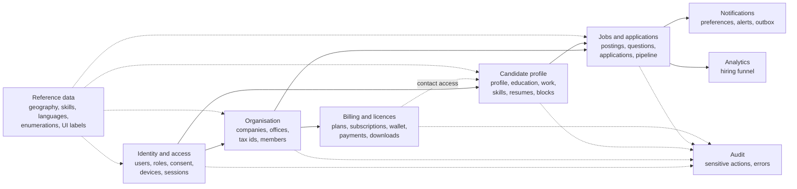
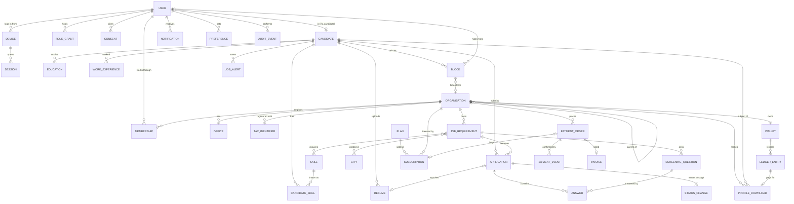
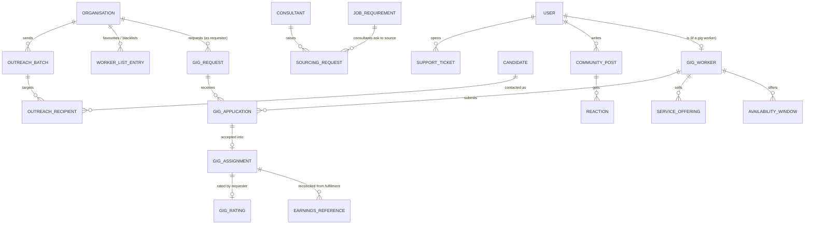

# 04 — Conceptual model

Level 1 of the three-level model: **what the business deals with and how the things relate.** No columns, no types, no technology. Entities are business concepts named in the language of [00](00-scope.md#7-glossary); the logical model ([05](05-logical-model.md)) gives them attributes and keys, and the physical model ([06](06-physical-model.md)) builds them in PostgreSQL.

## 1. Subject areas

## 2. Core entity–relationship diagram

## 3. Entity definitions and business rules

| Entity | Definition | Key business rules |
|---|---|---|
| User | anyone who can sign in | email identifies one account; contact details are personal; erased users keep no personal data (BR-01) |
| Candidate | a user looking for work | registers themselves only (BR-02); controls visibility (BR-03) and blocks (BR-04) |
| Role grant | what a user may do | permissions belong to roles; checked by the database (BR-05) |
| Consent | a user's yes or no to one purpose, at one policy version | a history; the latest record per purpose is current (BR-06) |
| Device / Session | where and when a user is signed in | active sessions per user ≤ the licence's devices per user; refusals audited (BR-07) |
| Organisation | an employer or client company | may belong to a group (a tree, no cycles); verified by staff |
| Membership | a user working for an organisation, from–to | one organisation at a time (BR-08); current members ≤ licence seats (BR-09) |
| Tax identifier | GSTIN, PAN, CIN… of an organisation | never stored in clear; unique per country and type (BR-10) |
| Job requirement | positions to fill, posted by an organisation | draft until published; publishing costs credits once (BR-11); filled when all positions are joined (BR-12) |
| Application | a candidate's bid for one job | one per candidate per job; only to open jobs (BR-13); allowed moves only (BR-14); the candidate may only withdraw (BR-15) |
| Status change | one move of an application | append-only; the full history explains every status (BR-16) |
| Plan / Subscription | what an organisation buys / the period it bought | the subscription is the licence; periods never overlap (BR-17) |
| Wallet / Ledger entry | an organisation's credits / one movement | the balance never goes negative; entries are never changed, only reversed (BR-18) |
| Payment order / event | money asked for / the gateway's confirmations | each gateway event is applied at most once (BR-19); capture grants credits or a period, plus an invoice |
| Profile download | an organisation buying access to a candidate's contact details | 1 credit; free again within 30 days; contact details only through a download (BR-20) |
| Notification | a message owed to a user | created with the event it reports (BR-21); opt-outs respected except security notices |
| Audit event | a record of a sensitive action | append-only; the actor cannot be forged (BR-22) |

The rules BR-01..BR-22 are realised in [06 §3–4](06-physical-model.md#3-constraints-and-rules) and traced to tests in [07](07-traceability.md).

## 4. Deferred subject areas

Designed at this level only, so that the core leaves room for them; built later ([08](08-gaps-and-next-steps.md)).

**Gig decision (ADR-013):** gigs are a separate subsystem, not a kind of job requirement. Gigs have windows, prices, a request–accept flow with no bidding, external fulfilment and ratings; forcing them into `job_requirement` / `application` would make most columns conditional. They share identity, organisation, reference data, the wallet and the audit trail with the core.
