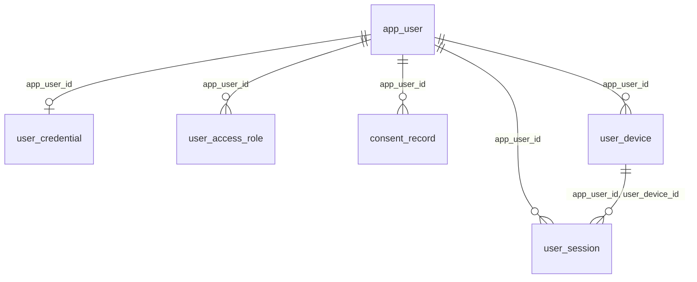
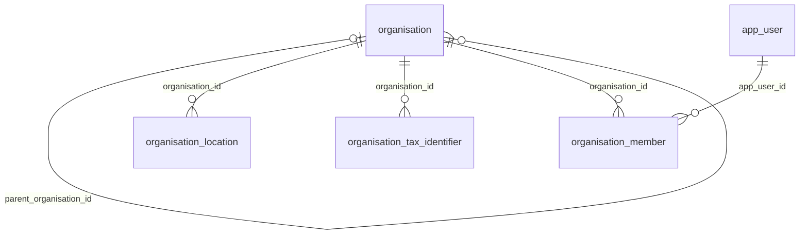
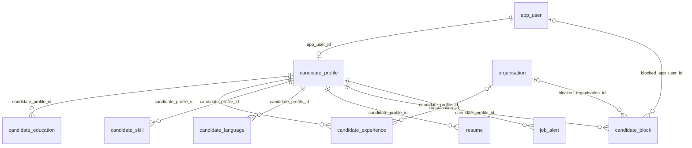
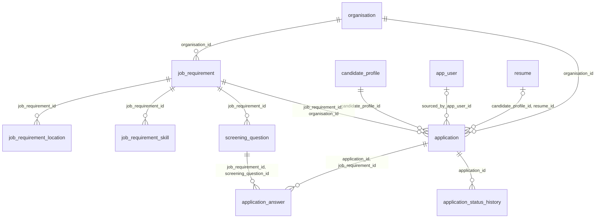
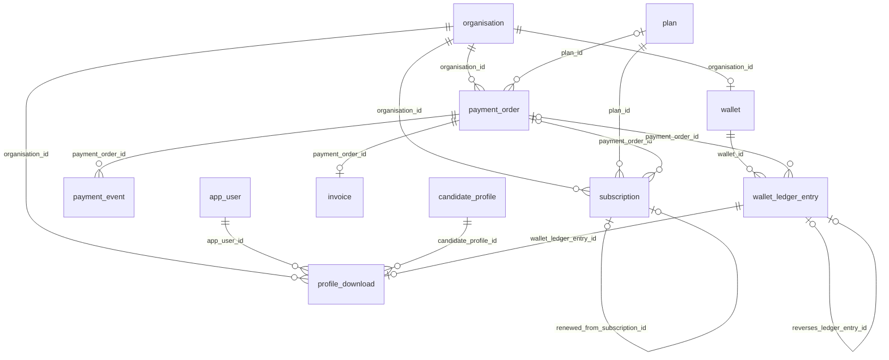
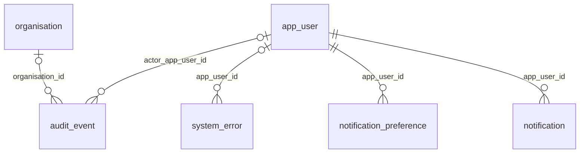

# Relationship ER diagrams (generated)

Tables and the foreign keys that connect them, no attributes. Each line reads **parent → foreign-key column → child**: `app_user ||--o| user_credential : "app_user_id"` means one app_user has at most one user_credential, linked by `user_credential.app_user_id`. Generated by `./run.sh dictionary` from the live catalog; attributes are in [logical-erd.md](logical-erd.md). Audit-column keys and keys to lookup tables are left out.

Notation: `||--o{` one-to-many · `||--o|` one-to-one · `|o--` optional parent (nullable key).

## Whole schema (37 tables, 55 relationships)

```mermaid
erDiagram
    app_user ||--o| user_credential : "app_user_id"
    app_user ||--o{ user_access_role : "app_user_id"
    app_user ||--o{ consent_record : "app_user_id"
    app_user ||--o{ user_device : "app_user_id"
    app_user ||--o{ user_session : "app_user_id"
    user_device ||--o{ user_session : "app_user_id, user_device_id"
    organisation |o--o{ organisation : "parent_organisation_id"
    organisation ||--o{ organisation_location : "organisation_id"
    organisation ||--o{ organisation_tax_identifier : "organisation_id"
    organisation ||--o{ organisation_member : "organisation_id"
    app_user ||--o{ organisation_member : "app_user_id"
    app_user ||--o| candidate_profile : "app_user_id"
    candidate_profile ||--o{ candidate_education : "candidate_profile_id"
    candidate_profile ||--o{ candidate_experience : "candidate_profile_id"
    organisation |o--o{ candidate_experience : "organisation_id"
    candidate_profile ||--o{ candidate_skill : "candidate_profile_id"
    candidate_profile ||--o{ candidate_language : "candidate_profile_id"
    candidate_profile ||--o{ resume : "candidate_profile_id"
    candidate_profile ||--o{ candidate_block : "candidate_profile_id"
    organisation |o--o{ candidate_block : "blocked_organisation_id"
    app_user |o--o{ candidate_block : "blocked_app_user_id"
    candidate_profile ||--o{ job_alert : "candidate_profile_id"
    job_requirement ||--o{ job_requirement_location : "job_requirement_id"
    organisation ||--o{ job_requirement : "organisation_id"
    job_requirement ||--o{ job_requirement_skill : "job_requirement_id"
    job_requirement ||--o{ screening_question : "job_requirement_id"
    organisation ||--o{ application : "organisation_id"
    candidate_profile ||--o{ application : "candidate_profile_id"
    app_user |o--o{ application : "sourced_by_app_user_id"
    job_requirement ||--o{ application : "job_requirement_id, organisation_id"
    resume |o--o{ application : "candidate_profile_id, resume_id"
    application ||--o{ application_answer : "application_id, job_requirement_id"
    screening_question ||--o{ application_answer : "job_requirement_id, screening_question_id"
    application ||--o{ application_status_history : "application_id"
    organisation ||--o{ subscription : "organisation_id"
    plan ||--o{ subscription : "plan_id"
    subscription |o--o| subscription : "renewed_from_subscription_id"
    organisation ||--o| wallet : "organisation_id"
    organisation ||--o{ payment_order : "organisation_id"
    plan |o--o{ payment_order : "plan_id"
    payment_order |o--o{ subscription : "payment_order_id"
    payment_order ||--o{ payment_event : "payment_order_id"
    organisation ||--o{ profile_download : "organisation_id"
    wallet ||--o{ wallet_ledger_entry : "wallet_id"
    wallet_ledger_entry |o--o| wallet_ledger_entry : "reverses_ledger_entry_id"
    payment_order |o--o{ wallet_ledger_entry : "payment_order_id"
    payment_order ||--o| invoice : "payment_order_id"
    app_user ||--o{ profile_download : "app_user_id"
    candidate_profile ||--o{ profile_download : "candidate_profile_id"
    wallet_ledger_entry ||--o| profile_download : "wallet_ledger_entry_id"
    app_user |o--o{ audit_event : "actor_app_user_id"
    organisation |o--o{ audit_event : "organisation_id"
    app_user |o--o{ system_error : "app_user_id"
    app_user ||--o{ notification_preference : "app_user_id"
    app_user ||--o{ notification : "app_user_id"
```

## Identity and access

## Organisation

## Candidate profile

## Jobs and applications

## Billing and licences

## Notifications and audit

