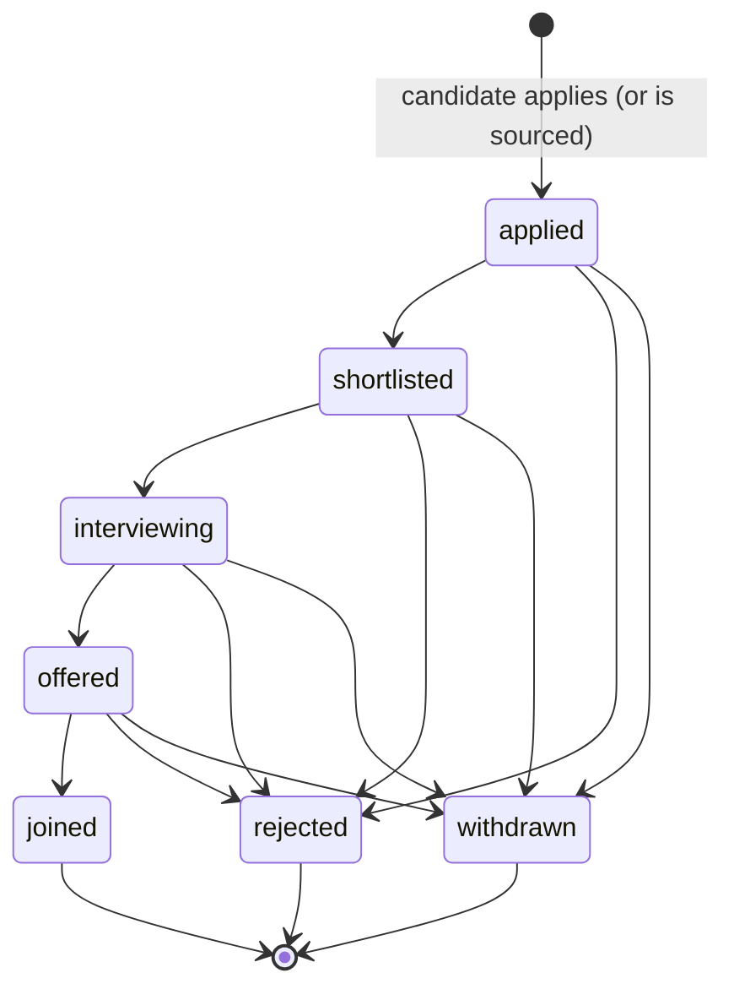
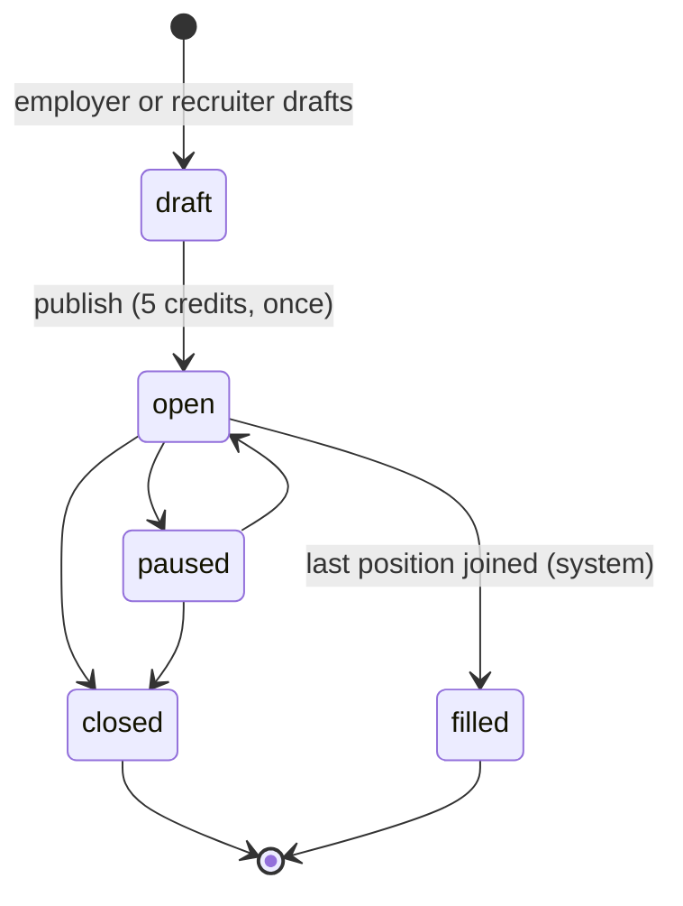
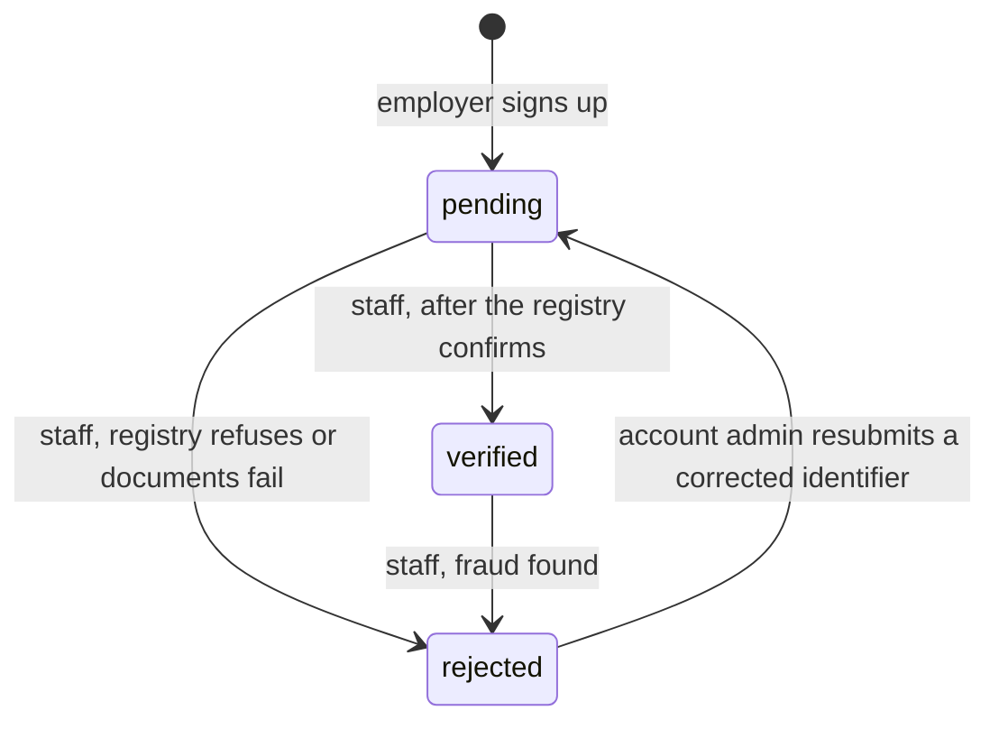
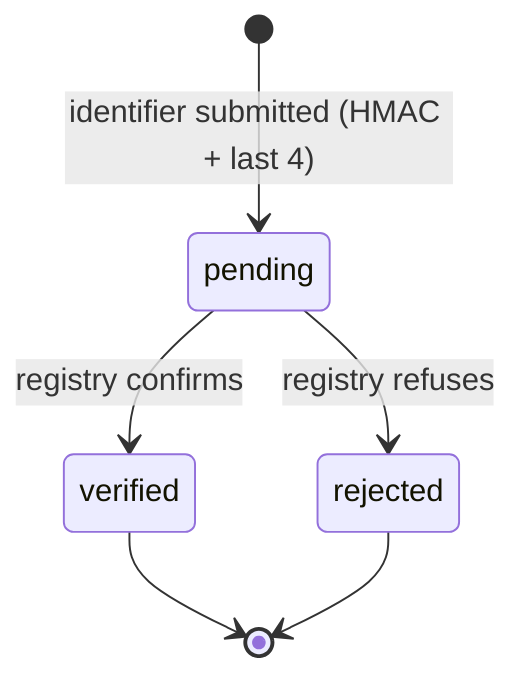
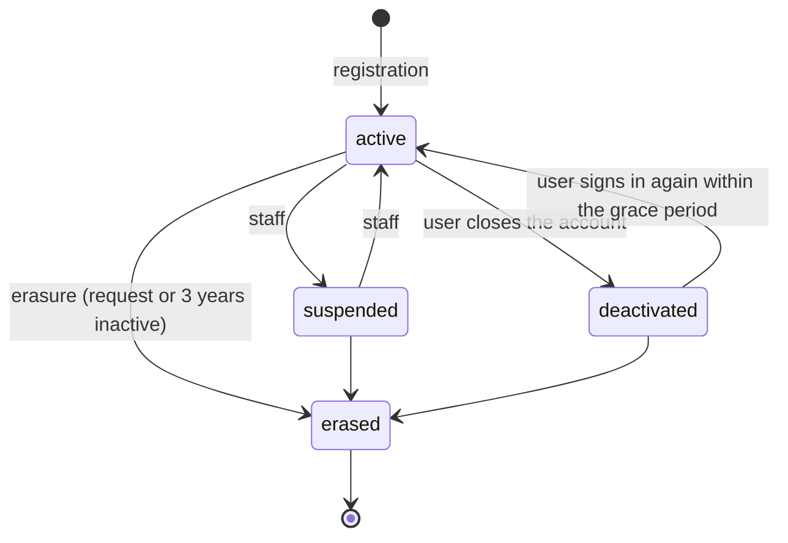
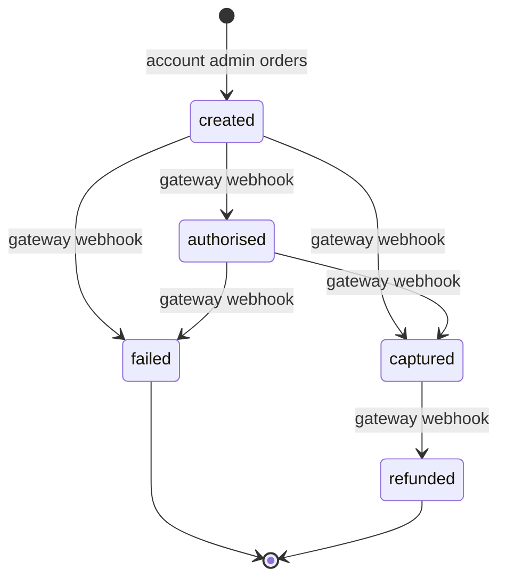
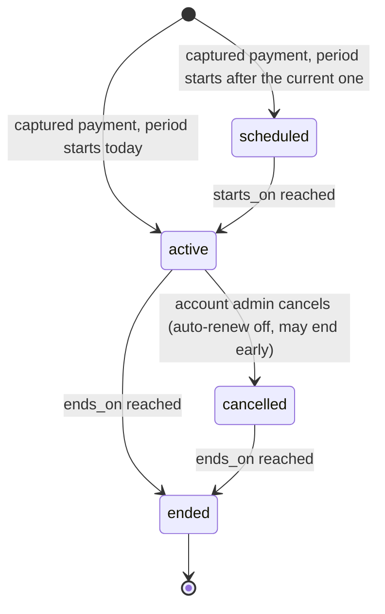
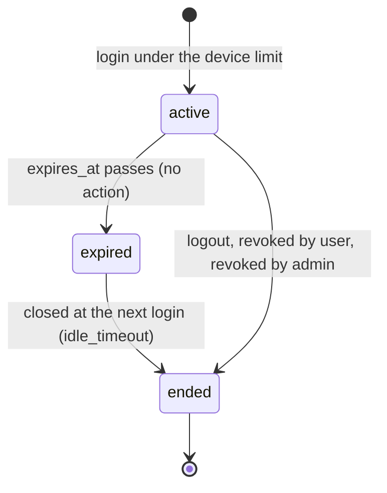
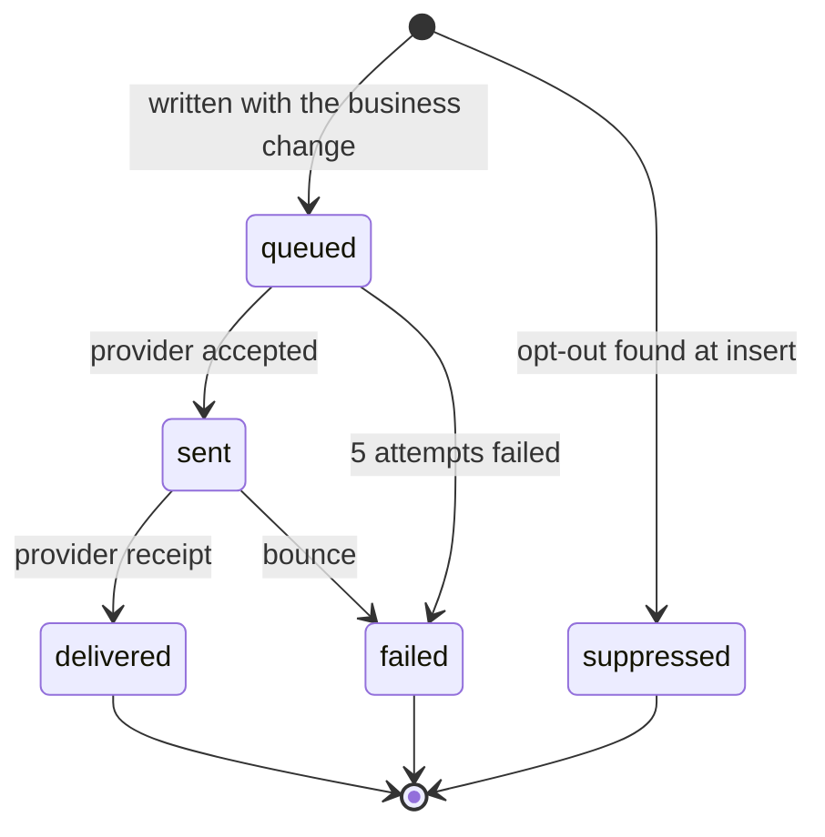

# Step 08 — Entity Lifecycle and State Machines

Conforms to schema [S-08](schemas.md#s-08--entity-lifecycle-and-state-machines). For every entity that moves through states: the states, every allowed transition with who triggers it, its guard and its side effects, the illegal transitions (each one a negative test), and where the database enforces it today. Entity IDs are from [step 06](06-entity-catalogue.md); findings (FND-nn) are collected in the [findings register](findings.md).

**How a state is stored.** Three patterns are used. Choosing one per entity is a design decision:

| Pattern | Entities | Why |
|---|---|---|
| Status column holding a lookup code | application, job requirement, organisation and tax-id verification, account, payment order, notification | the state is a fact the business names, shows and filters on |
| State derived from timestamps | session, device, membership, block, subscription | the state is "between two times"; a status column would duplicate the timestamps and could disagree with them |
| State derived from other rows | ledger entry (reversed or not), consent (current yes or no) | append-only facts; the current state is computed, never updated |

**Summary**

| # | Entity | States | Transitions | Final states | Enforced today | Findings |
|---|---|---|---|---|---|---|
| 1 | ENT-26 Application | 7 | 12 + creation | joined, rejected, withdrawn | full: transition table + trigger | none |
| 2 | ENT-22 Job requirement | 5 | 7 + creation | closed, filled | partial | FND-01, FND-02 |
| 3 | ENT-10 Organisation (verification) | 3 | 4 + creation | none (rejected can resubmit) | time only | FND-03 |
| 4 | ENT-12 Tax identifier (verification) | 3 | 3 + creation | verified, rejected | time only | (FND-03) |
| 5 | ENT-01 User account | 4 | 6 + creation | erased | erasure only | FND-05 |
| 6 | ENT-34 Payment order | 5 | 6 + creation | failed, refunded | full: inside the webhook function | none |
| 7 | ENT-31 Subscription | 4 (derived) | 5 | ended | full except un-cancel | FND-06 |
| 8 | ENT-09 Session | 3 (derived) | 3 + creation | ended | full: functions only | none |
| 9 | ENT-08 Device | 2 (derived) | 1 + creation | revoked | no entry point | FND-04 |
| 10 | ENT-13 Membership | 2 (derived) | 1 + creation | ended | partial | FND-07 |
| 11 | ENT-20 Block | 2 (derived) | 1 + creation | lifted | partial | FND-07 |
| 12 | ENT-39 Notification | 5 | 6 + creation | delivered, failed, suppressed | partial | FND-08 |
| 13 | ENT-33 Ledger entry | 2 (derived) | 1 + creation | reversed | full | none |
| 14 | ENT-07 Consent (per purpose) | 2 (derived) | 2 + creation | none | full (append-only) | FND-09 (not read) |

**Assumptions.** These transitions are design proposals, not facts of the current model or the docket. They are marked so that nobody mistakes them for agreed rules; each needs a client answer before the rebuild:

| ID | Assumption | Where | Question for the client |
|---|---|---|---|
| SA-01 | staff can move a verified organisation to rejected (fraud), which pauses its open jobs | §3 | is de-verification needed, and what happens to live jobs? |
| SA-02 | a rejected organisation can resubmit and return to pending | §3 | how many resubmissions are allowed? |
| SA-03 | a deactivated account can be reactivated by signing in within a grace period | §5 | how long is the grace period? |
| SA-04 | a pending organisation may publish jobs (current behaviour, finding F-05) | §2 | gate publishing on verification? |
| SA-05 | a corrected tax identifier is a new row; rejected rows are kept | §4 | — (data design choice, recorded for review) |
| SA-06 | a refund is refused when the credits it granted were already spent | §6 | refund anyway and let the wallet go negative, or refuse? |

---

## 1. ENT-26 Application — `application.application_status_id`

| From | To | Triggered by | Guard | Side effects |
|---|---|---|---|---|
| (none) | applied | candidate; recruiter or consultant when sourced | job open, published, not deleted, before `closes_on`; one per candidate and job; consultant only on jobs open to consultants | `organisation_id` copied from the job; first history row; |
| applied | shortlisted | recruiter (`application_manage`) | not blocked by the candidate | history row; candidate notified |
| shortlisted | interviewing | recruiter | same | history row; notified |
| interviewing | offered | recruiter | same | history row; notified |
| offered | joined | recruiter | `positions_filled < positions_total` (job row locked) | `positions_filled + 1`; job → filled when it reaches the total; history; notified |
| applied, shortlisted, interviewing, offered | rejected | recruiter | same | history row; notified |
| applied, shortlisted, interviewing, offered | withdrawn | candidate (the only move a candidate may make) or recruiter | — | history row; notified |

**Enforced by:** `application_status_transition` (the 12 allowed moves, as data) read by trigger `application_guard()`; `application_record_history()` writes every move; `application_notify()` queues the notification with a dedupe key.

**Illegal transitions (negative tests):**

| Test | Attempt | Expected |
|---|---|---|
| TC-08-001 | insert an application with any status other than applied | refused |
| TC-08-002 | applied → interviewing, offered or joined (skipping a stage) | refused |
| TC-08-003 | shortlisted → offered or joined | refused |
| TC-08-004 | interviewing → joined | refused |
| TC-08-005 | joined, rejected or withdrawn → any status | refused (final) |
| TC-08-006 | candidate moves their own application to anything except withdrawn | refused |
| TC-08-007 | two concurrent joins for the last position | one succeeds, the other is refused; job becomes filled |
| TC-08-008 | a recruiter of a company the candidate has blocked moves the application | refused (row not visible) |

## 2. ENT-22 Job requirement — `job_requirement.job_status_id`

| From | To | Triggered by | Guard | Side effects |
|---|---|---|---|---|
| (none) | draft | employer, recruiter (`job_post`) | own organisation | none; invisible outside the organisation |
| draft | open | employer (`job_post`) | wallet ≥ 5 credits; (product decision F-05: organisation verified?) | `published_at` set once; 5 credits debited once (idempotency key `job_post:<id>`); visible to all |
| open | paused | employer, recruiter (`job_manage`) | — | hidden from search; no new applications |
| paused | open | employer, recruiter | `closes_on` not passed | visible again |
| open, paused | closed | employer, recruiter | — | no new applications; pipeline continues for existing ones |
| open | filled | system (pipeline trigger) | `positions_filled = positions_total` | no new applications |
| draft | (soft-deleted) | employer | — | `deleted_at` set; a draft is abandoned, never "closed" |

**Enforced today:** draft ⇔ `published_at IS NULL` (`ck_job_requirement_published`); the charge happens once; filled is set by the pipeline. **Not enforced:** the API role may update both `job_status_id` and `published_at`, so open → draft (by clearing `published_at`), closed → open and filled → open are all accepted (**FND-01**, **FND-02**). **Design for the rebuild:** a `job_status_transition` table and guard trigger, the same pattern as the application pipeline; `published_at` write-once; filled settable only by the pipeline trigger.

| Test | Attempt | Expected |
|---|---|---|
| TC-08-009 | open, paused, closed or filled → draft | refused |
| TC-08-010 | closed or filled → open or paused | refused (final) |
| TC-08-011 | draft → paused, closed or filled | refused |
| TC-08-012 | a user sets filled directly | refused (system only) |
| TC-08-013 | clear or change `published_at` after publishing | refused |
| TC-08-014 | publish twice (draft → open, repeated request) | charged once |
| TC-08-015 | publish with fewer than 5 credits | refused, job stays draft |

## 3. ENT-10 Organisation verification — `organisation.verification_status_id`

| From | To | Triggered by | Guard | Side effects |
|---|---|---|---|---|
| (none) | pending | sign-up (`auth_register_employer()`) | — | wallet and admin membership created |
| pending | verified | admin (`organisation_verify`) | at least one tax identifier verified | `verified_at` set; audited |
| pending | rejected | admin | reason given | reason in the audit details; account admin notified |
| rejected | pending | account admin | a new or corrected tax identifier submitted | audited |
| verified | rejected | admin | reason given | `verified_at` cleared; open jobs paused (product rule); audited |

No final state: an organisation can always correct and resubmit. **Enforced today:** only `ck_organisation_verified_at` (verified ⇔ time present). There is no entry point for staff at all (**FND-03**): rebuild adds `organisation_set_verification()` (definer, staff only, these transitions, audited).

| Test | Attempt | Expected |
|---|---|---|
| TC-08-016 | an account admin sets their own organisation to verified | refused |
| TC-08-017 | pending → verified with no verified tax identifier | refused |
| TC-08-018 | verified → pending | refused |
| TC-08-019 | verified without `verified_at`, or `verified_at` while not verified | refused (check) |

## 4. ENT-12 Tax identifier verification — `organisation_tax_identifier.verification_status_id`

A corrected identifier is a **new row**; a rejected or verified row never changes again, so the history of what was submitted is kept. Registry down → the row stays pending (docket §6 failure behaviour). Enforced today: the time check only; the registry callback entry point comes with FND-03.

| Test | Attempt | Expected |
|---|---|---|
| TC-08-020 | verified or rejected → any status | refused (final) |
| TC-08-021 | the same identifier submitted twice for the same country and type | refused (unique hash) |

## 5. ENT-01 User account — `app_user.account_status_id`

| From | To | Triggered by | Guard | Side effects |
|---|---|---|---|---|
| (none) | active | registration functions | email unique | role, consent (and profile or organisation) created |
| active | suspended | admin (`user_manage`) | reason | sessions ended; permissions return false (`app_has_permission` requires active) |
| suspended | active | admin | — | audited |
| active | deactivated | the user | — | sessions ended; profile hidden |
| deactivated | active | the user | within the grace period | — |
| any but erased | erased | `candidate_erase()` | — | contact blanked (`ck_app_user_email_erased`), `deleted_at` set, credentials deleted |

**Enforced today:** erased only through erasure, and the checks tie erased to "no email" and "deleted". Suspend, reactivate and deactivate have no entry point, and nothing but the email check stops erased → active (**FND-05**).

| Test | Attempt | Expected |
|---|---|---|
| TC-08-022 | erased → any status | refused (final) |
| TC-08-023 | a suspended user opens a session | refused |
| TC-08-024 | a user suspends or reactivates themselves | refused (staff only) |

## 6. ENT-34 Payment order — `payment_order.payment_status_id`

| From | To | Triggered by | Guard | Side effects |
|---|---|---|---|---|
| (none) | created | account admin (`billing_manage`) | unique idempotency key; recharge has credits, subscription has a plan, never both | gateway order created by the payment service |
| created | authorised | gateway | event id never seen; amount = order amount | event stored; audited |
| created, authorised | captured | gateway | same | recharge credits, or subscription period + plan credits; GST invoice; audited |
| created, authorised | failed | gateway | same | nothing granted; audited |
| captured | refunded | gateway | same; the granted credits are still unspent | reversal ledger entry; subscription cancelled and ended early; audited |

**Enforced by:** `billing_apply_payment_event()`, the only writer of the status (the payment role may update nothing but `gateway_order_ref`). A late or repeated state (captured arriving after refunded, say) is **stored as evidence and changes nothing**; a duplicate event id is a no-op.

| Test | Attempt | Expected |
|---|---|---|
| TC-08-025 | the same webhook delivered twice | second is a no-op; credits granted once |
| TC-08-026 | event amount differs from the order | refused |
| TC-08-027 | captured arrives after refunded, or authorised after captured | stored, status unchanged |
| TC-08-028 | failed → captured | status unchanged (failed is final) |
| TC-08-029 | refund after the credits were spent | refused |

## 7. ENT-31 Subscription — derived from `starts_on`, `ends_on`, `cancelled_at`

| State | Condition |
|---|---|
| scheduled | today < `starts_on` |
| active | `starts_on` ≤ today < `ends_on`, `cancelled_at` NULL |
| cancelled | `cancelled_at` set and today < `ends_on` |
| ended | today ≥ `ends_on` |

Renewal is a **new row** chained by `renewed_from_subscription_id`, never an extension: each period is its own licence. **Enforced by:** `subscription_guard()` (plan, limits, start and payment never change; `ends_on` only moves earlier) and the exclusion constraint (no overlapping periods). **Gap:** `cancelled_at` can be cleared (**FND-06**).

| Test | Attempt | Expected |
|---|---|---|
| TC-08-030 | extend `ends_on`, or change seats, devices or plan | refused |
| TC-08-031 | an overlapping period for the same organisation | refused |
| TC-08-032 | clear `cancelled_at` | refused (after FND-06) |

## 8. ENT-09 Session — derived from `ended_at`, `expires_at`

Only **active** sessions (not ended, not expired) count against the device limit (rule group 9). The end reason is mandatory exactly when `ended_at` is set (`ck_user_session_ended`). The API role has no UPDATE on sessions: only `auth_open_session()` and `auth_end_session()` change them, and revocations are audited.

| Test | Attempt | Expected |
|---|---|---|
| TC-08-033 | login when active devices = the limit | refused and audited |
| TC-08-034 | an expired session is not counted | login succeeds |
| TC-08-035 | a user ends another user's session | refused (staff only) |
| TC-08-036 | end a session without a reason, or a reason without an end | refused (check) |

## 9. ENT-08 Device — derived from `revoked_at`

`trusted → revoked` (final). A revoked device can never open a session (`auth_open_session()` refuses and audits). The same physical device returning is the same fingerprint, so it stays revoked; a different fingerprint is a new device row. **Gap:** nothing can set `revoked_at` (**FND-04**); rebuild adds `auth_revoke_device()` that ends the device's sessions and audits.

| Test | Attempt | Expected |
|---|---|---|
| TC-08-037 | login from a revoked device | refused and audited |
| TC-08-038 | un-revoke a device | refused |

## 10. ENT-13 Membership and 11. ENT-20 Block — derived from a closing timestamp

| Entity | States | Transition | Re-entry | Enforced |
|---|---|---|---|---|
| Membership | current (`valid_to` NULL) → ended | account admin sets `valid_to` | a new row (history kept; one organisation at a time by exclusion constraint; seats checked) | partial: `valid_to` can be cleared again (**FND-07**) |
| Block | active (`unblocked_at` NULL) → lifted | the candidate sets `unblocked_at` | a new row (one active block per target by partial unique index) | partial: `unblocked_at` can be cleared again (**FND-07**) |

| Test | Attempt | Expected |
|---|---|---|
| TC-08-039 | reopen an ended membership by clearing `valid_to` | refused (after FND-07) |
| TC-08-040 | a second current membership for the same user | refused (exclusion) |
| TC-08-041 | a second active block on the same target | refused (partial unique) |

## 12. ENT-39 Notification — `notification.notification_status_id`

Retries keep the row **queued** with a later `next_attempt_at` (backoff 2, 4, 8, 16 minutes); a claimed row is leased for 5 minutes so a dead worker's rows come back. Security notices are never suppressed. **Gap:** `notification_record_result()` does not check the current status, so delivered → queued is possible (**FND-08**).

| Test | Attempt | Expected |
|---|---|---|
| TC-08-042 | delivered, failed or suppressed → any status | refused (after FND-08) |
| TC-08-043 | an opted-out marketing message | inserted as suppressed |
| TC-08-044 | an opted-out security notice | still queued |
| TC-08-045 | two workers claim at once | each row taken by one worker |

## 13. ENT-33 Ledger entry and 14. ENT-07 Consent — derived from other rows

- **Ledger entry:** `posted → reversed`, where "reversed" means a reversal entry points at it. The original row never changes (append-only), and an entry can be reversed once (unique `reverses_ledger_entry_id`). TC-08-046: reverse an entry twice → refused. TC-08-047: update or delete any ledger row → refused.
- **Consent, per user and purpose:** `granted ⇄ withdrawn`, each change a new record; the current state is the latest record (`consent_current`). No final state: a user can always change their mind. TC-08-048: update or delete a consent record → refused. **Gap:** the current consent is not read by notifications or visibility (**FND-09**).

---

## Check (exit test: every status has a way in and a way out, or is marked final)

| Entity | Every state reachable | Every non-final state has a way out | Final states marked |
|---|---|---|---|
| Application | yes | yes | joined, rejected, withdrawn |
| Job requirement | yes | yes (draft can also be soft-deleted) | closed, filled |
| Organisation | yes | yes | none, by design (resubmission) |
| Tax identifier | yes | yes | verified, rejected |
| User account | yes | yes | erased |
| Payment order | yes | yes; created and authorised also time out through the reconciliation job | failed, refunded |
| Subscription | yes | yes (time) | ended |
| Session | yes | yes | ended |
| Device, membership, block | yes | yes | revoked, ended, lifted |
| Notification | yes | yes | delivered, failed, suppressed |
| Ledger entry, consent | yes | yes | reversed; none for consent |

**Negative tests defined:** 48 (TC-08-001 to TC-08-048), one or more per illegal transition. They become part of test suite v1 in Phase 3 (step 15).
