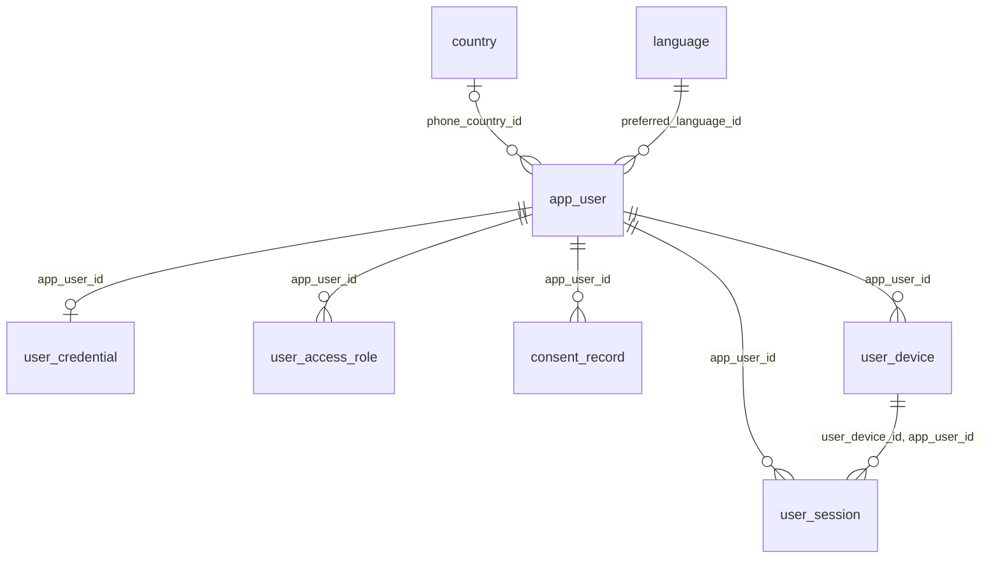
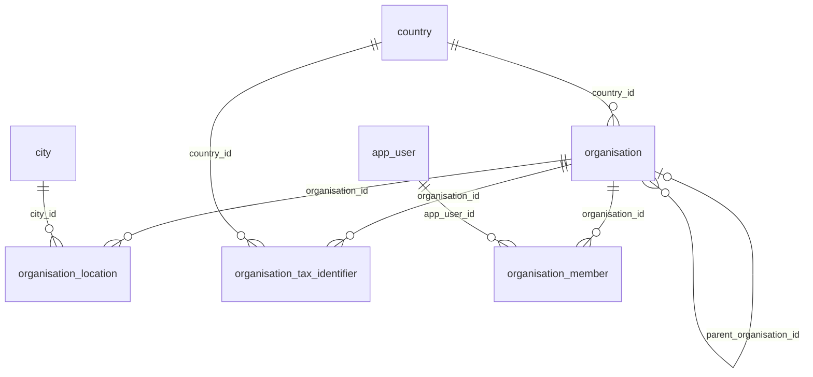
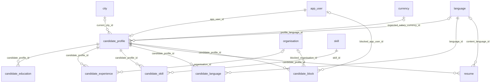
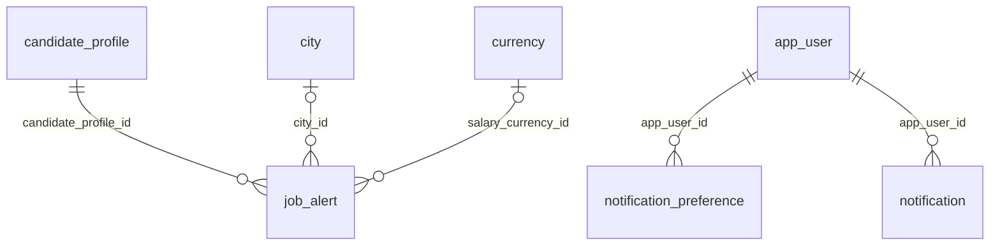
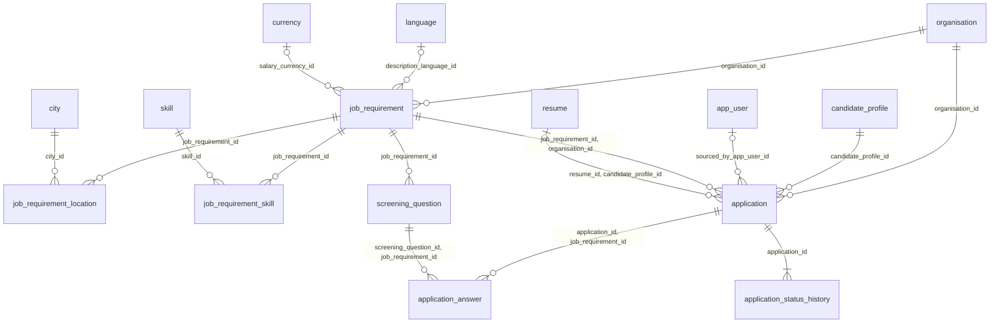
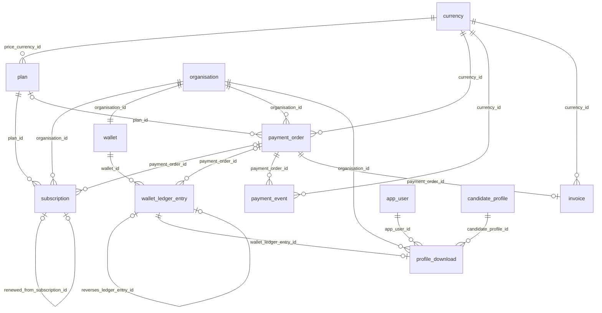
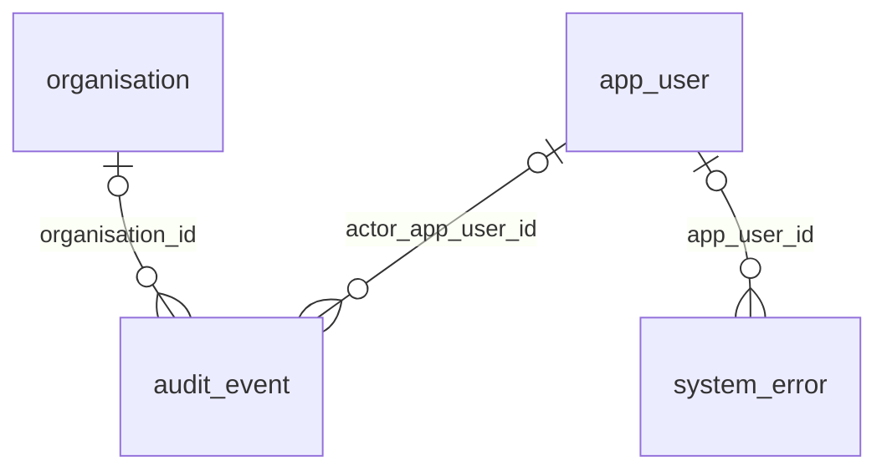
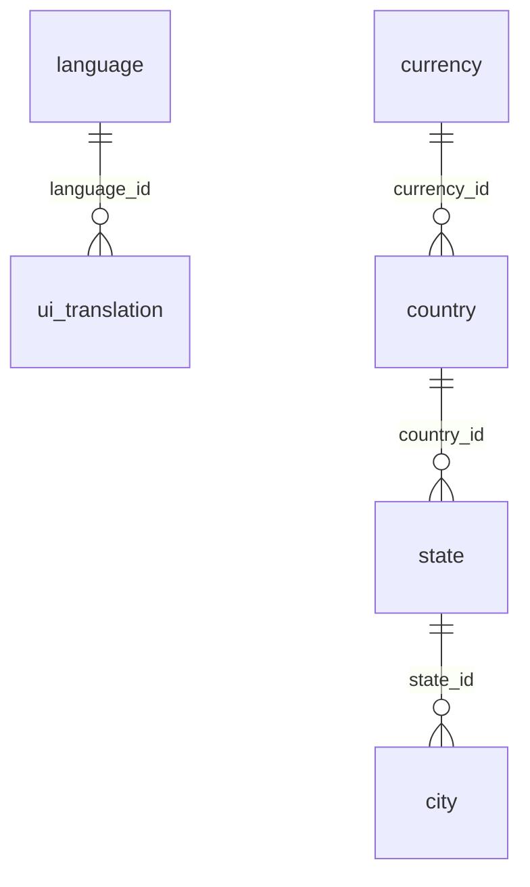

# Step 09 — Database, Tables and Relationships Discovery (logical ER model v0)

Generated by `python v2/phase2/tools/build_phase2.py` from the v2 model (`db/migrations`) and the curated notes in `tools/notes.py`. Edit those, then rerun; do not edit this file by hand.

Conforms to schema [S-09](schemas.md#s-09--database-tables-and-relationships-discovery). Every relationship between entities is listed with its key, its cardinality **in both directions**, its optionality and its delete rule. References to the 23 enumeration lookups and to UI labels are summarised in §3 rather than drawn.

## 1. Diagrams by subject area

Crow's foot notation: `||` exactly one, `|o` zero or one, `o{` zero or many, `|{` one or many. Labels are the foreign-key columns.

### Identity and access

### Organisation

### Candidate profile

### Notifications

### Jobs and applications

### Billing and licences

### Audit

### Reference data

## 2. Relationship register

| # | Parent | Child | Key (child side) | Parent → child | Child → parent | Delete rule | Note |
|---|---|---|---|---|---|---|---|
| R-01 | `country` | `app_user` | `phone_country_id` | one country has 0..* | each user has 0..1 | restrict |  |
| R-02 | `language` | `app_user` | `preferred_language_id` | one language has 0..* | each user has exactly 1 | restrict |  |
| R-03 | `app_user` | `user_credential` | `app_user_id` | one user has 0..1 (none after erasure) | each credential has exactly 1 | cascade |  |
| R-04 | `app_user` | `user_access_role` | `app_user_id` | one user has 0..* | each role grant has exactly 1 | cascade | junction: User ↔ Role |
| R-05 | `app_user` | `consent_record` | `app_user_id` | one user has 0..* | each consent record has exactly 1 | cascade |  |
| R-06 | `app_user` | `user_device` | `app_user_id` | one user has 0..* | each device has exactly 1 | cascade |  |
| R-07 | `app_user` | `user_session` | `app_user_id` | one user has 0..* | each session has exactly 1 | cascade |  |
| R-08 | `user_device` | `user_session` | `user_device_id, app_user_id` | one device has 0..* | each session has exactly 1 | cascade | composite key fk_user_session_user_device: proves cross-row consistency |
| R-09 | `country` | `organisation` | `country_id` | one country has 0..* | each organisation has exactly 1 | restrict |  |
| R-10 | `organisation` | `organisation` | `parent_organisation_id` | one organisation has 0..* | each organisation has 0..1 | restrict | self-reference |
| R-11 | `organisation` | `organisation_location` | `organisation_id` | one organisation has 0..1 at a time, 0..* over time | each office location has exactly 1 | cascade |  |
| R-12 | `city` | `organisation_location` | `city_id` | one city has 0..* | each office location has exactly 1 | restrict |  |
| R-13 | `organisation` | `organisation_tax_identifier` | `organisation_id` | one organisation has 0..* | each tax identifier has exactly 1 | cascade |  |
| R-14 | `country` | `organisation_tax_identifier` | `country_id` | one country has 0..* | each tax identifier has exactly 1 | restrict |  |
| R-15 | `organisation` | `organisation_member` | `organisation_id` | one organisation has 0..* | each membership has exactly 1 | restrict |  |
| R-16 | `app_user` | `organisation_member` | `app_user_id` | one user has 0..* | each membership has exactly 1 | restrict |  |
| R-17 | `app_user` | `candidate_profile` | `app_user_id` | one user has 0..1 | each candidate profile has exactly 1 | restrict |  |
| R-18 | `language` | `candidate_profile` | `profile_language_id` | one language has 0..* | each candidate profile has 0..1 | restrict |  |
| R-19 | `city` | `candidate_profile` | `current_city_id` | one city has 0..* | each candidate profile has 0..1 | restrict |  |
| R-20 | `currency` | `candidate_profile` | `expected_salary_currency_id` | one currency has 0..* | each candidate profile has 0..1 | restrict |  |
| R-21 | `candidate_profile` | `candidate_education` | `candidate_profile_id` | one candidate profile has 0..* | each education has exactly 1 | cascade |  |
| R-22 | `candidate_profile` | `candidate_experience` | `candidate_profile_id` | one candidate profile has 0..1 at a time, 0..* over time | each work experience has exactly 1 | cascade |  |
| R-23 | `organisation` | `candidate_experience` | `organisation_id` | one organisation has 0..* | each work experience has 0..1 | set null |  |
| R-24 | `candidate_profile` | `candidate_skill` | `candidate_profile_id` | one candidate profile has 0..* | each candidate skill has exactly 1 | cascade | junction: Candidate ↔ Skill |
| R-25 | `skill` | `candidate_skill` | `skill_id` | one skill has 0..* | each candidate skill has exactly 1 | restrict | junction: Candidate ↔ Skill |
| R-26 | `candidate_profile` | `candidate_language` | `candidate_profile_id` | one candidate profile has 0..* | each candidate language has exactly 1 | cascade | junction: Candidate ↔ Language |
| R-27 | `language` | `candidate_language` | `language_id` | one language has 0..* | each candidate language has exactly 1 | restrict | junction: Candidate ↔ Language |
| R-28 | `candidate_profile` | `resume` | `candidate_profile_id` | one candidate profile has 0..1 at a time, 0..* over time | each resume has exactly 1 | cascade |  |
| R-29 | `language` | `resume` | `content_language_id` | one language has 0..* | each resume has 0..1 | restrict |  |
| R-30 | `candidate_profile` | `candidate_block` | `candidate_profile_id` | one candidate profile has 0..* | each block has exactly 1 | cascade |  |
| R-31 | `organisation` | `candidate_block` | `blocked_organisation_id` | one organisation has 0..* | each block has 0..1 | cascade |  |
| R-32 | `app_user` | `candidate_block` | `blocked_app_user_id` | one user has 0..* | each block has 0..1 | cascade |  |
| R-33 | `candidate_profile` | `job_alert` | `candidate_profile_id` | one candidate profile has 0..* | each job alert has exactly 1 | cascade |  |
| R-34 | `city` | `job_alert` | `city_id` | one city has 0..* | each job alert has 0..1 | restrict |  |
| R-35 | `currency` | `job_alert` | `salary_currency_id` | one currency has 0..* | each job alert has 0..1 | restrict |  |
| R-36 | `organisation` | `job_requirement` | `organisation_id` | one organisation has 0..* | each job requirement has exactly 1 | restrict |  |
| R-37 | `language` | `job_requirement` | `description_language_id` | one language has 0..* | each job requirement has 0..1 | restrict |  |
| R-38 | `currency` | `job_requirement` | `salary_currency_id` | one currency has 0..* | each job requirement has 0..1 | restrict |  |
| R-39 | `job_requirement` | `job_requirement_location` | `job_requirement_id` | one job requirement has 0..* | each job location has exactly 1 | cascade | junction: Job ↔ City |
| R-40 | `city` | `job_requirement_location` | `city_id` | one city has 0..* | each job location has exactly 1 | restrict | junction: Job ↔ City |
| R-41 | `job_requirement` | `job_requirement_skill` | `job_requirement_id` | one job requirement has 0..* | each required skill has exactly 1 | cascade | junction: Job ↔ Skill |
| R-42 | `skill` | `job_requirement_skill` | `skill_id` | one skill has 0..* | each required skill has exactly 1 | restrict | junction: Job ↔ Skill |
| R-43 | `job_requirement` | `screening_question` | `job_requirement_id` | one job requirement has 0..* | each screening question has exactly 1 | cascade |  |
| R-44 | `organisation` | `application` | `organisation_id` | one organisation has 0..* | each application has exactly 1 | restrict |  |
| R-45 | `candidate_profile` | `application` | `candidate_profile_id` | one candidate profile has 0..* | each application has exactly 1 | restrict |  |
| R-46 | `app_user` | `application` | `sourced_by_app_user_id` | one user has 0..* | each application has 0..1 | restrict |  |
| R-47 | `job_requirement` | `application` | `job_requirement_id, organisation_id` | one job requirement has 0..* | each application has exactly 1 | restrict | composite key fk_application_job_requirement: proves cross-row consistency |
| R-48 | `resume` | `application` | `resume_id, candidate_profile_id` | one resume has 0..* | each application has 0..1 | restrict | composite key fk_application_resume: proves cross-row consistency |
| R-49 | `application` | `application_answer` | `application_id, job_requirement_id` | one application has 0..* | each answer has exactly 1 | cascade | composite key fk_application_answer_application: proves cross-row consistency |
| R-50 | `screening_question` | `application_answer` | `screening_question_id, job_requirement_id` | one screening question has 0..* | each answer has exactly 1 | cascade | composite key fk_application_answer_screening_question: proves cross-row consistency |
| R-51 | `application` | `application_status_history` | `application_id` | one application has 1..* | each status change has exactly 1 | cascade |  |
| R-52 | `currency` | `plan` | `price_currency_id` | one currency has 0..* | each plan has exactly 1 | restrict |  |
| R-53 | `organisation` | `subscription` | `organisation_id` | one organisation has 0..* | each subscription (licence) has exactly 1 | restrict |  |
| R-54 | `plan` | `subscription` | `plan_id` | one plan has 0..* | each subscription (licence) has exactly 1 | restrict |  |
| R-55 | `subscription` | `subscription` | `renewed_from_subscription_id` | one subscription (licence) has 0..1 | each subscription (licence) has 0..1 | restrict | self-reference |
| R-56 | `payment_order` | `subscription` | `payment_order_id` | one payment order has 0..1 at a time, 0..* over time | each subscription (licence) has 0..1 | restrict |  |
| R-57 | `organisation` | `wallet` | `organisation_id` | one organisation has 1 (FND-13) | each wallet has exactly 1 | restrict |  |
| R-58 | `wallet` | `wallet_ledger_entry` | `wallet_id` | one wallet has 0..* | each ledger entry has exactly 1 | restrict |  |
| R-59 | `wallet_ledger_entry` | `wallet_ledger_entry` | `reverses_ledger_entry_id` | one ledger entry has 0..1 | each ledger entry has 0..1 | restrict | self-reference |
| R-60 | `payment_order` | `wallet_ledger_entry` | `payment_order_id` | one payment order has 0..* | each ledger entry has 0..1 | restrict |  |
| R-61 | `organisation` | `payment_order` | `organisation_id` | one organisation has 0..* | each payment order has exactly 1 | restrict |  |
| R-62 | `currency` | `payment_order` | `currency_id` | one currency has 0..* | each payment order has exactly 1 | restrict |  |
| R-63 | `plan` | `payment_order` | `plan_id` | one plan has 0..* | each payment order has 0..1 | restrict |  |
| R-64 | `payment_order` | `payment_event` | `payment_order_id` | one payment order has 0..* | each payment event has exactly 1 | restrict |  |
| R-65 | `currency` | `payment_event` | `currency_id` | one currency has 0..* | each payment event has exactly 1 | restrict |  |
| R-66 | `payment_order` | `invoice` | `payment_order_id` | one payment order has 0..1 | each invoice has exactly 1 | restrict |  |
| R-67 | `currency` | `invoice` | `currency_id` | one currency has 0..* | each invoice has exactly 1 | restrict |  |
| R-68 | `organisation` | `profile_download` | `organisation_id` | one organisation has 0..* | each profile download has exactly 1 | restrict |  |
| R-69 | `app_user` | `profile_download` | `app_user_id` | one user has 0..* | each profile download has exactly 1 | restrict |  |
| R-70 | `candidate_profile` | `profile_download` | `candidate_profile_id` | one candidate profile has 0..* | each profile download has exactly 1 | restrict |  |
| R-71 | `wallet_ledger_entry` | `profile_download` | `wallet_ledger_entry_id` | one ledger entry has 0..1 | each profile download has exactly 1 | restrict |  |
| R-72 | `app_user` | `notification_preference` | `app_user_id` | one user has 0..* | each notification preference has exactly 1 | cascade | junction: User ↔ Category × Channel |
| R-73 | `app_user` | `notification` | `app_user_id` | one user has 0..* | each notification has exactly 1 | cascade |  |
| R-74 | `app_user` | `audit_event` | `actor_app_user_id` | one user has 0..* | each audit event has 0..1 | restrict |  |
| R-75 | `organisation` | `audit_event` | `organisation_id` | one organisation has 0..* | each audit event has 0..1 | restrict |  |
| R-76 | `app_user` | `system_error` | `app_user_id` | one user has 0..* | each system error has 0..1 | set null |  |
| R-77 | `language` | `ui_translation` | `language_id` | one language has 0..* | each ui translation has exactly 1 | restrict |  |
| R-78 | `currency` | `country` | `currency_id` | one currency has 0..* | each country has exactly 1 | restrict |  |
| R-79 | `country` | `state` | `country_id` | one country has 0..* | each state has exactly 1 | restrict |  |
| R-80 | `state` | `city` | `state_id` | one state has 0..* | each city has exactly 1 | restrict |  |

## 3. Summarised references

- **Enumerations:** 40 references from business and reference tables to the 23 lookups; each is many-to-one, mandatory unless the column is nullable (reason in step 07), delete rule RESTRICT (a used value can only be deactivated).
- **Audit columns:** 70 references (`created_by`, `updated_by` on every business table) to `app_user`, nullable (NULL = a system process), RESTRICT.
- **Labels:** every lookup and `ui_translation` reference `ui_label`.

## 4. Many-to-many relationships resolved

| Junction | Resolves | Extra attributes on the junction |
|---|---|---|
| `user_access_role` | User ↔ Role | — |
| `access_role_permission` | Role ↔ Permission | — |
| `candidate_skill` | Candidate ↔ Skill | proficiency, experience months |
| `candidate_language` | Candidate ↔ Language | proficiency |
| `job_requirement_location` | Job ↔ City | — |
| `job_requirement_skill` | Job ↔ Skill | mandatory flag |
| `application` | Candidate ↔ Job (with its own life) | status, source, resume, dates (it is a core entity, not a bare junction) |
| `notification_preference` | User ↔ Category × Channel | enabled flag |

## 5. Normalisation

Third normal form throughout: every non-key attribute depends on the key, the whole key and nothing but the key. Repeating groups (skills, languages, cities, questions, roles) are separate relations; enumerations are lookups, not repeated text. Each deliberate denormalisation states what keeps it consistent:

| Redundant value | Why | Kept consistent by |
|---|---|---|
| `wallet.balance_credits` | the debit check must not sum the ledger | written only by `wallet_post()` with each entry, under a row lock |
| `application.organisation_id` | row-level security and the employer pipeline filter without a join (ADR-011) | filled by trigger, pinned by composite key to the job |
| `application_answer.job_requirement_id` | lets two composite keys prove the question belongs to the job applied for | the composite keys |
| `job_requirement.positions_filled` | the "no join beyond positions" check is one row update under a lock | pipeline trigger |
| `subscription.max_seats`, `max_devices_per_user` | a sold licence must not change when the plan is repriced | history, not redundancy; update guard |
| `search_vector` columns | full-text search | generated columns (cannot drift) |
| `agg_hiring_funnel_monthly` | dashboards on 100M applications | materialized view, refreshed hourly |

## 6. How history is kept, and why (the playbook's "go deeper")

| Pattern | Used for | Why this pattern, not another |
|---|---|---|
| **Event history** (append-only rows, current state derived or cached) | status changes, consent, payment events, audit | the facts are the record; the current state is a cache that can always be rebuilt from them |
| **Effective dating** (`valid_from`, `valid_to`, no overlap by exclusion constraint) | memberships | "who worked here on date X" is a range question; SCD type 2 on a membership row is exactly this |
| **Snapshot at the time of sale** | subscription limits copied from the plan | the plan is reference data that changes; the sale must not |
| **Ledger with reversals** | wallet credits | money is never edited; a correction points at the entry it reverses |
| **Soft delete** (`deleted_at`) | users, organisations, profiles, jobs | other records keep pointing at them; erasure blanks personal data instead of deleting the row |
| **Row audit of changed column names** | identity, organisation, membership, tax ids, blocks, subscriptions | proves who changed what without copying personal values into the audit trail |
| *Not used:* SCD type 2 on core tables | — | it would multiply profile and job rows and complicate every foreign key; the event tables already answer "what was it then" |

## 7. Check

- **Relationships:** 80; with cardinality stated in both directions: 80 (exit test: all).
- **Self-references:** 3. **Composite keys:** 5. **Optional parents:** 23.
