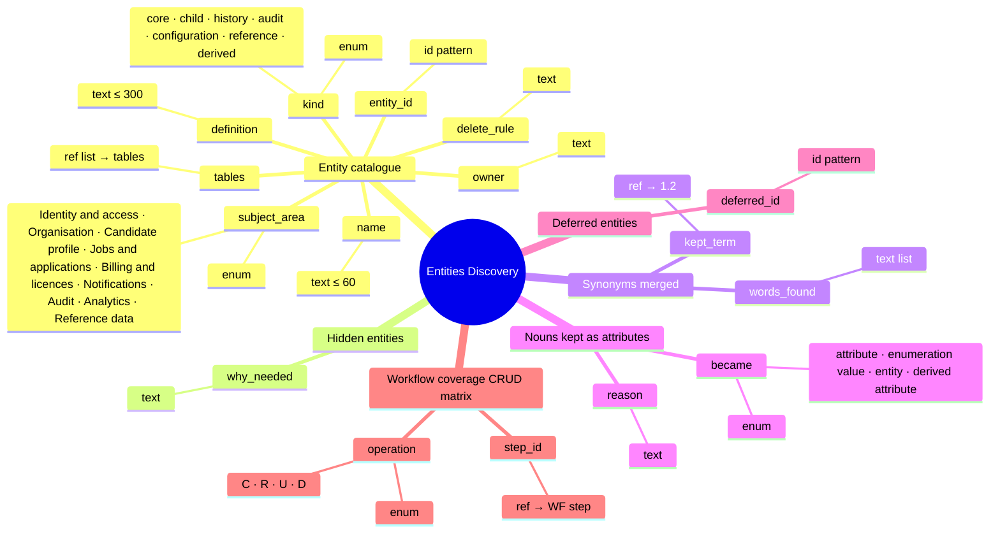
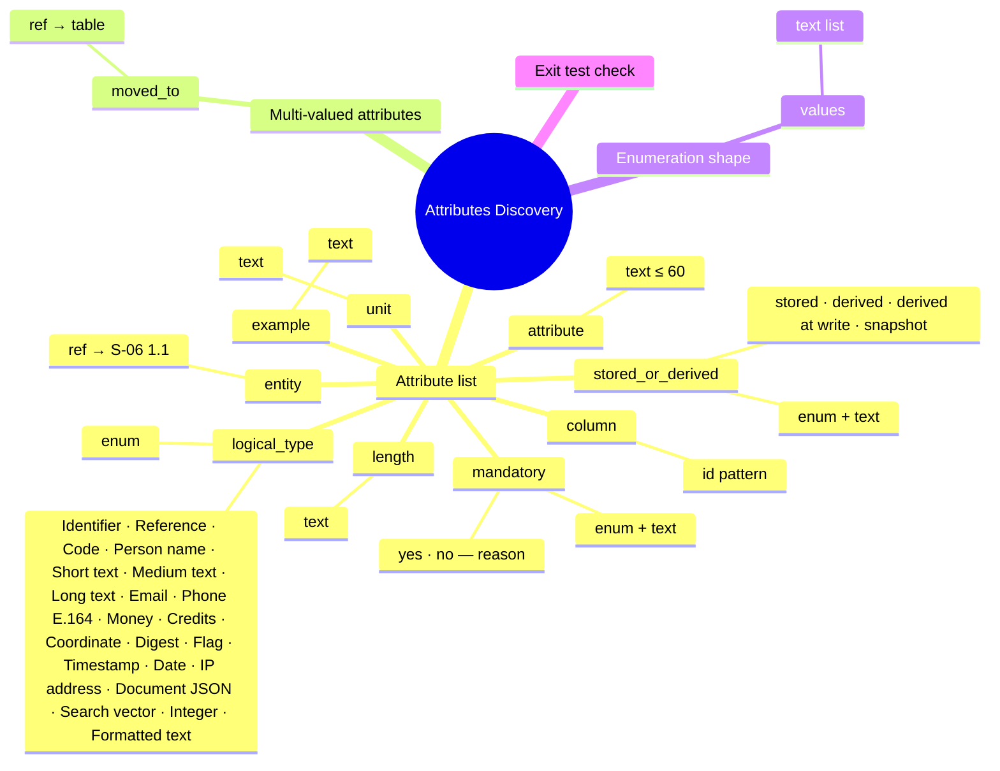
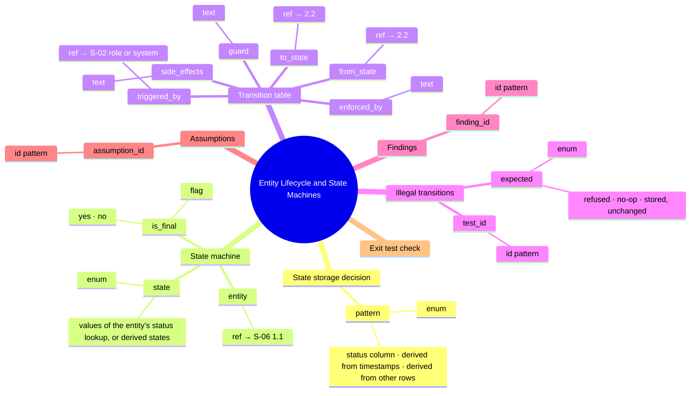
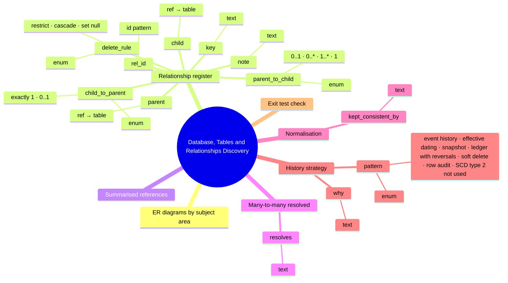
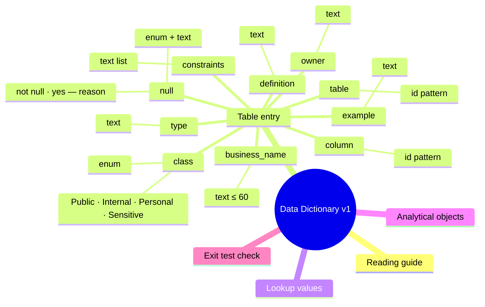
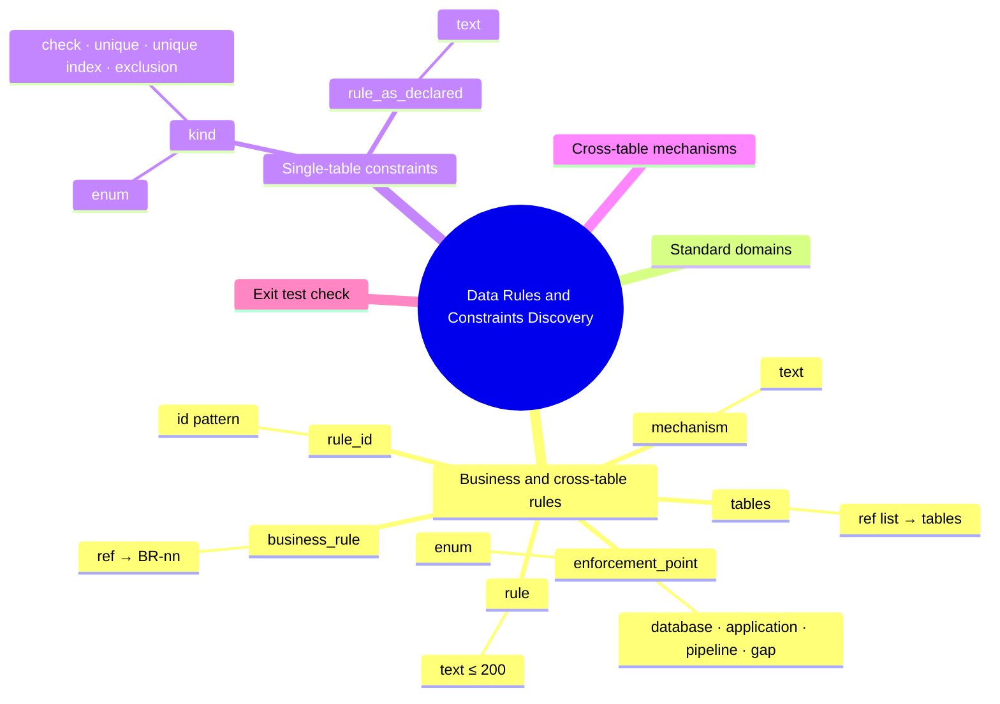
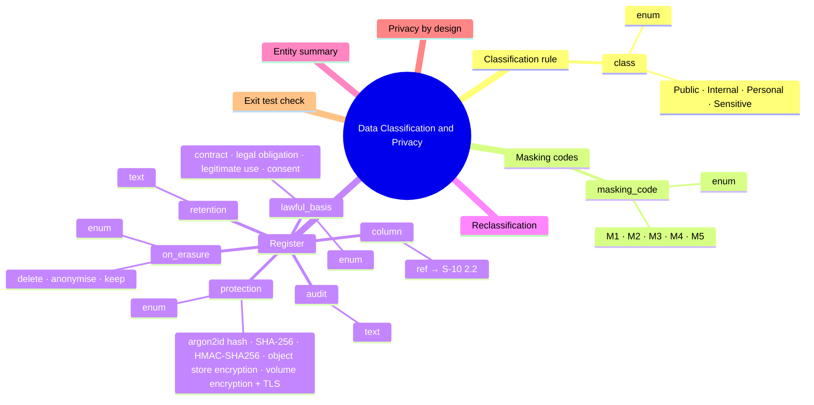

# Phase 2 — Output schemas as trees (generated)

Each output schema from [schemas.md](schemas.md) drawn as the playbook asks: **L1 sections → L2 parameters → L3 allowed values → L4 atomic type**. Generated by `python stage1/schema_trees.py`; the tables in schemas.md hold the full definition, reason, mandatory flag and source of every node.

**Depth rule applied:** stop when each leaf is atomic (one meaning, one type, one rule set). Level 3 appears only where a parameter has a closed list of values; level 4 is the atomic type of each parameter. No schema needed level 5.

## S-06 — Entities Discovery

## Schema size by level

| Schema | L1 sections | L2 parameters | L3 allowed values | L4 typed leaves |
|---|---|---|---|---|
| S-06 — Entities Discovery | 6 | 16 | 24 | 16 |
| S-07 — Attributes Discovery | 4 | 11 | 27 | 11 |
| S-08 — Entity Lifecycle and State Machines | 7 | 14 | 9 | 14 |
| S-09 — Database, Tables and Relationships Discovery | 7 | 12 | 16 | 12 |
| S-10 — Data Dictionary v1 | 5 | 10 | 6 | 10 |
| S-11 — Data Rules and Constraints Discovery | 5 | 8 | 8 | 8 |
| S-12 — Data Classification and Privacy | 7 | 8 | 21 | 8 |

6 sections · 16 parameters · 24 allowed values · 16 typed leaves



```text
Entities Discovery
├── Entity catalogue
│   ├── entity_id  [id ENT-[0-9]{2}]
│   ├── name  [text ≤ 60]
│   ├── definition  [text ≤ 300]
│   ├── subject_area  [enum]  ── Identity and access · Organisation · Candidate profile · Jobs and applications · Billing and licences · Notifications · Audit · Analytics · Reference data
│   ├── kind  [enum]  ── core · child · history · audit · configuration · reference · derived
│   ├── owner  [text]
│   ├── delete_rule  [text]
│   └── tables  [ref list → tables]
├── Hidden entities
│   └── why_needed  [text]
├── Synonyms merged
│   ├── kept_term  [ref → 1.2]
│   └── words_found  [text list]
├── Nouns kept as attributes
│   ├── became  [enum]  ── attribute · enumeration value · entity · derived attribute
│   └── reason  [text]
├── Deferred entities
│   └── deferred_id  [id ENT-D[0-9]{2}]
└── Workflow coverage (CRUD matrix)
    ├── step_id  [ref → WF step]
    └── operation  [enum]  ── C · R · U · D
```

## S-07 — Attributes Discovery

4 sections · 11 parameters · 27 allowed values · 11 typed leaves



```text
Attributes Discovery
├── Attribute list
│   ├── entity  [ref → S-06 1.1]
│   ├── attribute  [text ≤ 60]
│   ├── column  [id [a-z][a-z0-9_]*]
│   ├── logical_type  [enum]  ── Identifier · Reference · Code · Person name · Short text · Medium text · Long text · Email · Phone (E.164) · Money · Credits · Coordinate · Digest · Flag · Timestamp · Date · IP address · Document (JSON) · Search vector · Integer · Formatted text
│   ├── length  [text]
│   ├── mandatory  [enum + text]  ── yes · no — reason
│   ├── unit  [text]
│   ├── example  [text]
│   └── stored_or_derived  [enum + text]  ── stored · derived · derived at write · snapshot
├── Multi-valued attributes
│   └── moved_to  [ref → table]
├── Enumeration shape
│   └── values  [text list]
└── Exit test check
```

## S-08 — Entity Lifecycle and State Machines

7 sections · 14 parameters · 9 allowed values · 14 typed leaves



```text
Entity Lifecycle and State Machines
├── State storage decision
│   └── pattern  [enum]  ── status column · derived from timestamps · derived from other rows
├── State machine
│   ├── entity  [ref → S-06 1.1]
│   ├── state  [enum]  ── values of the entity's status lookup, or derived states
│   └── is_final  [flag]  ── yes · no
├── Transition table
│   ├── from_state  [ref → 2.2]
│   ├── to_state  [ref → 2.2]
│   ├── triggered_by  [ref → S-02 role or system]
│   ├── guard  [text]
│   ├── side_effects  [text]
│   └── enforced_by  [text]
├── Illegal transitions
│   ├── test_id  [id TC-08-[0-9]{3}]
│   └── expected  [enum]  ── refused · no-op · stored, unchanged
├── Findings
│   └── finding_id  [id FND-[0-9]{2}]
├── Assumptions
│   └── assumption_id  [id SA-[0-9]{2}]
└── Exit test check
```

## S-09 — Database, Tables and Relationships Discovery

7 sections · 12 parameters · 16 allowed values · 12 typed leaves



```text
Database, Tables and Relationships Discovery
├── ER diagrams by subject area
├── Relationship register
│   ├── rel_id  [id R-[0-9]{2}]
│   ├── parent  [ref → table]
│   ├── child  [ref → table]
│   ├── key  [text]
│   ├── parent_to_child  [enum]  ── 0..1 · 0..* · 1..* · 1
│   ├── child_to_parent  [enum]  ── exactly 1 · 0..1
│   ├── delete_rule  [enum]  ── restrict · cascade · set null
│   └── note  [text]
├── Summarised references
├── Many-to-many resolved
│   └── resolves  [text]
├── Normalisation
│   └── kept_consistent_by  [text]
├── History strategy
│   ├── pattern  [enum]  ── event history · effective dating · snapshot · ledger with reversals · soft delete · row audit · SCD type 2 (not used)
│   └── why  [text]
└── Exit test check
```

## S-10 — Data Dictionary v1

5 sections · 10 parameters · 6 allowed values · 10 typed leaves



```text
Data Dictionary v1
├── Reading guide
├── Table entry
│   ├── table  [id [a-z][a-z0-9_]*]
│   ├── column  [id [a-z][a-z0-9_]*]
│   ├── business_name  [text ≤ 60]
│   ├── type  [text]
│   ├── null  [enum + text]  ── (not null) · yes — reason
│   ├── constraints  [text list]
│   ├── definition  [text]
│   ├── example  [text]
│   ├── class  [enum]  ── Public · Internal · Personal · Sensitive
│   └── owner  [text]
├── Lookup values
├── Analytical objects
└── Exit test check
```

## S-11 — Data Rules and Constraints Discovery

5 sections · 8 parameters · 8 allowed values · 8 typed leaves



```text
Data Rules and Constraints Discovery
├── Business and cross-table rules
│   ├── rule_id  [id DR-[0-9]{3}]
│   ├── rule  [text ≤ 200]
│   ├── tables  [ref list → tables]
│   ├── enforcement_point  [enum]  ── database · application · pipeline · gap
│   ├── mechanism  [text]
│   └── business_rule  [ref → BR-nn]
├── Standard domains
├── Single-table constraints
│   ├── kind  [enum]  ── check · unique · unique (index) · exclusion
│   └── rule_as_declared  [text]
├── Cross-table mechanisms
└── Exit test check
```

## S-12 — Data Classification and Privacy

7 sections · 8 parameters · 21 allowed values · 8 typed leaves



```text
Data Classification and Privacy
├── Classification rule
│   └── class  [enum]  ── Public · Internal · Personal · Sensitive
├── Masking codes
│   └── masking_code  [enum]  ── M1 · M2 · M3 · M4 · M5
├── Register
│   ├── column  [ref → S-10 2.2]
│   ├── protection  [enum]  ── argon2id hash · SHA-256 · HMAC-SHA256 · object store encryption · volume encryption + TLS
│   ├── retention  [text]
│   ├── on_erasure  [enum]  ── delete · anonymise · keep
│   ├── lawful_basis  [enum]  ── contract · legal obligation · legitimate use · consent
│   └── audit  [text]
├── Reclassification
├── Entity summary
├── Privacy by design
└── Exit test check
```

