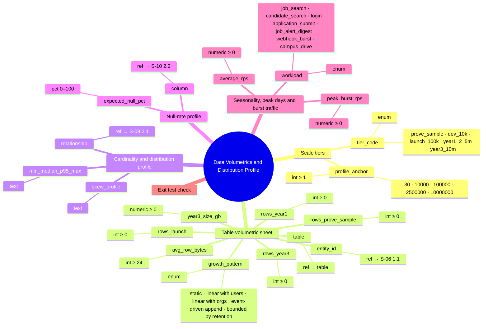
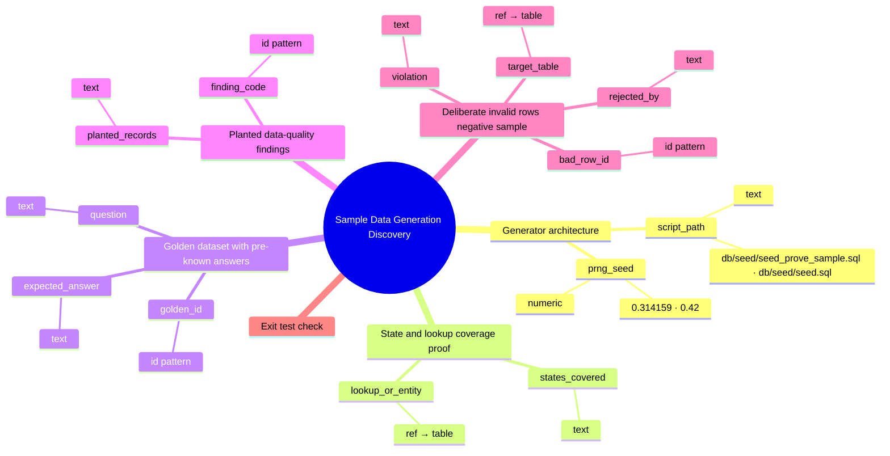
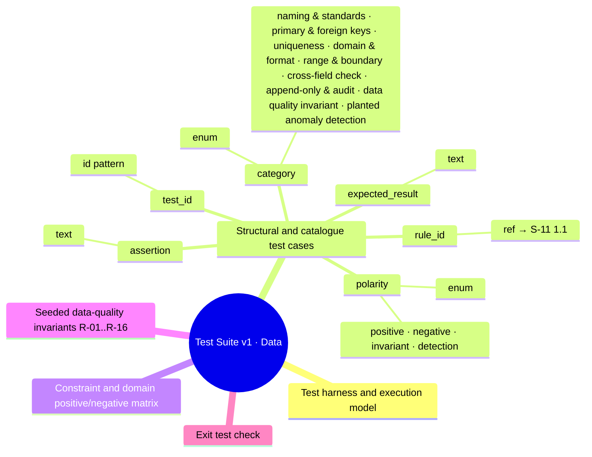
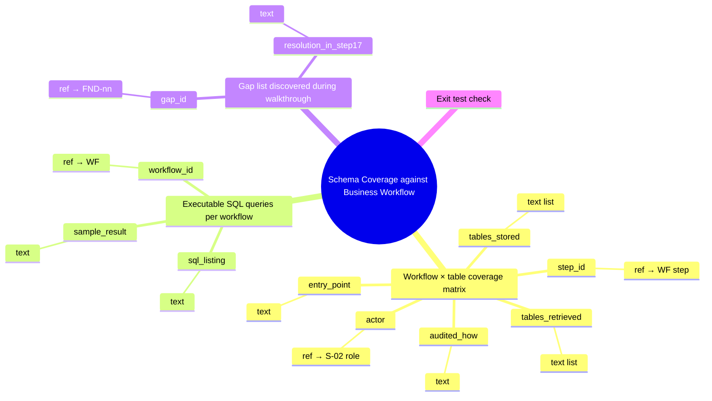
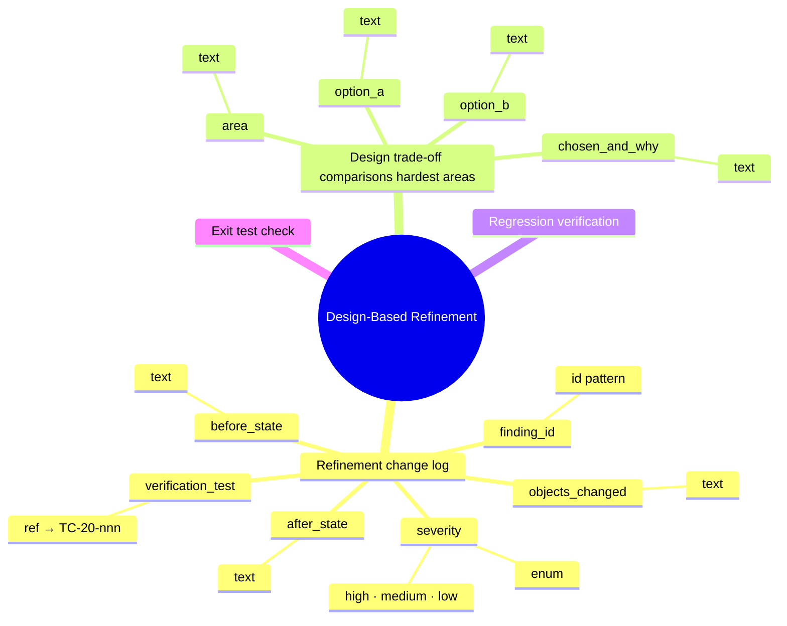
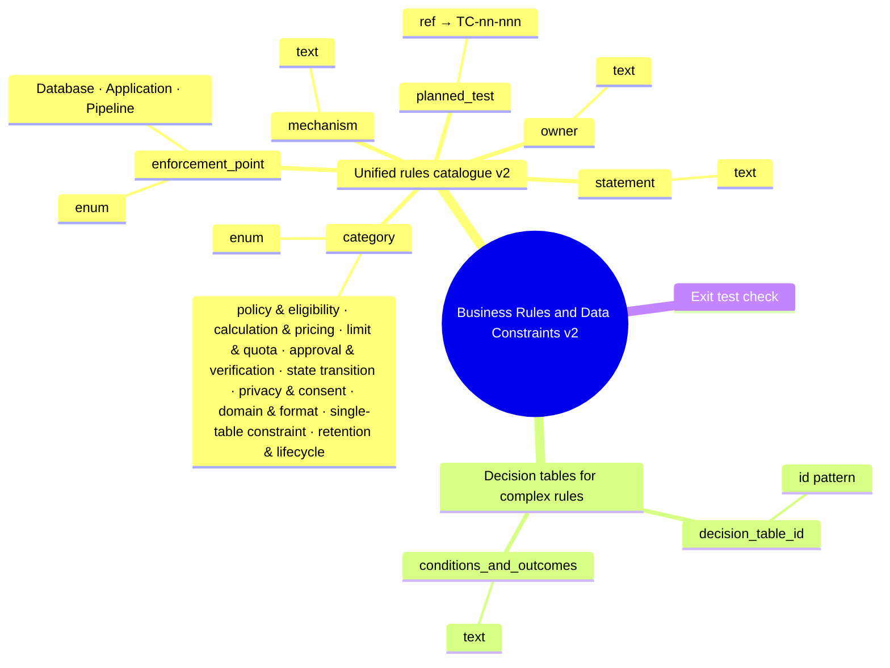
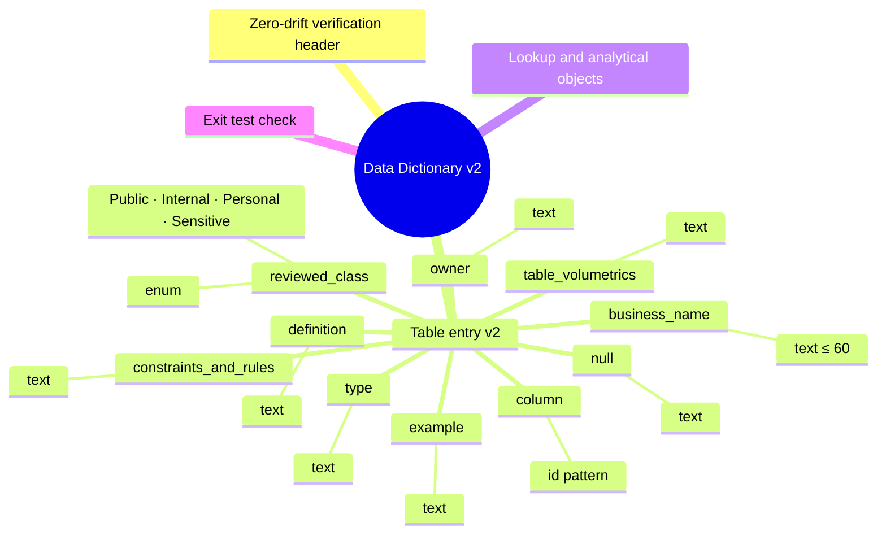
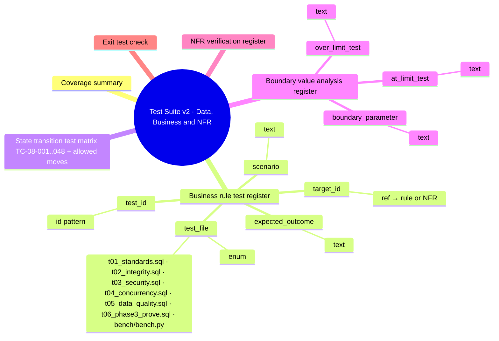
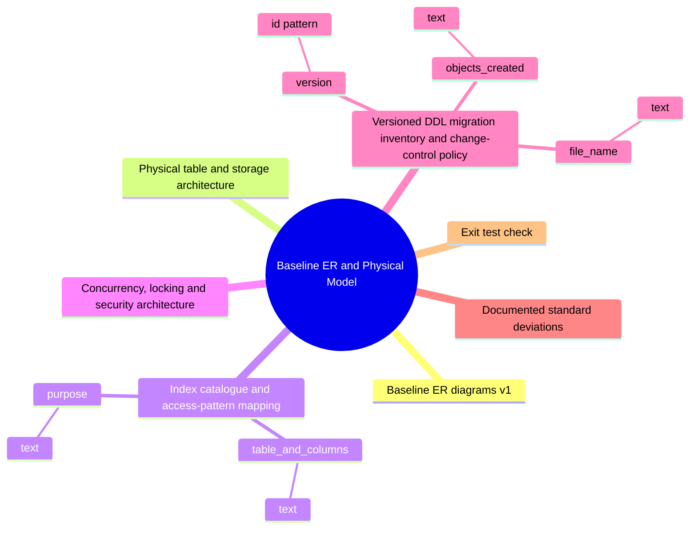

# Phase 3 — Output schemas as trees (generated)

Each output schema from [schemas.md](schemas.md) drawn as the playbook asks: **L1 sections → L2 parameters → L3 allowed values → L4 atomic type**. Generated by `python stage1/schema_trees.py`; the tables in schemas.md hold the full definition, reason, mandatory flag and source of every node.

**Depth rule applied:** stop when each leaf is atomic (one meaning, one type, one rule set). Level 3 appears only where a parameter has a closed list of values; level 4 is the atomic type of each parameter. No schema needed level 5.

## S-13 — Data Volumetrics and Distribution Profile

## Schema size by level

| Schema | L1 sections | L2 parameters | L3 allowed values | L4 typed leaves |
|---|---|---|---|---|
| S-13 — Data Volumetrics and Distribution Profile | 6 | 19 | 22 | 19 |
| S-14 — Sample Data Generation (Discovery) | 6 | 13 | 4 | 13 |
| S-15 — Test Suite v1 · Data | 5 | 6 | 13 | 6 |
| S-16 — Schema Coverage against Business Workflow | 4 | 11 | 0 | 11 |
| S-17 — Design-Based Refinement | 4 | 10 | 3 | 10 |
| S-18 — Business Rules and Data Constraints v2 | 3 | 8 | 12 | 8 |
| S-19 — Data Dictionary v2 | 4 | 10 | 4 | 10 |
| S-20 — Test Suite v2 · Data, Business and NFR | 6 | 8 | 7 | 8 |
| S-21 — Baseline ER and Physical Model | 7 | 5 | 0 | 5 |

6 sections · 19 parameters · 22 allowed values · 19 typed leaves



```text
Data Volumetrics and Distribution Profile
├── Scale tiers
│   ├── tier_code  [enum]  ── prove_sample · dev_10k · launch_100k · year1_2_5m · year3_10m
│   └── profile_anchor  [int ≥ 1]  ── 30 · 10000 · 100000 · 2500000 · 10000000
├── Table volumetric sheet
│   ├── table  [ref → table]
│   ├── entity_id  [ref → S-06 1.1]
│   ├── rows_prove_sample  [int ≥ 0]
│   ├── rows_launch  [int ≥ 0]
│   ├── rows_year1  [int ≥ 0]
│   ├── rows_year3  [int ≥ 0]
│   ├── growth_pattern  [enum]  ── static · linear with users · linear with orgs · event-driven append · bounded by retention
│   ├── avg_row_bytes  [int ≥ 24]
│   └── year3_size_gb  [numeric ≥ 0]
├── Cardinality and distribution profile
│   ├── relationship  [ref → S-09 2.1]
│   ├── min_median_p95_max  [text]
│   └── skew_profile  [text]
├── Null-rate profile
│   ├── column  [ref → S-10 2.2]
│   └── expected_null_pct  [pct 0–100]
├── Seasonality, peak days and burst traffic
│   ├── workload  [enum]  ── job_search · candidate_search · login · application_submit · job_alert_digest · webhook_burst · campus_drive
│   ├── average_rps  [numeric ≥ 0]
│   └── peak_burst_rps  [numeric ≥ 0]
└── Exit test check
```

## S-14 — Sample Data Generation (Discovery)

6 sections · 13 parameters · 4 allowed values · 13 typed leaves



```text
Sample Data Generation (Discovery)
├── Generator architecture
│   ├── script_path  [text]  ── db/seed/seed_prove_sample.sql · db/seed/seed.sql
│   └── prng_seed  [numeric]  ── 0.314159 · 0.42
├── State and lookup coverage proof
│   ├── lookup_or_entity  [ref → table]
│   └── states_covered  [text]
├── Golden dataset with pre-known answers
│   ├── golden_id  [id GQ-[0-9]{2}]
│   ├── question  [text]
│   └── expected_answer  [text]
├── Planted data-quality findings
│   ├── finding_code  [id F-0[1-6]]
│   └── planted_records  [text]
├── Deliberate invalid rows (negative sample)
│   ├── bad_row_id  [id BAD-[0-9]{2}]
│   ├── target_table  [ref → table]
│   ├── violation  [text]
│   └── rejected_by  [text]
└── Exit test check
```

## S-15 — Test Suite v1 · Data

5 sections · 6 parameters · 13 allowed values · 6 typed leaves



```text
Test Suite v1 · Data
├── Test harness and execution model
├── Structural and catalogue test cases
│   ├── test_id  [id TC-15-[0-9]{3}]
│   ├── rule_id  [ref → S-11 1.1]
│   ├── category  [enum]  ── naming & standards · primary & foreign keys · uniqueness · domain & format · range & boundary · cross-field check · append-only & audit · data quality invariant · planted anomaly detection
│   ├── polarity  [enum]  ── positive · negative · invariant · detection
│   ├── assertion  [text]
│   └── expected_result  [text]
├── Constraint and domain positive/negative matrix
├── Seeded data-quality invariants (R-01..R-16)
└── Exit test check
```

## S-16 — Schema Coverage against Business Workflow

4 sections · 11 parameters · 0 allowed values · 11 typed leaves



```text
Schema Coverage against Business Workflow
├── Workflow × table coverage matrix
│   ├── step_id  [ref → WF step]
│   ├── actor  [ref → S-02 role]
│   ├── tables_stored  [text list]
│   ├── tables_retrieved  [text list]
│   ├── audited_how  [text]
│   └── entry_point  [text]
├── Executable SQL queries per workflow
│   ├── workflow_id  [ref → WF]
│   ├── sql_listing  [text]
│   └── sample_result  [text]
├── Gap list discovered during walkthrough
│   ├── gap_id  [ref → FND-nn]
│   └── resolution_in_step17  [text]
└── Exit test check
```

## S-17 — Design-Based Refinement

4 sections · 10 parameters · 3 allowed values · 10 typed leaves



```text
Design-Based Refinement
├── Refinement change log
│   ├── finding_id  [id FND-[0-9]{2}]
│   ├── severity  [enum]  ── high · medium · low
│   ├── objects_changed  [text]
│   ├── before_state  [text]
│   ├── after_state  [text]
│   └── verification_test  [ref → TC-20-nnn]
├── Design trade-off comparisons (hardest areas)
│   ├── area  [text]
│   ├── option_a  [text]
│   ├── option_b  [text]
│   └── chosen_and_why  [text]
├── Regression verification
└── Exit test check
```

## S-18 — Business Rules and Data Constraints v2

3 sections · 8 parameters · 12 allowed values · 8 typed leaves



```text
Business Rules and Data Constraints v2
├── Unified rules catalogue v2
│   ├── category  [enum]  ── policy & eligibility · calculation & pricing · limit & quota · approval & verification · state transition · privacy & consent · domain & format · single-table constraint · retention & lifecycle
│   ├── statement  [text]
│   ├── owner  [text]
│   ├── enforcement_point  [enum]  ── Database · Application · Pipeline
│   ├── mechanism  [text]
│   └── planned_test  [ref → TC-nn-nnn]
├── Decision tables for complex rules
│   ├── decision_table_id  [id DT-[0-9]{2}]
│   └── conditions_and_outcomes  [text]
└── Exit test check
```

## S-19 — Data Dictionary v2

4 sections · 10 parameters · 4 allowed values · 10 typed leaves



```text
Data Dictionary v2
├── Zero-drift verification header
├── Table entry v2
│   ├── table_volumetrics  [text]
│   ├── column  [id [a-z][a-z0-9_]*]
│   ├── business_name  [text ≤ 60]
│   ├── type  [text]
│   ├── null  [text]
│   ├── constraints_and_rules  [text]
│   ├── definition  [text]
│   ├── example  [text]
│   ├── reviewed_class  [enum]  ── Public · Internal · Personal · Sensitive
│   └── owner  [text]
├── Lookup and analytical objects
└── Exit test check
```

## S-20 — Test Suite v2 · Data, Business and NFR

6 sections · 8 parameters · 7 allowed values · 8 typed leaves



```text
Test Suite v2 · Data, Business and NFR
├── Coverage summary
├── Business rule test register
│   ├── test_id  [id TC-20-[0-9]{3}]
│   ├── target_id  [ref → rule or NFR]
│   ├── test_file  [enum]  ── t01_standards.sql · t02_integrity.sql · t03_security.sql · t04_concurrency.sql · t05_data_quality.sql · t06_phase3_prove.sql · bench/bench.py
│   ├── scenario  [text]
│   └── expected_outcome  [text]
├── State transition test matrix (TC-08-001..048 + allowed moves)
├── Boundary value analysis register
│   ├── boundary_parameter  [text]
│   ├── at_limit_test  [text]
│   └── over_limit_test  [text]
├── NFR verification register
└── Exit test check
```

## S-21 — Baseline ER and Physical Model

7 sections · 5 parameters · 0 allowed values · 5 typed leaves



```text
Baseline ER and Physical Model
├── Baseline ER diagrams v1
├── Physical table and storage architecture
├── Index catalogue and access-pattern mapping
│   ├── table_and_columns  [text]
│   └── purpose  [text]
├── Concurrency, locking and security architecture
├── Versioned DDL migration inventory and change-control policy
│   ├── version  [id V[0-9]{3}]
│   ├── file_name  [text]
│   └── objects_created  [text]
├── Documented standard deviations
└── Exit test check
```

