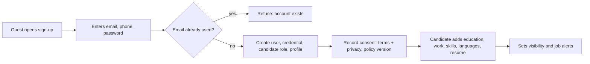
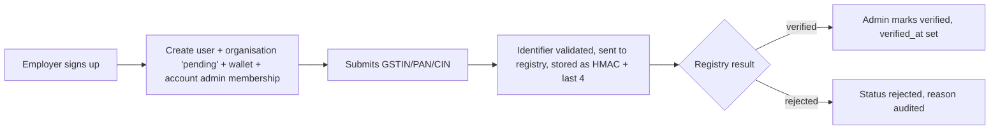
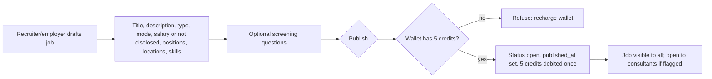
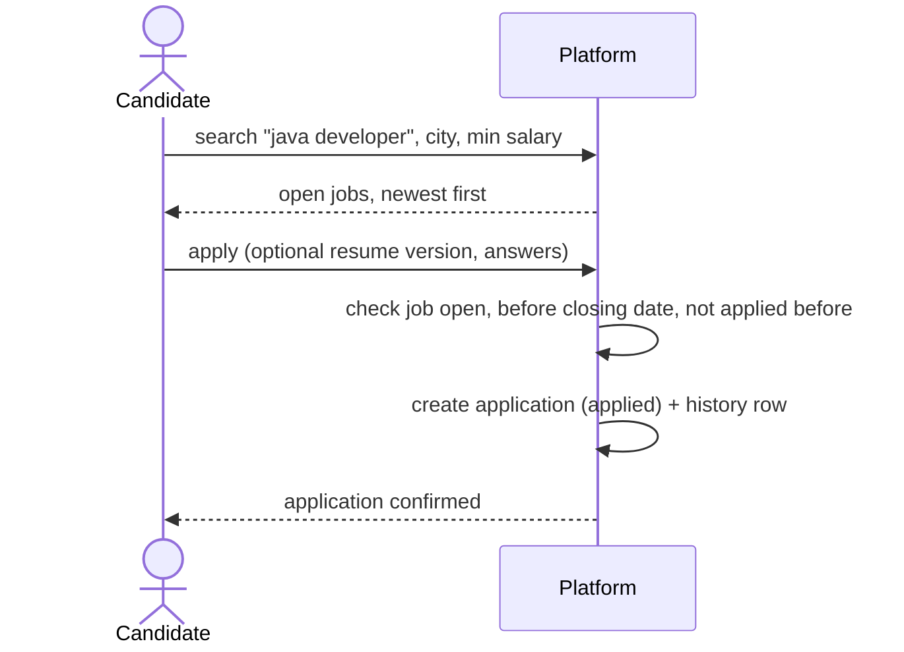
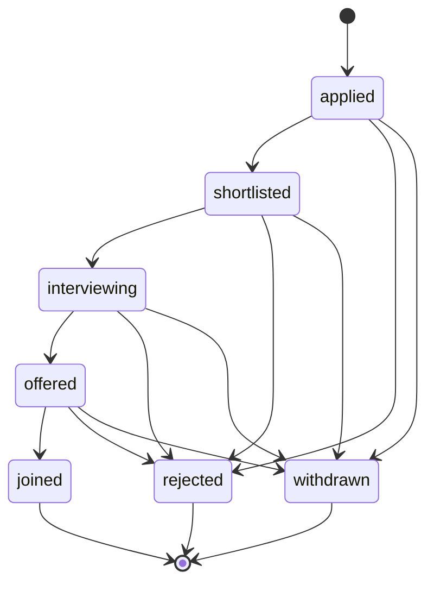
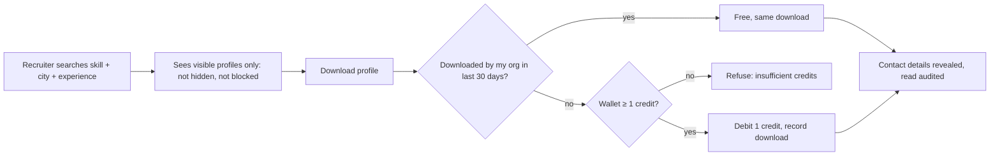
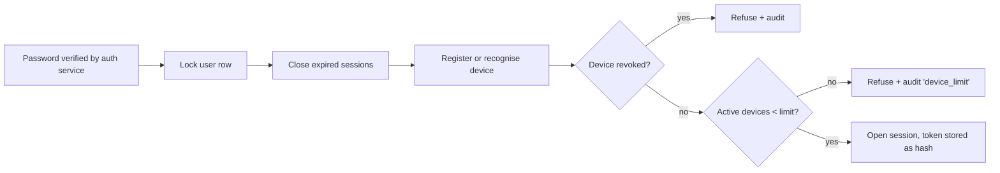

# Step 05 — Business Workflow Analysis

Output document for Stage 1, step 05. It conforms to the schema S-05 in [output-schemas.md](output-schemas.md#s-05-business-workflow-analysis). For each core workflow (docket section 2): actors, trigger, steps, business rules, exceptions, the data touched, and how it is enforced. The two deliverables are the **workflow maps** below and the **[exception catalogue](#exception-catalogue)** (30 exceptions, including cancel, refund, retry and timeout paths).

## Workflow inventory and priority

| ID | Workflow | Actors | Central to schema? | Status in v2 |
|---|---|---|---|---|
| WF-01 | Candidate registration and profile building | candidate | yes | built |
| WF-02 | Employer registration and verification | employer, admin | yes | built |
| WF-03 | Job requirement posting with questionnaire | employer, recruiter | yes | built |
| WF-04 | Job search and application | candidate | yes | built |
| WF-05 | Application pipeline (shortlist → hire) | recruiter, candidate | yes | built |
| WF-06 | Candidate sourcing and profile download | recruiter | yes | built |
| WF-07 | Subscription, wallet recharge and credit use | account admin, payment gateway | yes | built |
| WF-08 | Login with device limit | all users | yes | built |
| WF-09 | Blocking a company or person | candidate | yes | built |
| WF-10 | Notifications and job alerts | system, user | yes | built |
| WF-11 | Consultant sourcing request and bulk outreach | consultant, employer | secondary | deferred |
| WF-12 | Gig request → application → assignment | requester, gig worker | secondary (separate subsystem) | deferred |
| WF-13 | Support tickets and FAQs | user, admin | secondary | deferred |
| WF-14 | Data erasure request | candidate, admin | yes (compliance) | built |

**Why some are secondary:** WF-01..10 and WF-14 create or change the records every other feature depends on (people, organisations, jobs, applications, money). WF-11..13 consume those records and can be added without changing them.

---

### WF-01 Candidate registration and profile building

- **Trigger:** a guest signs up. **Actor:** the candidate only.
- **Rules:**
  - Recruiters cannot register candidates.
  - Email is unique and lower case; phone is E.164.
  - Consent is recorded with the policy version.
  - Salary is disclosed, not disclosed, or not provided.
- **Exceptions:**
  - Duplicate email: refused.
  - Same phone and name as an existing profile: flagged as a probable duplicate (finding F-01).
- **Data:** app_user, user_credential, user_access_role, candidate_profile, consent_record, profile sections, resume.
- **Enforced by:** `auth_register_candidate()`, domains, `ck_candidate_profile_salary`.

### WF-02 Employer registration and verification

- **Rules:**
  - The tax id is never stored in clear.
  - It is unique per country and type.
  - Verification records its time.
- **Exception:** registry down → the organisation stays pending. Finding F-05: pending organisations can currently post; this is a product decision.
- **Data:** organisation, organisation_tax_identifier, wallet, organisation_member, audit_event.

### WF-03 Job requirement posting

- **Rules:**
  - Minimum salary ≤ maximum.
  - Experience range valid.
  - A published job never returns to draft.
  - Publishing is charged exactly once.
- **Data:** job_requirement (+ location, skill, screening_question), wallet_ledger_entry.

### WF-04 Job search and application

- **Rules:**
  - One application per candidate per job.
  - Only the candidate's own resume can be attached.
  - Answers only to that job's questions.
  - Consultant-sourced applications only on jobs open to consultants.
- **Exceptions:** job closed or filled → refused; duplicate application → refused.
- **Data:** application, application_answer, application_status_history.

### WF-05 Application pipeline

- **Actors:**
  - Recruiter: every move.
  - Candidate: withdraw only.
- **Rules:**
  - Only the moves listed above are allowed.
  - Every move is kept in the history and notifies the candidate.
  - A join fills one position; the job becomes "filled" when all positions are joined.
  - Joins beyond positions are refused, even when concurrent.
- **Data:** application, application_status_history, job_requirement.positions_filled, notification.

### WF-06 Candidate sourcing and profile download

- **Rules:**
  - Contact details only through a download.
  - A block cuts access, even after a download.
  - The download history is append-only.

### WF-07 Subscription, recharge and credit use
```mermaid
sequenceDiagram
  actor A as Account admin
  participant T as Talentra
  participant G as Payment gateway
  A->>T: buy plan / recharge 100 credits
  T->>T: payment_order (created, idempotency key)
  T->>G: create gateway order
  G-->>T: webhook authorised / captured (may repeat, may arrive late)
  T->>T: apply event once (unique event id), check amount
  T->>T: captured: subscription period (no overlap) + plan credits, or recharge credits; GST invoice
  G-->>T: webhook refunded
  T->>T: reversal ledger entry (never an update)
```
- **Rules:**
  - The ledger is append-only and the balance is never negative.
  - Licence periods never overlap.
  - A sold licence keeps its seat and device limits.
- **Exceptions:**
  - Duplicate webhook: no-op.
  - Amount mismatch: refused.
  - Declined card: order failed, nothing granted.

### WF-08 Login with device limit

- **Limits:**
  - Candidate: 3 devices.
  - Organisation staff: the devices per user of their licence (1 without a licence).
- **Concurrency:** parallel logins are serialised per user (tested: 6 at once with a limit of 3 → 3 succeed, 3 refused).

### WF-09 Blocking
- **Flow:** the candidate blocks a company or a person. That party immediately stops seeing the profile, applications and contact details, and never sees the block. Unblocking restores visibility; history is kept.

### WF-10 Notifications and job alerts
- **Flow:** a business change (e.g. a status move) writes a notification in the same transaction. A worker claims a batch (skip-locked) and sends it through the provider. Delivery status is recorded; failures retry with backoff up to 5 times.
- **Rules:**
  - Marketing opt-outs are respected; security notices always go.
  - No message bodies or contact details in the payload.

### WF-14 Data erasure (DPDP Act 2023)
- **Flow:** the candidate (or staff, or the 3-year inactivity job) requests erasure. In one transaction:
  - profile sections, resumes (files deleted via the outbox), credentials and sessions are removed;
  - name, contact and salary are blanked;
  - applications, downloads and ledger rows are kept, pointing at an anonymous profile;
  - an audit event is recorded.

## Exception catalogue

Not only the happy path: cancellation, refund, retry, timeout, concurrency and external failure.

| ID | Workflow | Type | Exception | Handling | Enforced by |
|---|---|---|---|---|---|
| EX-01 | WF-01 | validation | email already registered / not lower case / phone not E.164 | refused with a clear error | `uq_app_user_email`, domains |
| EX-02 | WF-01 | business rule | a recruiter tries to register a candidate | refused | `auth_register_candidate()` |
| EX-03 | WF-01 | data quality | same phone and name as an existing profile | accepted, flagged as a probable duplicate | finding F-01, AP-12 |
| EX-04 | WF-02 | external down | company registry unavailable | organisation stays pending; retried | `verification_status` |
| EX-05 | WF-02 | validation | tax id already used by another organisation | refused | `uq_organisation_tax_identifier_...` |
| EX-06 | WF-03 | business rule | publish with fewer than 5 credits | refused: recharge first | `wallet_post()` |
| EX-07 | WF-03 | cancel | employer closes or pauses a job | no new applications; existing ones stay | `application_guard` |
| EX-08 | WF-04 | business rule | apply to a closed or filled job, or after the closing date | refused | `application_guard` |
| EX-09 | WF-04 | validation | second application to the same job | refused | `uq_application_...` |
| EX-10 | WF-04 | business rule | attach someone else's resume / answer another job's question | refused | composite foreign keys |
| EX-11 | WF-05 | business rule | invalid move (e.g. applied → joined) | refused | `application_status_transition` |
| EX-12 | WF-05 | cancel | candidate withdraws | moves to withdrawn from any active stage; employer notified | pipeline trigger |
| EX-13 | WF-05 | concurrency | two joins race for the last position | one wins, the other is refused; job becomes filled | `ck_job_requirement_positions` + row lock (t04) |
| EX-14 | WF-06 | business rule | download without credits | refused | `wallet_post()` |
| EX-15 | WF-06 | business rule | candidate blocked the company after the download | contact access withdrawn | `candidate_contact()` |
| EX-16 | WF-06 | retry | recruiter downloads the same profile again within 30 days | no second charge; same download returned | `billing_download_profile()` |
| EX-17 | WF-07 | retry | gateway redelivers a webhook | no-op | `uq_payment_event_gateway_event_ref` |
| EX-18 | WF-07 | external | webhook amount differs from the order | refused, alert raised | `billing_apply_payment_event()` |
| EX-19 | WF-07 | external | card declined | order failed; nothing granted; user may retry with a new order | payment status machine |
| EX-20 | WF-07 | timeout | no webhook arrives | order stays created; reconciliation job polls the gateway | operations (backlog) |
| EX-21 | WF-07 | refund | payment refunded | reversal ledger entry; refused if the credits were already spent; subscription cancelled | `wallet_post()` reversal |
| EX-22 | WF-07 | cancel | subscription cancelled | auto-renew off, period may end early; never deleted | `subscription_guard` |
| EX-23 | WF-07 | concurrency | parallel debits on a small balance | serialised; balance never negative | wallet row lock (t04) |
| EX-24 | WF-07 | business rule | adding a member beyond licence seats | refused | seat-limit trigger (t02, t04) |
| EX-25 | WF-08 | business rule | login past the device limit | refused and audited | `auth_open_session()` (t04) |
| EX-26 | WF-08 | timeout | session idle or expired | closed automatically; not counted against the limit | `auth_open_session()` |
| EX-27 | WF-08 | security | revoked device tries to log in | refused and audited | `user_device.revoked_at` |
| EX-28 | WF-10 | retry / external down | messaging provider fails | retried with exponential backoff, failed after 5 attempts with a reason | `notification_record_result()` |
| EX-29 | WF-10 | timeout | worker crashes mid-batch | lease expires after 5 minutes; rows picked up again | `notification_claim()` |
| EX-30 | WF-14 | business rule | erasure requested while applications exist | personal data removed; applications kept anonymised | `candidate_erase()` |

## Deferred workflows (designed, not built)

| ID | Outline |
|---|---|
| WF-11 | Consultant raises a sourcing request on a job open to consultants → employer accepts or declines → consultant shortlists → bulk outreach batch (credits per recipient) → candidate responds |
| WF-12 | Requester posts a gig (window, fixed or rate price) → gig workers apply → requester accepts one → handoff reference to the fulfilment system → status and earnings reconciled → requester rates; no overlapping windows per worker |
| WF-13 | User opens a ticket → support assigns and replies → resolved or closed; FAQs maintained by admins |
