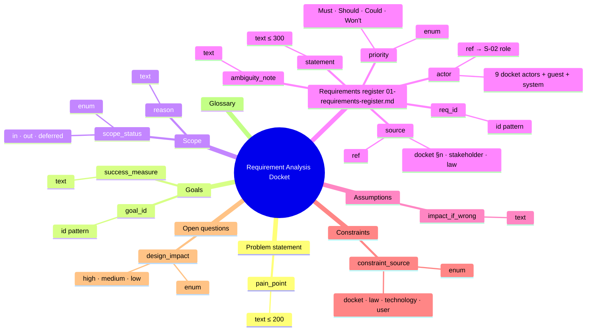
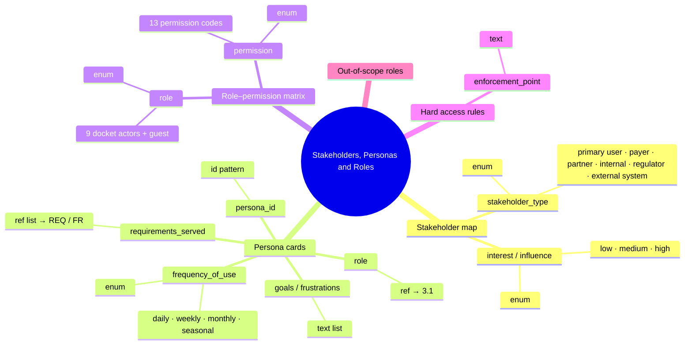
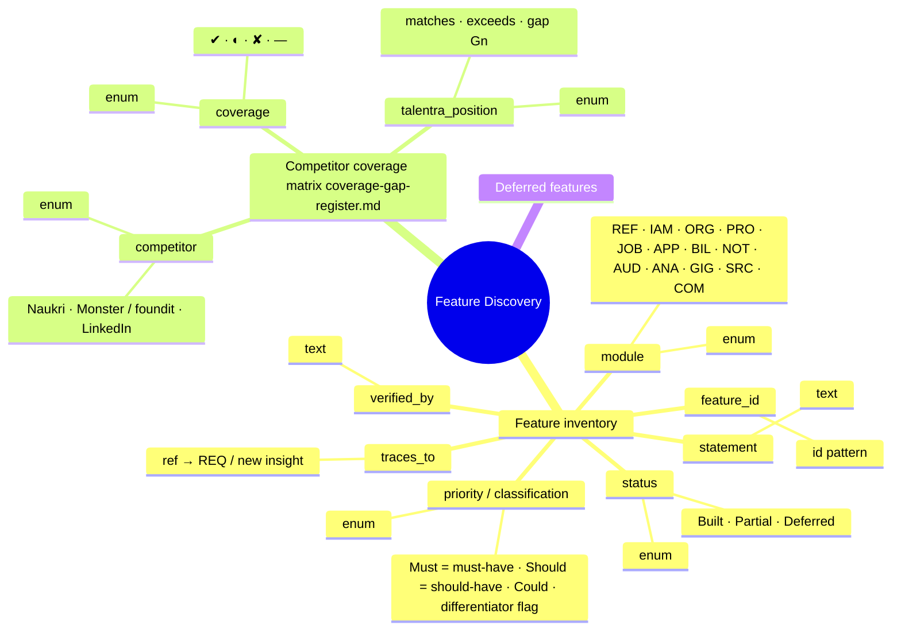
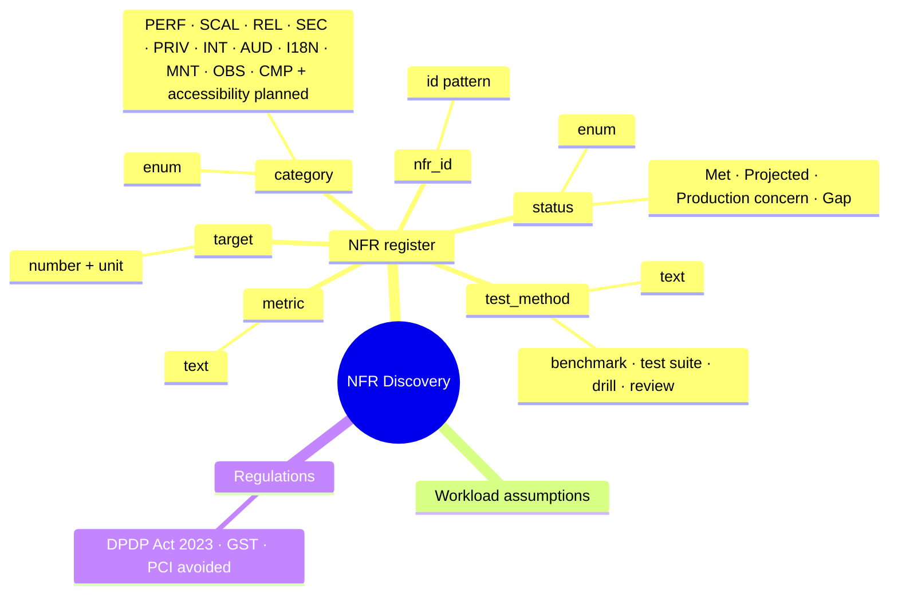
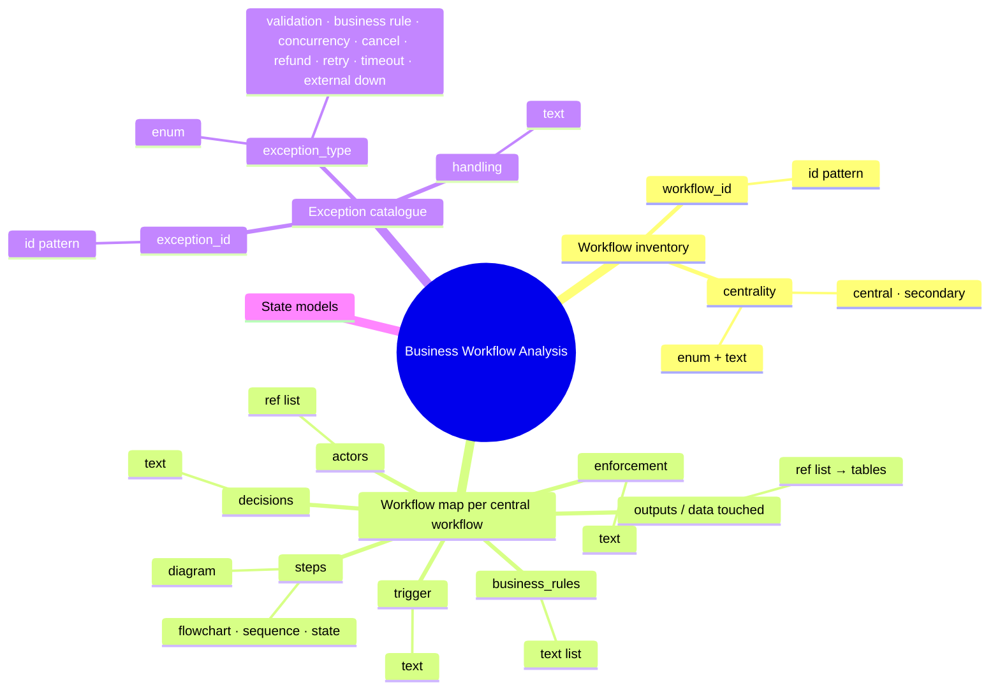

# Stage 1 — Output schemas as trees (generated)

Each output schema from [output-schemas.md](output-schemas.md) drawn as the playbook asks: **L1 sections → L2 parameters → L3 allowed values → L4 atomic type**. Generated by `python stage1/schema_trees.py`; the tables in output-schemas.md hold the full definition, reason, mandatory flag and source of every node.

**Depth rule applied:** stop when each leaf is atomic (one meaning, one type, one rule set). Level 3 appears only where a parameter has a closed list of values; level 4 is the atomic type of each parameter. No schema needed level 5.

## S-01 — Requirement Analysis Docket

## Schema size by level

| Schema | L1 sections | L2 parameters | L3 allowed values | L4 typed leaves |
|---|---|---|---|---|
| S-01 — Requirement Analysis Docket | 8 | 14 | 18 | 14 |
| S-02 — Stakeholders, Personas and Roles | 5 | 10 | 15 | 10 |
| S-03 — Feature Discovery | 3 | 10 | 30 | 10 |
| S-04 — NFR Discovery | 3 | 6 | 22 | 6 |
| S-05 — Business Workflow Analysis | 4 | 12 | 13 | 12 |

8 sections · 14 parameters · 18 allowed values · 14 typed leaves



```text
Requirement Analysis Docket
├── Problem statement
│   └── pain_point  [text ≤ 200]
├── Goals
│   ├── goal_id  [id G[0-9]+]
│   └── success_measure  [text]
├── Scope
│   ├── scope_status  [enum]  ── in · out · deferred
│   └── reason  [text]
├── Requirements register (01-requirements-register.md)
│   ├── req_id  [id REQ-[0-9]{3}]
│   ├── statement  [text ≤ 300]
│   ├── source  [ref]  ── docket §n · stakeholder · law
│   ├── actor  [ref → S-02 role]  ── 9 docket actors + guest + system
│   ├── priority  [enum]  ── Must · Should · Could · Won't
│   └── ambiguity_note  [text]
├── Assumptions
│   └── impact_if_wrong  [text]
├── Constraints
│   └── constraint_source  [enum]  ── docket · law · technology · user
├── Open questions
│   └── design_impact  [enum]  ── high · medium · low
└── Glossary
```

## S-02 — Stakeholders, Personas and Roles

5 sections · 10 parameters · 15 allowed values · 10 typed leaves



```text
Stakeholders, Personas and Roles
├── Stakeholder map
│   ├── stakeholder_type  [enum]  ── primary user · payer · partner · internal · regulator · external system
│   └── interest / influence  [enum]  ── low · medium · high
├── Persona cards
│   ├── persona_id  [id P[0-9]+]
│   ├── role  [ref → 3.1]
│   ├── goals / frustrations  [text list]
│   ├── frequency_of_use  [enum]  ── daily · weekly · monthly · seasonal
│   └── requirements_served  [ref list → REQ / FR]
├── Role–permission matrix
│   ├── role  [enum]  ── 9 docket actors + guest
│   └── permission  [enum]  ── 13 permission codes
├── Hard access rules
│   └── enforcement_point  [text]
└── Out-of-scope roles
```

## S-03 — Feature Discovery

3 sections · 10 parameters · 30 allowed values · 10 typed leaves



```text
Feature Discovery
├── Feature inventory
│   ├── feature_id  [id FR-[A-Z]{3}-[0-9]{2}]
│   ├── statement  [text]
│   ├── module  [enum]  ── REF · IAM · ORG · PRO · JOB · APP · BIL · NOT · AUD · ANA · GIG · SRC · COM
│   ├── priority / classification  [enum]  ── Must (= must-have) · Should (= should-have) · Could · differentiator flag
│   ├── status  [enum]  ── Built · Partial · Deferred
│   ├── verified_by  [text]
│   └── traces_to  [ref → REQ / "new insight"]
├── Competitor coverage matrix (coverage-gap-register.md)
│   ├── competitor  [enum]  ── Naukri · Monster / foundit · LinkedIn
│   ├── coverage  [enum]  ── ✔ · ◐ · ✘ · —
│   └── talentra_position  [enum]  ── matches · exceeds · gap Gn
└── Deferred features
```

## S-04 — NFR Discovery

3 sections · 6 parameters · 22 allowed values · 6 typed leaves



```text
NFR Discovery
├── NFR register
│   ├── nfr_id  [id NFR-[A-Z0-9]+-[0-9]{2}]
│   ├── category  [enum]  ── PERF · SCAL · REL · SEC · PRIV · INT · AUD · I18N · MNT · OBS · CMP (+ accessibility planned)
│   ├── metric  [text]
│   ├── target  [number + unit]
│   ├── test_method  [text]  ── benchmark · test suite · drill · review
│   └── status  [enum]  ── Met · Projected · Production concern · Gap
├── Workload assumptions
└── Regulations
    └── DPDP Act 2023 · GST · PCI (avoided)
```

## S-05 — Business Workflow Analysis

4 sections · 12 parameters · 13 allowed values · 12 typed leaves



```text
Business Workflow Analysis
├── Workflow inventory
│   ├── workflow_id  [id WF-[0-9]{2}]
│   └── centrality  [enum + text]  ── central · secondary
├── Workflow map (per central workflow)
│   ├── trigger  [text]
│   ├── actors  [ref list]
│   ├── steps  [diagram]  ── flowchart · sequence · state
│   ├── decisions  [text]
│   ├── business_rules  [text list]
│   ├── outputs / data touched  [ref list → tables]
│   └── enforcement  [text]
├── Exception catalogue
│   ├── exception_id  [id EX-[0-9]{2}]
│   ├── exception_type  [enum]  ── validation · business rule · concurrency · cancel · refund · retry · timeout · external down
│   └── handling  [text]
└── State models
```

